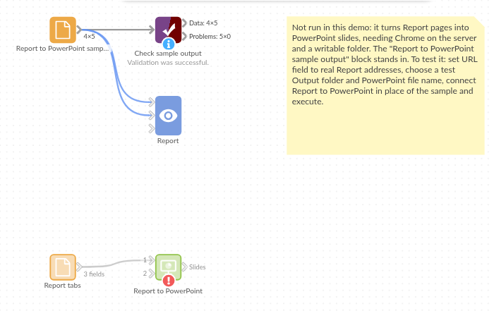

# Report to PowerPoint

*Omniscope custom block · Outputs*

**The quarterly review deck, one slide per Report tab, rebuilt from the latest figures on every run.**

**Python** · visokio-omniprint (Chrome), python-pptx, pandas · visokio-omniprint and python-pptx installed on first run; needs Chrome or the block's Docker image

## The problem it solves

The quarterly review is presented from slides, but the numbers are in an Omniscope Report. Each quarter someone screenshots every tab, crops the browser out, pastes the pictures into a deck and resizes them to fit. The next time a figure is corrected, it all happens again.

This block screenshots each tab in its input at a fixed size and builds the deck, one tab per slide, each screenshot filling its slide.

- **5** tabs of an invented quarterly review in, **1** PowerPoint file with **5** slides out
- **13.33 x 7.5** inch slides (16:9) for 1280 x 720 screenshots; 4:3 and Portrait sizes give slides of their own shape
- Each screenshot fills its slide without cropping or resizing by hand

### How it works

- Chrome, driven by the visokio-omniprint package, opens each URL with its page area at the chosen size, waits for the Report to finish drawing, then for the delay, and saves a PNG.
- python-pptx makes a deck whose slides have the screenshots' proportions and puts one screenshot on each slide, filling it, in input order.
- The PNGs are kept beside the deck; the output lists them with the deck's path.

## What goes in

### Report tabs

The five tabs of an invented quarterly review, as a Project metadata block would list them.

| Report | Tab | Report tab URL |
|---|---|---|
| Quarterly Review | Headlines | `http://127.0.0.1:24679/Finance/Quarterly%20Review.iox/r/Quarterly%20Review/#Headlines` |
| Quarterly Review | Revenue | `.../Quarterly%20Review/#Revenue` |
| Quarterly Review | Costs | `.../Quarterly%20Review/#Costs` |
| Quarterly Review | Cash | `.../Quarterly%20Review/#Cash` |
| Quarterly Review | Outlook | `.../Quarterly%20Review/#Outlook` |

*5 rows in the sample file.*

## The options

| Option | Demo setting | What it does |
|---|---|---|
| URL field | `Report tab URL` | The field holding each tab's address. |
| Screenshot size | 1280x720 (HD) | The size of each screenshot, and so the slides' shape. |
| Orientation | Landscape | Portrait turns the size on its side. |
| Output folder | a folder on the server | Where the deck and the PNGs go. |
| Page load delay (seconds) | 3 | Extra wait before each screenshot. |
| PowerPoint file name | `Quarterly Review.pptx` | Empty gives `report.pptx`. |
| Shrink with Tinify | unticked | Shrink the PNGs with the Tinify web service (API key needed); the screenshots are uploaded to it. |
| Username / Password | (empty) | For a Report behind Basic Authentication. |

## What comes out

### Slides made

| URL | Screenshot filename | PowerPoint file |
|---|---|---|
| `.../Quarterly%20Review/#Headlines` | screenshot_0.png | `<folder>/Quarterly Review.pptx` |
| `.../Quarterly%20Review/#Revenue` | screenshot_1.png | `<folder>/Quarterly Review.pptx` |
| `.../Quarterly%20Review/#Costs` | screenshot_2.png | `<folder>/Quarterly Review.pptx` |
| `.../Quarterly%20Review/#Cash` | screenshot_3.png | `<folder>/Quarterly Review.pptx` |
| `.../Quarterly%20Review/#Outlook` | screenshot_4.png | `<folder>/Quarterly Review.pptx` |

5 records (the `Screenshot path` field, the PNG's full path, is left out here). The deck has 5 slides of 13.33 x 7.5 inches.

## Where it pays off

### Finance: Quarterly and board reviews

The review deck rebuilt from the Report after the quarter's figures are final, ready to present.

### Sales: Weekly pipeline meeting

A slide per region's pipeline tab, made before the Monday meeting.

### Consultancy: Client updates

A short deck of the client's dashboard tabs to send ahead of a steering meeting.

### Operations: Performance packs

Monthly service-level tabs as slides for a contract review.

*Use cases describe typical scenarios and are illustrative; the sample data is invented.*

## Why do this in Omniscope

- **The deck comes from the Report the workflow just refreshed.** The block runs after the data blocks, so a corrected figure reaches the slides on the next run without anyone touching PowerPoint.
- **The tabs to include are records.** Project metadata lists the tabs; a filter keeps the ones for the deck and sets their order, so the slide list changes with the Report.
- **Slides that fit their pictures.** Each slide has the screenshots' proportions and each picture fills it, at the same size every quarter.
- **The slide layout is in the script.** The deck is built by a few lines of python-pptx in the block's editor: add a title to each slide, or start from your own template.

## How it fits into an Omniscope workflow

Project metadata → filter (the review's tabs, in order) → **Report to PowerPoint** → Batch Output (email the deck)

## Try it

1. Open the demo project (`demo.iox` on the demo server, or import `demo.ioz` from this folder). It holds the sample tabs, the block, not run (it needs Chrome on the server and a folder to write to), and a File block with `placeholder.csv`: what the block outputs for the sample.
2. The question: which tabs went into this quarter's deck, and where is it?
3. Look at the placeholder records: one per slide, with the deck's path.
4. To make a deck for real, on a server with Chrome (or Docker): connect a Project metadata block of your own project, choose an output folder, and run the block.

## Running in Omniscope

*The demo project's workflow: the sample data, the block, and a Validate data check on its output.*

<!--language-->
## Language and libraries

Python. It uses visokio-omniprint (MIT), which drives Chrome with selenium (Apache License 2.0), python-pptx (MIT) and pandas (BSD 3-Clause).

pandas is part of Omniscope's Python environment. visokio-omniprint is listed in the block's dependencies and brings python-pptx with it; Omniscope installs them with pip on first run. Chrome must be on the machine running Omniscope, or the server must run custom blocks in Docker, where the block uses an image with Chrome included.
<!--/language-->

## Tested

The block is covered by automated tests that run its script against a stand-in for Omniscope's Python API and a stand-in for Chrome; the deck is made by the real python-pptx and read back: the sample (5 slides of 13.33 x 7.5 inches, each picture filling its slide, screenshots of 1280 x 720); Portrait 4:3 with a file name without `.pptx`; a login that keeps the address's `#tab` and stays out of the output; Tinify; empty input; missing URLs and a new folder; bad options and a page that fails to open; and 200 tabs. The block was also run with real headless Chromium: screenshots of exactly the chosen size, on slides of the same shape.
