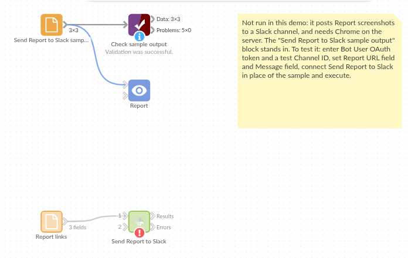

# Send Report to Slack

*Omniscope custom block · Outputs*

**A picture of each team's dashboard in their Slack channel, with a line on what changed and a link to the live Report.**

**Python** · visokio-omniprint (Chrome), requests, pandas · visokio-omniprint and requests installed on first run; needs Chrome or the block's Docker image

## The problem it solves

Each team has a dashboard tab and a Slack channel. A link alone gets few clicks; someone copying a screenshot into each channel every morning is a chore that stops when they are away.

This block takes a screenshot of each tab in its input and posts it to the channel with the record's message and a link to the Report.

- **3** team dashboards in the invented sample, **3** screenshots posted, then **1** PDF of all three
- **1280 x 720** pixels per screenshot, the size chosen
- No password is posted: a Basic Authentication login opens the page, and the link in Slack is the address as given

### How it works

- Chrome, driven by the visokio-omniprint package, opens each URL with its page area at the chosen size, waits for the Report to finish drawing, then for the delay, and saves a PNG.
- The PNG is posted through Slack's external upload, with the message and the link as its comment (the link is not repeated if the message holds it).
- A record that fails is listed in the Errors output and the rest carry on; if nothing could be posted the block stops, so a scheduled run shows the failure.

## What goes in

### Report links

| Team | Report URL | Message |
|---|---|---|
| Sales | `http://127.0.0.1:24679/Sales/Monthly%20Review.iox/r/Board%20Pack/#Overview` | Monthly sales review: revenue 4% above target. |
| Operations | `http://127.0.0.1:24679/Operations/Stock.iox/r/Report/#Warehouses` | Stock levels this morning: 3 warehouses below cover. |
| Finance | `.../Quarterly%20Review/#Cash` | Cash position at month end (full report: `.../Quarterly%20Review/#Cash`). |

*3 rows in the sample file.*

## The options

| Option | Demo setting | What it does |
|---|---|---|
| Report URL field | `Report URL` | The field holding each tab's address. |
| Message field | `Message` | Each record's message. |
| Screenshot size / Orientation | 1280x720, Landscape | The size of each screenshot. |
| Page load delay (seconds) | 3 | Extra wait before each screenshot. |
| Also post a PDF | ticked | One PDF of all the screenshots, after them. |
| Channel ID | `C0123ABCD` (an example) | The channel to post to. |
| Bot User OAuth token | (an example token) | The app's bot token, `xoxb-...`. |
| Username / Password | (empty) | For a Report behind Basic Authentication. |
| Shrink with Tinify | unticked | Shrink the PNGs with the Tinify web service (API key needed); the screenshots are uploaded to it. |

## What comes out

### Results

| Row | Status | SlackFileId |
|---|---|---|
| 0 | posted | F08H2K7Q1LM |
| 1 | posted | F08H2K8C3NP |
| 2 | posted | F08H2K8T5QR |

The Errors output is empty. In Slack, the Sales post reads "Monthly sales review: revenue 4% above target." with the link on the next line; the Finance post keeps its link where it is in the message. (File IDs are invented: they come from Slack.)

## Where it pays off

### Sales: Morning dashboard post

Yesterday's sales tab, posted to the sales channel with the headline figure in the message.

### Operations: Shift start

The warehouse or service dashboard as each shift starts, so the team sees it without opening the Report.

### Management: Weekly round-up

Each department's tab to its own channel, plus a PDF of all of them for the leadership channel.

### Projects: Status updates

A project status tab posted to the project channel after the weekly data refresh.

*Use cases describe typical scenarios and are illustrative; the sample data is invented.*

## Why do this in Omniscope

- **The picture and the figure in the message come from the same run.** The message is built from the same aggregated data the Report shows, in one pass, so the screenshot and the text can't disagree.
- **Which tabs go where is data.** URLs and messages are fields: a Text Input or a join with a team list decides each post, and adding a team adds a record, not another block.
- **Every morning without anyone.** On the scheduler the posts go out after the refresh; the Results output lists what was posted, and a run where nothing reached Slack stops with the reason.
- **Changeable posting rules.** The comment format and the upload are short Python functions, editable after unlocking the block's design: post to a thread, or one channel per record from a field.

## How it fits into an Omniscope workflow

Data → Aggregate → Report; Text Input (team, tab URL) → Field Organiser (formula field: the message, with the day's figure) → **Send Report to Slack**

## Try it

1. Open the demo project (`demo.iox` on the demo server, or import `demo.ioz` from this folder). It holds the sample links, the block with example settings (it needs Chrome on the server and your own Slack app), and a File block with `placeholder.csv`: what the block outputs when it posts the sample.
2. The question: did every team's dashboard reach Slack?
3. Look at the placeholder records: three posted, each with Slack's file ID.
4. To post for real, on a server with Chrome (or Docker): set up a Slack app as the README describes, paste its bot token and channel ID, point the URL field at your own Report tabs, and run the block.

## Running in Omniscope

*The demo project's workflow: the sample data, the block, and a Validate data check on its output.*

<!--language-->
## Language and libraries

Python. It uses visokio-omniprint (MIT), which drives Chrome with selenium (Apache License 2.0) and makes the PDF with fpdf (LGPL v3), requests (Apache License 2.0) and pandas (BSD 3-Clause).

pandas is part of Omniscope's Python environment. visokio-omniprint and requests are listed in the block's dependencies, so Omniscope installs them with pip on first run. Chrome must be on the machine running Omniscope, or the server must run custom blocks in Docker, where the block uses an image with Chrome included.
<!--/language-->

## Tested

The block is covered by automated tests that run its script against a stand-in for Omniscope's Python API, a stand-in for Chrome and a stand-in for Slack's API with canned replies (no live calls): the sample, with every upload checked (file, size 1280 x 720, comment, token header) and the PDF; a link already in the message; a login that opens the page but never reaches Slack; integer fields with missing values and an empty message; one page failing while the others are posted; nothing posted (the block stops); missing settings; Portrait, Tinify and no PDF; empty input and empty URLs; and 300 records.
