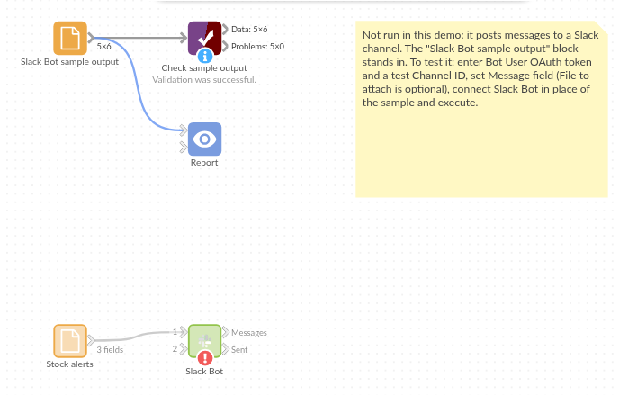

# Slack Bot

*Omniscope custom block · Outputs*

**Alerts computed in the workflow, posted to the team's Slack channel as they happen: one message per record, with links that work.**

**Python** · requests, pandas · requests installed on first run if missing

## The problem it solves

The workflow already knows which warehouses are below their reorder level each morning; the warehouse leads find out when someone reads the Report. A message in their Slack channel, one per warehouse with a link to the details, reaches them first.

This block posts each record's message to a channel as your Slack app's bot, turning the addresses in it into links.

- **6** warehouses in the invented sample, **5** messages posted (Glasgow has nothing below its reorder level, so its message is empty and skipped)
- **1** request per message (`chat.postMessage`), or **3** with a file attached
- **1** clear stop if Slack refuses: the record, Slack's error and what to check, and how many were posted before it

### How it works

- Each record's message is put in Slack's text format: `&`, `<` and `>` escaped, and web addresses made into links that end at the first space.
- Messages are posted in input order with the bot token, to the channel ID given.
- With a file chosen, each message is posted with the file attached, through Slack's external upload.

## What goes in

### Stock alerts

| Warehouse | Lines below reorder level | Message |
|---|---|---|
| Leeds | 12 | Leeds: 12 lines below reorder level. Details: `http://127.0.0.1:24679/Operations/Stock.iox/r/Report/#Leeds` |
| Bristol | 3 | Bristol: 3 lines below reorder level. Details: `.../#Bristol` |
| Glasgow | 0 | |
| Norwich | 7 | Norwich: 7 lines below reorder level (garden & outdoor < 5 days' cover). Details: `.../#Norwich` |

*6 rows in the sample file.*

## The options

| Option | Demo setting | What it does |
|---|---|---|
| Bot User OAuth token | (an example token) | The app's bot token, `xoxb-...`. |
| Channel ID | `C0123ABCD` (an example) | The channel to post to. |
| Message field | `Message` | Each record's message. |
| File to attach | (empty) | Optional: a file attached to every message. |
| Attachment title | My Report | The title shown for the file. |

## What comes out

### Sent

| Row | Action | Channel | Timestamp | File ID |
|---|---|---|---|---|
| 0 | postMessage | C0123ABCD | 1741331101.004519 | |
| 1 | postMessage | C0123ABCD | 1741331101.825639 | |
| 2 | skip | | | |
| 3 | postMessage | C0123ABCD | 1741331102.613209 | |
| 4 | postMessage | C0123ABCD | 1741331103.402871 | |
| 5 | postMessage | C0123ABCD | 1741331104.190455 | |

The Messages output holds each message as sent: Norwich's reads `(garden &amp; outdoor &lt; 5 days' cover)` in Slack's format, and shows in Slack as typed. (Timestamps are invented: they come from Slack.)

## Where it pays off

### Operations: Exception alerts

A message per warehouse, machine or route that crossed a threshold in the latest data, with a link to the detail.

### Sales: Daily numbers

Yesterday's orders and revenue per region, posted to the sales channel before the stand-up.

### Data teams: Run reports

A note when a scheduled workflow has finished, with record counts and anything that failed validation.

### Customer service: Queue warnings

A message when a queue's waiting time or backlog goes over its target.

*Use cases describe typical scenarios and are illustrative; the sample data is invented.*

## Why do this in Omniscope

- **The alert rule is the workflow.** The threshold that decides who gets a message is a filter in the same workflow that loads the stock data, so the Slack message and the Report always agree.
- **Messages built from fields.** A formula field writes each message from the record's values and the Report's address, so changing the wording is a change to one formula, not to the block.
- **Every run leaves a record.** The Sent output lists what was posted, with Slack's timestamps, so the scheduled morning run can be checked and kept like any other data.
- **More of Slack's API is a short edit away.** The posting is a small Python function; unlock the block's design to edit it, and add `thread_ts` to reply in a thread, or Block Kit blocks for richer layouts.

## How it fits into an Omniscope workflow

Database (stock) → Aggregate (per warehouse) → Field Organiser (formula field: the message) → **Slack Bot**

## Try it

1. Open the demo project (`demo.iox` on the demo server, or import `demo.ioz` from this folder). It holds the sample alerts, the block with example settings (it needs your own Slack app to post), and a File block with `placeholder.csv`: what the block outputs when it posts the sample.
2. The question: which alerts were posted, and which were skipped?
3. Look at the placeholder records: five posted, Glasgow skipped.
4. To post for real: set up a Slack app as the README describes, paste its bot token and your channel ID, and run the block.

## Running in Omniscope

*The demo project's workflow: the sample data, the block, and a Validate data check on its output.*

<!--language-->
## Language and libraries

Python. It uses requests (Apache License 2.0) and pandas (BSD 3-Clause).

pandas is part of Omniscope's Python environment. requests is listed in the block's dependencies, so Omniscope installs it with pip on first run if it is missing.
<!--/language-->

## Tested

The block is covered by automated tests that run its script against a stand-in for Omniscope's Python API and a stand-in for Slack's API with canned replies (no live calls): the sample, with every request checked (channel, text, token header); links, escaping and existing Slack markup; integer and date fields with missing values; a file attachment, with the three upload requests checked; a missing file; Slack's refusals (not in channel, bad token, a server error, no network), with the count of messages already posted; missing settings; empty input; and 2,000 messages.
