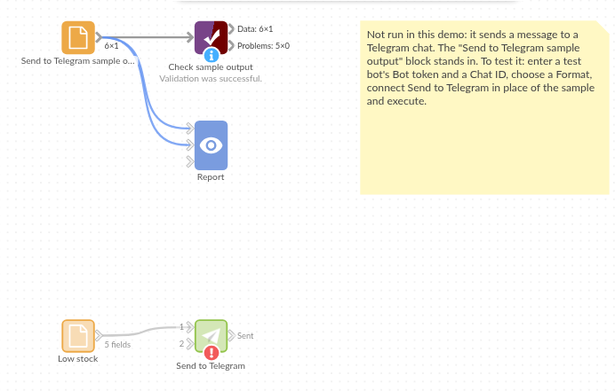

# Send to Telegram

*Omniscope custom block · Outputs*

**This morning's reorder list on the warehouse leads' phones, as a table that lines up, sent by the workflow that worked it out.**

**Python** · requests, pandas · requests installed on first run if missing

## The problem it solves

The stock workflow knows each morning which products have fallen below their reorder level. The people who reorder are on the warehouse floor, with phones, not at a dashboard. A message in their Telegram group, with the list, gets acted on.

This block sends the records to a Telegram chat through your bot, split into several messages if the list is longer than Telegram allows.

- **8** low-stock lines in the invented sample, sent as **1** table message of **744** characters
- **4,096** characters per message at most: a longer list is split between records, the table header repeated on each part
- Nothing is sent when there are no records

### How it works

- The records are written in the chosen format: text (one line per record), a fixed-width table, or JSON.
- The text is split into messages of at most 4,096 characters, never in the middle of a record.
- Each message is sent with the Bot API's `sendMessage`; if Telegram refuses one, the block stops with Telegram's reason.

## What goes in

### Low stock

| Product | Warehouse | In stock | Reorder level | Last delivery |
|---|---|---|---|---|
| Terracotta pot 30cm | Leeds | 14 | 40 | 2025-03-03 |
| Compost 50L | Leeds | 22 | 60 | 2025-02-24 |
| Hose reel | Bristol | 3 | 10 | 2025-02-17 |
| Netting 4m | Bristol | 0 | 15 | |
| Fleece & frost cover | Reading | 4 | 12 | 2025-02-20 |

*8 rows in the sample file.*

## The options

| Option | Demo setting | What it does |
|---|---|---|
| Bot token | (an example token) | The token from @BotFather. |
| Chat ID | `-1001234567890` (an example) | The group, chat or `@channel` to send to. |
| Format | Table | Text (one line per record), Table or JSON. |

## What comes out

### The message (as Telegram shows it, first lines)

```
Product                | Warehouse | In stock | Reorder level | Last delivery
-----------------------+-----------+----------+---------------+--------------
Terracotta pot 30cm    | Leeds     | 14       | 40            | 2025-03-03
Compost 50L            | Leeds     | 22       | 60            | 2025-02-24
Hose reel              | Bristol   | 3        | 10            | 2025-02-17
Netting 4m             | Bristol   | 0        | 15            |
```

### Sent

| Part | Parts | Records | Characters | Message ID | Chat |
|---|---|---|---|---|---|
| 1 | 1 | 8 | 744 | 4101 | -1001234567890 |

One message holding all 8 records. (The message ID is invented: it comes from Telegram.)

## Where it pays off

### Warehousing: Reorder lists

The lines below their reorder level, sent to the warehouse group each morning.

### Field service: Today's jobs

Each engineer's jobs for the day, filtered per engineer and sent to their chat.

### Finance: Payment exceptions

Payments that failed a check overnight, as JSON for a follow-up bot or as a table for people.

### Monitoring: Threshold alerts

Sensors or sites outside their limits in the latest data; no records, no message.

*Use cases describe typical scenarios and are illustrative; the sample data is invented.*

## Why do this in Omniscope

- **The list is worked out where the data is.** The stock join, the reorder rule and the sort run just before the block, so the message holds exactly the records the Report would show for this morning.
- **Silence when there is nothing to say.** An empty input sends nothing, so a filter before the block turns any query into an alert that fires only when it matters, on the scheduler.
- **A record of what was sent.** The Sent output lists every message with Telegram's ID and the records it held, so a scheduled run can be checked like any other data.
- **The message format is yours to change.** The text, table and JSON writers are short Python functions in the block's editor: add a heading line, or bold the worst item with Telegram's HTML.

## How it fits into an Omniscope workflow

Database (stock) → Join (reorder levels) → filter (in stock below reorder level) → Sort → **Send to Telegram**

## Try it

1. Open the demo project (`demo.iox` on the demo server, or import `demo.ioz` from this folder). It holds the sample low-stock list, the block with example settings (it needs your own bot to send), and a File block with `placeholder.csv`: what the block outputs when it sends the sample as a table.
2. The question: was the list sent, and in how many messages?
3. Look at the placeholder record: one message, eight records.
4. To send for real: create a bot with @BotFather, add it to a group, paste the token and the group's chat ID, and run the block.

## Running in Omniscope



*The demo project's workflow: the sample data, the block, and a Validate data check on its output.*

<!--language-->
## Language and libraries

Python. It uses requests (Apache License 2.0) and pandas (BSD 3-Clause).

pandas is part of Omniscope's Python environment. requests is listed in the block's dependencies, so Omniscope installs it with pip on first run if it is missing.
<!--/language-->

## Tested

The block is covered by automated tests that run its script against a stand-in for Omniscope's Python API and a stand-in for Telegram's Bot API that answers as Telegram does, refusals included (no live calls): the sample in each format, with the text checked line by line; a table that lines up and escapes `&`; JSON with numbers and dates; 400 records split into several messages in each format, with every record sent once; an unknown chat and a wrong token; a network error, with the token kept out of the message; empty input; missing settings; a channel name and mixed field types; and 20,000 records.
