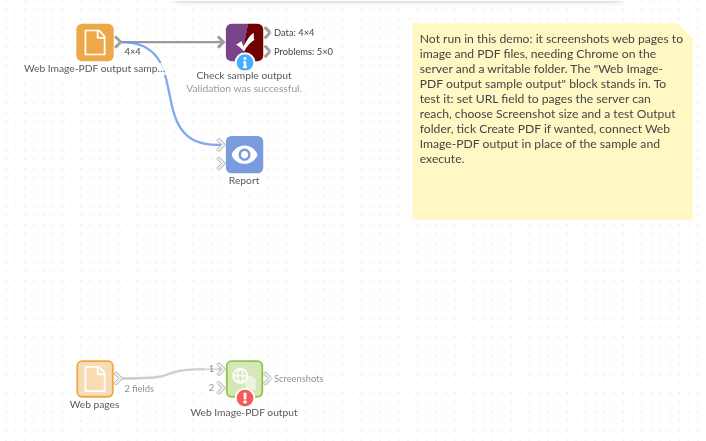

# Web Image-PDF output

*Omniscope custom block · Outputs*

**A picture of each dashboard or web page in the list, at exactly the size you need, and all of them in one PDF if you like.**

**Python** · visokio-omniprint (Chrome), pandas · visokio-omniprint installed on first run; needs Chrome or the block's Docker image

## The problem it solves

A daily email wants a picture of the sales dashboard, a weekly archive wants a snapshot of the stock page, and a supplier's price list page needs keeping as it was on the day. Taking screenshots by hand gives a different size each time, with browser bars and scroll bars, and it doesn't happen when nobody is at the desk.

This block opens each URL in Chrome with the page area set to the size you choose, saves a PNG, and can put all of them into one PDF.

- **4** pages in the invented sample (three Report tabs and a web page), **4** PNG files of **1280 x 720** pixels out
- **1** optional PDF, one page per screenshot, each page the size of the screenshot
- Login details stay out of the output: a username and password for Basic Authentication open the page and go no further

### How it works

- Chrome, driven by the visokio-omniprint package, opens each URL with its page area at the chosen size (turned on its side for Portrait), waits for Omniscope Reports to finish drawing, then for the delay, and saves what it shows.
- Files are named `screenshot_<n>.png` by record number, so each run replaces the last one's files.
- Optionally the PNGs are shrunk with the Tinify service, after the PDF is made from the full-size images.

## What goes in

### Web pages

| Page | URL |
|---|---|
| Sales dashboard | `http://127.0.0.1:24679/Sales/Monthly%20Review.iox/r/Board%20Pack/#Overview` |
| Regional view | `http://127.0.0.1:24679/Sales/Monthly%20Review.iox/r/Board%20Pack/#Regions` |
| Stock levels | `http://127.0.0.1:24679/Operations/Stock.iox/r/Report/#Warehouses` |
| Price list | `https://www.example.com/trade/price-list` |

*4 rows in the sample file.*

## The options

| Option | Demo setting | What it does |
|---|---|---|
| URL field | `URL` | The field holding each page's address. |
| Screenshot size | 1280x720 (HD) | The size of each PNG. |
| Orientation | Landscape | Portrait turns the size on its side. |
| Output folder | a folder on the server | Where the files go (created if missing). |
| Page load delay (seconds) | 3 | Extra wait before the screenshot. |
| Create PDF | ticked | One PDF of all the screenshots. |
| PDF file name | (empty: `screenshots.pdf`) | The PDF's name. |
| Shrink with Tinify | unticked | Shrink the PNGs with the Tinify service (API key needed). |
| Username / Password | (empty) | For pages behind Basic Authentication. |

## What comes out

### Screenshots saved

| URL | Screenshot path | Screenshot filename | PDF |
|---|---|---|---|
| `.../Board%20Pack/#Overview` | `<folder>/screenshot_0.png` | screenshot_0.png | `<folder>/screenshots.pdf` |
| `.../Board%20Pack/#Regions` | `<folder>/screenshot_1.png` | screenshot_1.png | `<folder>/screenshots.pdf` |
| `.../Stock.iox/r/Report/#Warehouses` | `<folder>/screenshot_2.png` | screenshot_2.png | `<folder>/screenshots.pdf` |
| `https://www.example.com/trade/price-list` | `<folder>/screenshot_3.png` | screenshot_3.png | `<folder>/screenshots.pdf` |

4 records, each PNG 1280 x 720 pixels; the PDF has 4 pages of 1280 x 720 points.

## Where it pays off

### Management reporting: Dashboard picture in the morning email

A fixed-size image of the overnight dashboard, attached to or embedded in the morning email.

### Operations: Daily snapshot archive

A dated picture of the stock or service page each day, kept as a record of how things stood.

### Purchasing: Supplier pages as they were

Capture a supplier's published prices or terms on the day an order was placed.

### Presentations: Charts for slides

Screenshots at 1920x1080 or 4K to drop into a slide deck or a document.

*Use cases describe typical scenarios and are illustrative; the sample data is invented.*

## Why do this in Omniscope

- **The list of pages is data.** URLs come from a field, so a Project metadata block, a Text Input or a database table decides what is captured, and a new dashboard tab joins the list without editing the block.
- **The same size every time.** Every screenshot is exactly the chosen size, without browser bars or scroll bars, so this week's picture lines up with last week's in the archive or the email.
- **Captured after the refresh, on the schedule.** Placed after the data load, the pictures always show the figures just computed, and the scheduler takes them at the same time each day.
- **Open for changes.** File naming and the PDF step are Python code you can change: date-stamp the file names, or skip the PDF for pages that fail.

## How it fits into an Omniscope workflow

Text Input (pages to capture) → **Web Image-PDF output** → Validate data (4 screenshots) → Batch Output (email with the images)

## Try it

1. Open the demo project (`demo.iox` on the demo server, or import `demo.ioz` from this folder). It holds the sample pages, the block, not run (it needs Chrome on the server and a folder to write to), and a File block with `placeholder.csv`: what the block outputs for the sample.
2. The question: where are today's screenshots and the PDF?
3. Look at the placeholder records: one per page, with the PNG and PDF paths.
4. To capture for real, on a server with Chrome (or Docker): put your own addresses in the URL field, choose an output folder, and run the block.

## Running in Omniscope

*The demo project's workflow: the sample data, the block, and a Validate data check on its output.*

<!--language-->
## Language and libraries

Python. It uses visokio-omniprint (MIT), which drives Chrome with selenium (Apache License 2.0) and makes the PDF with fpdf (LGPL v3), and pandas (BSD 3-Clause).

pandas is part of Omniscope's Python environment. visokio-omniprint is listed in the block's dependencies, so Omniscope installs it with pip on first run. Chrome must be on the machine running Omniscope, or the server must run custom blocks in Docker, where the block uses an image with Chrome included.
<!--/language-->

## Tested

The block is covered by automated tests that run its script against a stand-in for Omniscope's Python API and a stand-in for Chrome that behaves like headless Chrome (a 1920x1080 window whose page area is 143 pixels shorter): the sample, with every screenshot checked at 1280 x 720; a PDF with the default name, Portrait A4 and compression; a login that keeps the address's `#tab` and stays out of the output; Tinify shrinking the PNGs after the PDF; empty input; missing URLs and a new folder; bad options and a page that fails to open; and 500 pages. The block was also run with real headless Chromium: screenshots of exactly the chosen size, and a PDF whose pages match them.
