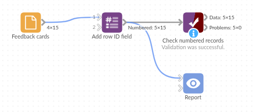

# Add row ID field

*Omniscope custom block · Preparation*

**Records with no key of their own? Number them 1, 2, 3 in the order they arrive, and keep that order and that key through the rest of the workflow.**

**Python** · pandas · nothing extra to install

## The problem it solves

Customer feedback cards are typed in as they arrive: date, branch, rating and a comment, with no reference number. To follow up a card, quote it in a report, or put the cards back in their original order after sorting by rating, each one needs an identifier.

This block adds a field numbering the records in the order they arrive.

- **15** feedback cards in, **15** out, numbered **1** to **15**
- **0** fields changed: the date, branch, rating and comment keep their values and types
- **1** option to make the number the first field, and **1** to start from another number (1001, say)

### How it works

- The records are numbered in the order they reach the block, starting at the chosen number and going up by one.
- The new field is added last, or first if ticked. A blank name gives `Row ID`; an existing field of the same name has its values replaced.
- The block streams: the records pass through in chunks and the count carries on from chunk to chunk, so a large input never has to fit in memory and the numbers have no gaps or repeats.

## What goes in

### Feedback cards

15 invented feedback cards from three branches of a café chain.

| Received | Branch | Rating | Comment |
|---|---|---|---|
| 2025-04-01 | Harrogate | 5 | Quick service and friendly staff |
| 2025-04-01 | York | 3 | Had to wait for a table |
| 2025-04-01 | Harrogate | 4 | |
| 2025-04-02 | Leeds | 2 | Order was wrong |

*15 rows in the sample file.*

## The options

| Option | Demo setting | What it does |
|---|---|---|
| ID field name | `Card No` | Name of the new field; blank gives Row ID. |
| Start at | `1001` | The number given to the first record. |
| Put the ID field first | ticked | Make the ID the first field rather than the last. |

## What comes out

### Numbered records (first rows)

| Card No | Received | Branch | Rating | Comment |
|---|---|---|---|---|
| 1001 | 2025-04-01 | Harrogate | 5 | Quick service and friendly staff |
| 1002 | 2025-04-01 | York | 3 | Had to wait for a table |
| 1003 | 2025-04-01 | Harrogate | 4 | |
| 1004 | 2025-04-02 | Leeds | 2 | Order was wrong |

15 records in all, numbered 1001 to 1015. Card 1010 is the one-star "Cold food" card.

## Where it pays off

### Customer feedback: A reference for every response

Give survey responses, complaints or feedback cards a number staff can quote when they follow one up.

### Before a sort or aggregate: Keep the original order

Number the records first, sort or filter them for analysis, and sort by the ID to get the original order back.

### Before a join: Check nothing was lost or doubled

Number the records before a join, then count the IDs afterwards: a missing ID was dropped, a repeated one matched twice.

### Log and sensor files: Line numbers

Keep each line's position in the file, so an odd reading can be found in the original file.

*Use cases describe typical scenarios and are illustrative; the sample data is invented.*

## Why do this in Omniscope

- **A key the next blocks can use**: the ID goes straight into the Join, Aggregate or Report that follows, so a card quoted in the report can be traced back to the record it came from.
- **Checked on every run**: after a join, an Aggregate on the ID feeding a Validate data block (as many IDs as went in, each once) stops a scheduled run when the join drops or doubles records, instead of the report quietly showing wrong totals.
- **Options the formula lacks**: the start number, first position and in-place replacement are a few lines of Python in the block's editor, and the same place to add, for example, a prefix such as `FB-`.

## How it fits into an Omniscope workflow

Feedback cards (File) → **Add row ID field** → Sort (lowest rating first) → Report

The ID stays with each card through the sort, so the report can list cards by rating and still quote each card's number.

## Try it

1. Open the demo project (`demo.iox` on the demo server, or import `demo.ioz` from this folder): 15 feedback cards with no reference.
2. The question: how do we refer to a single card?
3. Open Add row ID field: name `Card No`, start at `1001`, put first ticked. Run it.
4. Look at the output: 15 records, Card No 1001 to 1015 as the first field; 1010 is the "Cold food" card.
5. Clear the name, set Start at back to 1 and untick Put first: the cards get a `Row ID` from 1 to 15 as the last field.

## Running in Omniscope

*The demo project's workflow: the sample data, the block, and a Validate data check on its output.*

<!--language-->
## Language and libraries

Python. It uses pandas.

pandas is part of Omniscope's Python environment. It needs nothing else installed.
<!--/language-->

## Tested

The block is covered by automated tests that run its script against a stand-in for Omniscope's Python API: the sample data, a chosen name, start number and position, blank names, an existing field of the same name, numbering that runs on across chunks with no gaps or repeats, every field type passed through, empty input, a bad start number, and 1,000,000 records. On an Omniscope server, 300,000 records were numbered 1 to 300,000 with no gaps or repeats.
