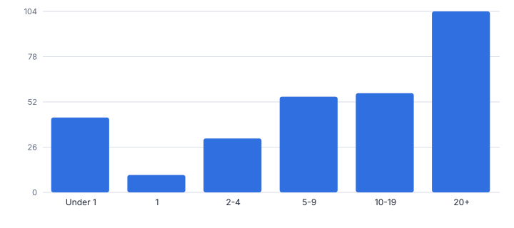
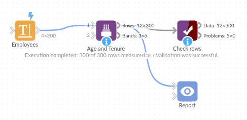

# Age and Tenure

*Omniscope custom block · Preparation*

**Exact age or length of service in years, months and days, with bands, next anniversaries and upcoming milestones.**

**Python** · pandas, numpy · nothing extra to install

## The problem it solves

"How long has each employee been with us?" or "how old is each customer?" sounds like subtracting dates, but completed years need the calendar (29 February included), leavers need their leaving date, and HR wants bands and long-service milestones.

This block computes exact years, months and days, decimal years, bands, the next anniversary and upcoming milestones in one step.

- **300** employees (invented)
- **11** long-service milestones in the next 90 days, for current staff
- **Under 1** shortest-service band
- **29 Feb** anniversaries handled

### How it works

- Connect data with a start date (birth or joining), and optionally an end date (leaving).
- Leavers (an end date before the as-of date) get no upcoming milestone.
- Set the as-of date (default today), the band boundaries, the milestones and the window for upcoming milestones.
- Outputs: rows with years, months, days, decimal years, band, next anniversary, days to it and milestone; and the count per band.

## What goes in

### Employees

300 invented employees; dates of birth in day/month/year format; one born on 29 February.

| Employee | Date Of Birth | Joined | Left |
|---|---|---|---|
| E1000 | 15/11/2001 | 2024-12-03 |  |
| E1001 | 01/04/1983 | 2016-06-11 |  |
| E1002 | 03/06/1988 | 2010-06-28 | 2020-04-18 |
| E1003 | 02/01/1983 | 2010-08-09 |  |
| E1004 | 08/11/1968 | 1992-08-31 |  |
| E1005 | 29/02/1980 | 2015-11-20 |  |

*300 rows in the sample file.*

## The options

| Option | Demo setting | What it does |
|---|---|---|
| Start date (birth, joining) | `Joined` |  |
| End date (optional) | `Left` | For example a leaving date. |
| As of date | `2025-11-05` | Default: today. |
| Band boundaries (years) | `1, 2, 5, 10, 20` |  |
| Milestones (years) | `5, 10, 15, 20, 25, 30` |  |
| Prefix for new fields (optional) | `Service ` | For example 'Age ' or 'Service '. |

## What comes out

### Milestones in the next 90 days

Current staff only: the 4 leavers whose next anniversary after leaving would have been a milestone get none.

| Employee | Joined | Service Years | Service Months | Service Days | Service Next Anniversary | Service Upcoming Milestone |
|---|---|---|---|---|---|---|
| E1005 | 2015-11-20 | 9 | 11 | 16 | 2025-11-20 | 10 years on 2025-11-20 |
| E1015 | 2001-01-25 | 24 | 9 | 11 | 2026-01-25 | 25 years on 2026-01-25 |
| E1020 | 1995-11-17 | 29 | 11 | 19 | 2025-11-17 | 30 years on 2025-11-17 |
| E1053 | 2015-12-11 | 9 | 10 | 25 | 2025-12-11 | 10 years on 2025-12-11 |
| E1056 | 2010-11-26 | 14 | 11 | 10 | 2025-11-26 | 15 years on 2025-11-26 |
| E1067 | 2006-01-25 | 19 | 9 | 11 | 2026-01-25 | 20 years on 2026-01-25 |
| E1175 | 2015-12-08 | 9 | 10 | 28 | 2025-12-08 | 10 years on 2025-12-08 |
| E1190 | 2021-01-20 | 4 | 9 | 16 | 2026-01-20 | 5 years on 2026-01-20 |
| E1212 | 2020-12-17 | 4 | 10 | 19 | 2025-12-17 | 5 years on 2025-12-17 |
| E1247 | 2021-01-08 | 4 | 9 | 28 | 2026-01-08 | 5 years on 2026-01-08 |
| E1297 | 2020-12-19 | 4 | 10 | 17 | 2025-12-19 | 5 years on 2025-12-19 |

### Bands

| Band | Rows | Share |
|---|---|---|
| Under 1 | 43 | 0.143 |
| 1 | 10 | 0.033 |
| 2-4 | 31 | 0.103 |
| 5-9 | 55 | 0.183 |
| 10-19 | 57 | 0.19 |
| 20+ | 104 | 0.347 |

*Service bands from the bands output (invented data).*

## Where it pays off

### HR: Length of service and long-service awards

Service in years and months, bands for reporting, and milestones coming up for recognition.

### Marketing: Customer age and tenure

Age bands from date of birth and customer tenure from first purchase, for segmentation.

### Insurance and pensions: Exact ages

Age in completed years at a valuation date, handling 29 February.

### Asset management: Asset age

Age of equipment or vehicles since commissioning, banded for replacement planning.

*Use cases describe typical scenarios and are illustrative; the sample data is synthetic.*

## Why do this in Omniscope

- **Milestones mailed each month.** The as-of date defaults to today, so each monthly run recalculates service from the current extract and the upcoming long-service milestones go to managers from the same workflow.
- **Exact to the day.** Completed years, months and days follow the calendar, leavers are measured to their leaving date and get no upcoming milestone, and a 29 February birthday falls on 28 February in other years, as the tests check.
- **Bands to your boundaries.** Bands, milestones and the window are options, and the field prefix lets the block run twice, once for age and once for service.

## How it fits into an Omniscope workflow

HR or customer data → **Age and Tenure** → Report / Email output (milestones)

Working Days gives working-day differences, Date Dimension the calendar; Churn Survival Curves gives retention from the same start and end dates.

Email the upcoming milestones to managers each month.

Bands and milestones are recalculated from the current extract, and the milestone email goes out from the same workflow.

## In one step

Exact years, months and days with bands and milestones in one block.

## Try it

1. Open the demo project (`demo.iox` on the demo server, or import `demo.ioz` from this folder): invented employees with joining and leaving dates.
2. The question: whose long-service anniversary is coming up, and what does our service profile look like?
3. Run the block as of 5 November 2025 with service bands 1, 2, 5, 10, 20.
4. Look at the 11 milestones in the next 90 days (leavers get none) and the band chart.
5. Point the same block at dates of birth with the default age bands.

## Running in Omniscope

*The demo project's workflow: the sample data, the block, and a Validate data check on its output.*

<!--language-->
## Language and libraries

Python. It uses pandas and numpy, plus the Python standard library (re).

pandas and numpy are part of Omniscope's Docker Python image, and the block was run in both host mode and Docker mode on an Omniscope server, with the same results. It needs nothing else installed.
<!--/language-->

## Tested

Run on a real Omniscope server:

- The demo workflow ran without errors (rows: 300 records, bands: 6 records).

The block is also covered by automated tests (normal data, empty input, wrong types, large input, leavers with no upcoming milestone, one-year band labels).
