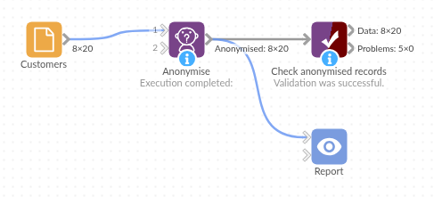

# Anonymise

*Omniscope custom block · Preparation*

**A customer list you need for a demo but can't show? Names and emails become code words, amounts and dates get random noise, and the shape of the data stays.**

**Python** · pandas, numpy, OpenDP · installs `opendp` on first run

## The problem it solves

A sales team wants a dashboard demo built on real-looking customer data; a developer needs a copy of the CRM extract to test a workflow. Neither should see the real names, email addresses, spend or sign-up dates, but both need data with the same fields, the same number of records and believable values.

This block replaces the chosen text fields with code words, consistently, and adds random noise to the chosen number and date fields.

- **20** customers in, **20** out, with the same 8 fields
- **2** customers with the same name get the same code word, so counts by name stay right
- **City** and **Segment** left untouched, so the report's breakdowns still work
- **Orders** stay whole numbers; lifetime spend moves by a couple of pounds; sign-up dates by about a day

### How it works

- Each distinct text value becomes a code word such as `mango3`, the same in every chosen field within a run. Missing values stay missing.
- Number fields get Laplace noise with a typical size of *sensitivity ÷ privacy budget*; whole-number fields are rounded back to whole numbers.
- Date fields are moved by a random number of seconds, sized the same way.
- Every run gives new code words and new noise.
- This is pseudonymisation, not anonymisation: the output keeps the data's patterns, frequencies and approximate values, so someone who knows the data may still recognise records. Treat it as sensitive, and don't rely on it for publication or as a compliance control.

## What goes in

### Customers

20 invented customers of a home furnishings retailer.

| Customer ID | Name | Email | City | Segment | Signup Date | Orders | Lifetime Spend |
|---|---|---|---|---|---|---|---|
| C-1001 | Harriet Ellison | h.ellison@example.com | Leeds | Retail | 2023-02-14 | 12 | 1,840.50 |
| C-1002 | Owen Pritchard | owen.pritchard@example.net | Cardiff | Trade | 2022-11-03 | 38 | 9,625.00 |
| C-1008 | Harriet Ellison | harriet.e@example.net | Bristol | Retail | 2024-09-02 | 2 | 131.60 |
| C-1014 | Lucy Hargreaves | | Leeds | Retail | 2024-03-11 | 6 | 540.80 |
| C-1017 | George Pell | g.pell@example.net | Bristol | Retail | | 5 | 402.10 |

*20 rows in the sample file. One email, one sign-up date and one customer's orders and spend are empty.*

## The options

| Option | Demo setting | What it does |
|---|---|---|
| Fields to anonymise | `Customer ID`, `Name`, `Email`, `Signup Date`, `Orders`, `Lifetime Spend` | The fields to replace or add noise to; empty means every field. |
| Number privacy budget (epsilon) | 5 (default) | Lower means more noise on numbers. |
| Number sensitivity | 10 (default) | With a budget of 5, numbers move by about 2 on average. |
| Date privacy budget (epsilon) | 5 (default) | Lower means more noise on dates. |
| Date sensitivity (seconds) | 432,000 (5 days) | With a budget of 5, dates move by about a day on average (the default, 3,600, moves them by about 12 minutes). |

## What comes out

### Anonymised records (one run; yours will differ)

| Customer ID | Name | Email | City | Segment | Signup Date | Orders | Lifetime Spend |
|---|---|---|---|---|---|---|---|
| appearance1 | analysis1 | courgette1 | Leeds | Retail | 2023-02-12 09:07 | 12 | 1,838.63 |
| challenge1 | accept1 | achieve1 | Cardiff | Trade | 2022-10-29 15:27 | 33 | 9,625.03 |
| believe1 | analysis1 | quince1 | Bristol | Retail | 2024-09-01 14:25 | 3 | 134.57 |
| addition1 | citizens1 | | Leeds | Retail | 2024-03-11 03:01 | 9 | 539.63 |
| cherry1 | lemon1 | calendar1 | Bristol | Retail | | 3 | 400.38 |

20 records, 8 fields. Both Harriet Ellisons became `analysis1`; the empty email and sign-up date are still empty; City and Segment are unchanged. Orders moved by a few in each direction and are still whole numbers.

## Where it pays off

### Sales and presales: Demos on realistic data

Show a dashboard built from a customer's own kind of data without showing anyone's name or spend.

### Development and testing: A safe copy of production data

Give developers and testers an extract with the real structure, volumes and skew, but code words for every identifier.

### Training: Course material from real workflows

Build training projects from real workflows whose data has been disguised.

### Support: Reproducing a problem

Send a dataset that reproduces a problem in a workflow, with the identifying values replaced.

*Use cases describe typical scenarios and are illustrative; the sample data is invented.*

## Why do this in Omniscope

- **One workflow from source to safe copy**: the File or database block, Anonymise, and a Random sample or Filter sit in one project, so the disguised data a demo report uses is always derived from the same source the same way, and nobody copies real records into a spreadsheet by hand.
- **Checked on every run**: a Validate data block after Anonymise can confirm on each run that the record count and the fields are unchanged before the output is written anywhere, and the block can be scheduled with the rest of the project.
- **Joins still work after anonymising**: a value gets the same code word in every chosen field, so a customer ID in two fields of the same table stays matched; append two tables before the block if their IDs must match across both.
- **Change it in the block editor**: the code-word list and the noise are in a short Python script; replace the word list with surnames or town names, or keep chosen fields non-negative, by editing a few lines.

## How it fits into an Omniscope workflow

Customer extract (File or database) → **Anonymise** → Random sample → Validate data → File output / Report

Run it once and write the output to a file if everyone should see the same disguised copy; each run of the block gives new code words and new noise.

## Try it

1. Open the demo project (`demo.iox` on the demo server, or import `demo.ioz` from this folder): 20 invented customers.
2. The question: can this customer list be shown in a demo without showing anyone's name, email or exact spend?
3. Open Anonymise: fields Customer ID, Name, Email, Signup Date, Orders and Lifetime Spend; date sensitivity 432,000. Run it.
4. Look at the output: 20 records, names and emails replaced with code words (the two Harriet Ellisons share one), City and Segment unchanged, orders still whole numbers, dates moved by a day or so.
5. Run it again: the code words and the noise change. Then set the number sensitivity to 1,000 and run once more: the spend values move by hundreds.

## Running in Omniscope

*The demo project's workflow: the sample data, the block, and a Validate data check on its output.*

<!--language-->
## Language and libraries

Python. It uses pandas, numpy and OpenDP (`opendp`, MIT licence) for the noise.

pandas and numpy are part of Omniscope's Python environment. Omniscope installs `opendp` with pip the first time the block runs, so the server needs access to the Python package index (or `opendp` installed beforehand).
<!--/language-->

## Tested

The block is covered by automated tests that run its script against a stand-in for Omniscope's Python API: the sample data with the demo settings, the default of every field, one code word per value across fields, the size of the noise against sensitivity ÷ budget, whole-number fields, empty input, an all-missing text field, no input and invalid options, other field types, and 200,000 records.
