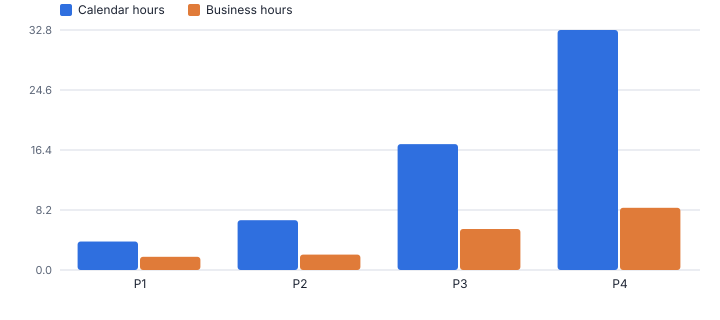
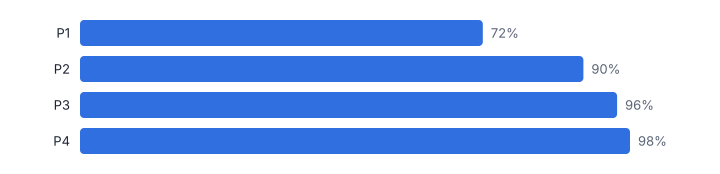
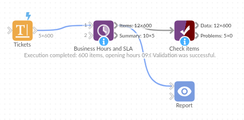

# Business Hours and SLA

*Omniscope custom block · Preparation*

**Resolution times in business hours, within opening hours and skipping weekends and bank holidays, with SLA due times and met or breached for every ticket.**

**Python** · pandas, numpy · nothing extra to install

## The problem it solves

A ticket opened at 16:00 on a Friday and fixed at 10:00 on Monday took 66 hours, or 2.5 working hours. Service levels are agreed in working time, but timestamps are in calendar time, and converting between them, with bank holidays, is an awkward calculation.

This block measures every ticket in business hours, works out when its SLA falls due, flags met and breached (including open tickets already past due) and summarises by priority.

- **600** tickets (synthetic)
- **93%** of closed tickets met their SLA
- **43** breached
- **3** still open and already past due

### How it works

- Connect tickets with an opened and (optionally) resolved time; open tickets are measured to the as-of time.
- Set opening hours, weekend, holiday region and closure dates; give SLA hours by priority, from a field, or one value for all.
- Outputs: tickets with business and calendar hours, SLA due, status and hours to spare; and a summary per priority.

## What goes in

### Tickets

600 synthetic service desk tickets, November 2025.

| Ticket | Priority | Team | Opened | Resolved |
|---|---|---|---|---|
| INC40109 | P4 | Applications | 2025-11-03 10:26 | 2025-11-04 14:13 |
| INC40584 | P4 | Network | 2025-11-03 10:52 | 2025-11-05 10:46 |
| INC40068 | P3 | Network | 2025-11-03 11:22 | 2025-11-03 12:09 |
| INC40135 | P3 | Network | 2025-11-03 11:23 | 2025-11-03 18:27 |
| INC40378 | P3 | Service Desk | 2025-11-03 11:25 | 2025-11-10 06:19 |
| INC40065 | P1 | Applications | 2025-11-03 11:51 | 2025-11-03 13:54 |

*600 rows in the sample file.*

## The options

| Option | Demo setting | What it does |
|---|---|---|
| Opened (start) field | `Opened` | When each item was opened. |
| Resolved (end) field | `Resolved` | Empty = still open. |
| Priority field (optional) | `Priority` | Priority of each item, for the SLA hours by priority. |
| SLA hours by priority | `P1=4, P2=8, P3=24, P4=40` | For example: P1=4, P2=8, P3=24, P4=40 |
| As of (for open items) | `2025-11-28 17:00` | Default: the latest time in the data. |
| Opening time | `09:00` | Start of the working day, as HH:MM. |
| Closing time | `17:30` | End of the working day, as HH:MM. |
| Public holidays | `England and Wales` | Public holidays that do not count as working time. |

## What comes out

### Tickets (first rows)

| Ticket | Priority | Opened | Resolved | Business Hours Elapsed | Calendar Hours Elapsed | SLA Hours | SLA Due | SLA Status | Business Hours To Spare |
|---|---|---|---|---|---|---|---|---|---|
| INC40109 | P4 | Mon 03 Nov 10:26 | Tue 04 Nov 14:13 | 12.28 | 27.78 | 40 | Fri 07 Nov 16:26 | Met | 27.72 |
| INC40584 | P4 | Mon 03 Nov 10:52 | Wed 05 Nov 10:46 | 16.9 | 47.9 | 40 | Fri 07 Nov 16:52 | Met | 23.1 |
| INC40068 | P3 | Mon 03 Nov 11:22 | Mon 03 Nov 12:09 | 0.78 | 0.78 | 24 | Thu 06 Nov 09:52 | Met | 23.22 |
| INC40135 | P3 | Mon 03 Nov 11:23 | Mon 03 Nov 18:27 | 6.12 | 7.07 | 24 | Thu 06 Nov 09:53 | Met | 17.88 |
| INC40378 | P3 | Mon 03 Nov 11:25 | Mon 10 Nov 06:19 | 40.08 | 162.90 | 24 | Thu 06 Nov 09:55 | Breached | -16.08 |
| INC40065 | P1 | Mon 03 Nov 11:51 | Mon 03 Nov 13:54 | 2.05 | 2.05 | 4 | Mon 03 Nov 15:51 | Met | 1.95 |
| INC40118 | P1 | Mon 03 Nov 12:01 | Mon 03 Nov 14:08 | 2.12 | 2.12 | 4 | Mon 03 Nov 16:01 | Met | 1.88 |
| INC40206 | P2 | Mon 03 Nov 12:01 | Mon 03 Nov 16:28 | 4.45 | 4.45 | 8 | Tue 04 Nov 11:31 | Met | 3.55 |
| INC40586 | P4 | Mon 03 Nov 12:58 | Mon 03 Nov 22:49 | 4.53 | 9.85 | 40 | Mon 10 Nov 10:28 | Met | 35.47 |
| INC40161 | P2 | Mon 03 Nov 13:00 | Mon 03 Nov 18:44 | 4.5 | 5.73 | 8 | Tue 04 Nov 12:30 | Met | 3.5 |

### Summary by priority

| Priority | Items | Closed | Open | Met | Breached | Open And Breached | Met Rate (closed) | Median Business Hours | Median Calendar Hours |
|---|---|---|---|---|---|---|---|---|---|
| P1 | 53 | 53 | 0 | 38 | 15 | 0 | 0.717 | 1.75 | 3.9 |
| P2 | 125 | 125 | 0 | 112 | 13 | 0 | 0.896 | 2.117 | 6.767 |
| P3 | 278 | 271 | 7 | 259 | 12 | 1 | 0.956 | 5.633 | 17.25 |
| P4 | 144 | 140 | 4 | 137 | 3 | 2 | 0.979 | 8.5 | 32.78 |
| All | 600 | 589 | 11 | 546 | 43 | 3 | 0.927 | 4.483 | 14.68 |

*Calendar time overstates how long tickets took in working time, most for lower priorities that wait overnight (synthetic data).*

*P1 has the tightest target and the lowest met rate.*

## Where it pays off

### IT and customer service: Service desk SLAs

Response and resolution times in business hours by priority, team and month, with open tickets at risk.

### Financial services: Complaint handling

Time to acknowledge and resolve complaints in working days and hours against regulatory targets.

### Public sector: Case and request targets

Information requests, planning applications or casework measured in working time.

### Logistics and B2B: Order processing

Order-to-dispatch time within warehouse opening hours, by customer contract.

*Use cases describe typical scenarios and are illustrative.*

## Why do this in Omniscope

- **From ticket export to breach list.** The tickets load on a schedule, the open and breached ones are emailed to team leads, and met rates by priority and month sit in the same report.
- **Pinned to known answers.** The tests fix the result for known cases, such as Friday 16:30 to Monday 10:00 counting 2 working hours and Christmas closures being skipped; the holiday rules are those of the Working Days block, so hourly and whole-day figures use the same calendar.
- **Your hours and closures.** Opening hours, weekend, region and closure dates are options; overnight shifts are not handled yet, and the opening-hours arithmetic is in the block's script for anyone who needs to add them.

## How it fits into an Omniscope workflow

Ticket system export → **Business Hours and SLA** → Report (met rate, breaches) → Email output (open and breached)

Load tickets on a schedule; Working Days gives whole-day versions of the same calculation, Date Dimension the calendar.

Email the open and breached tickets to team leads; show met rates by priority and month in a Report.

## In one step

Business hours net of weekends and holidays, and SLA status for each item.

## Try it

1. Open the demo project (`demo.iox` on the demo server, or import `demo.ioz` from this folder): synthetic service desk tickets with priorities.
2. The question: are we meeting our SLAs, measured the way the contract measures them?
3. Open the block: opened and resolved fields, P1=4, P2=8, P3=24, P4=40, opening hours 09:00 to 17:30. Run it.
4. Look at the summary: 93% met overall, P1 lowest; and the 3 open tickets already past due.
5. Change the opening hours or add a closure day and re-run.

## Running in Omniscope

*The demo project's workflow: the sample data, the block, and a Validate data check on its output.*

<!--language-->
## Language and libraries

Python. It uses pandas and numpy, plus the Python standard library (datetime, re).

pandas and numpy are part of Omniscope's Docker Python image, and the block was run in both host mode and Docker mode on an Omniscope server, with the same results. It needs nothing else installed.
<!--/language-->

## Tested

The demo workflow ran without errors on an Omniscope server, giving 600 records in Items and 5 in Summary. Automated tests cover normal data, empty input, wrong types and large input.
