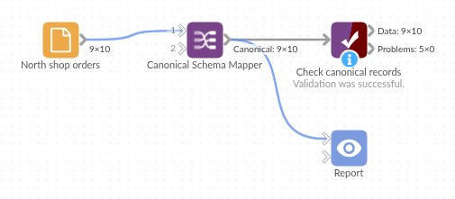

# Canonical Schema Mapper

*Omniscope custom block · Preparation*

**The same orders, exported by two systems under different field names and formats? One set of rules gives them both the same names, types and defaults.**

**Python** · pandas · nothing extra to install

## The problem it solves

A garden supplies wholesaler takes orders through two shops. The north shop's system exports `OrderID`, `Order Date` as 03/02/2025, `Qty` (and, since an upgrade, a second `Quantity` field) and `Paid` as Yes or No. The south shop's exports `order no`, `date ordered` as 2025-02-03, `units` and `is paid` as true or false. Before the two can be appended and reported on, every field needs one name, one type and one way of writing a date.

This block applies one rules table to each export:

- **10** north orders and **6** south orders in; **8** canonical fields out of each, with the same names and types
- **2** quantity fields in the north export combined into one: each order takes whichever is filled in
- **1** quantity typed as `two`: left empty, and counted in the block's message rather than turned into 0
- **1** field, `currency`, that neither export has: added with its default, GBP

### How it works

- Each rule names a canonical field, the aliases it may arrive under, and optionally a type, a default and a date format.
- Field names are matched ignoring case, spaces, hyphens and underscores (untick **Match names loosely** to match exactly).
- When several fields match, each record takes the first value present: a field already named like the canonical field, then the aliases in the rule's order.
- Values that can't be converted to the type become empty; empty values get the default, if the rule has one.

## What goes in

### North shop orders

10 invented orders, dates written day first.

| OrderID | Order Date | Customer | SKU | Qty | Quantity | Unit Price | Paid | Notes |
|---|---|---|---|---|---|---|---|---|
| N-1001 | 03/02/2025 | Fernhill Garden Centre | TP-30 | 12 | | 4.50 | Yes | |
| N-1003 | 05/02/2025 | Brookside Allotment Society | CN-10 | | 15 | 2.20 | No | |
| N-1005 | 07/02/2025 | Willow Bank Landscapes | HT-02 | 6 | 6 | 3.10 | | Paid on account |
| N-1009 | 13/02/2025 | Kestrel Nurseries | HR-01 | two | | 18.00 | No | Typed in by hand |

*10 rows in the sample file.*

### South shop orders

6 invented orders, ISO dates.

| order no | date ordered | client | product code | units | price | is paid | Channel |
|---|---|---|---|---|---|---|---|
| S-2001 | 2025-02-03 | Harbour View Gardens | TP-30 | 10 | 4.50 | true | Web |
| S-2004 | 2025-02-07 | Harbour View Gardens | HT-02 | 3 | 3.10 | | Web |

*6 rows in the sample file.*

### The rules (typed into the block)

| canonical | aliases | type | default | format |
|---|---|---|---|---|
| order_id | OrderID \| Order No | string | | |
| order_date | Order Date \| OrderDate \| Date Ordered | date | | %d/%m/%Y |
| customer | Customer Name \| Client | string | | |
| sku | SKU \| SKU Code \| Product Code | string | | |
| quantity | Qty \| Quantity \| Units | integer | | |
| unit_price | Unit Price \| Price | number | | |
| paid | Paid \| Is Paid | boolean | false | |
| currency | Currency | string | GBP | |

## The options

| Option | Demo setting | What it does |
|---|---|---|
| Schema rules | the 8 rules of `schema-rules.csv`, separated by semicolons | The rules CSV written in the block: canonical, aliases, and optionally type, default and format. |
| Schema rules file | empty | A CSV file of the same rules on the server; used only when Schema rules is empty. |
| Keep unmapped fields | Ticked | Pass fields that match no rule (Notes, Channel) through unchanged. |
| Treat blank text as missing | Ticked | Text that is empty or only spaces counts as missing. |
| Match names loosely | Ticked | `order no` matches the alias `Order No`. |
| Output every canonical field | Ticked | Every canonical field, in the rules' order, even `currency`, which neither export has. |

## What comes out

### Canonical records (north shop, selected orders)

| order_id | order_date | customer | sku | quantity | unit_price | paid | currency | Notes |
|---|---|---|---|---|---|---|---|---|
| N-1001 | 2025-02-03 | Fernhill Garden Centre | TP-30 | 12 | 4.50 | true | GBP | |
| N-1003 | 2025-02-05 | Brookside Allotment Society | CN-10 | 15 | 2.20 | false | GBP | |
| N-1005 | 2025-02-07 | Willow Bank Landscapes | HT-02 | 6 | 3.10 | false | GBP | Paid on account |
| N-1009 | 2025-02-13 | Kestrel Nurseries | HR-01 | | 18.00 | false | GBP | Typed in by hand |

10 records, with `order_date` a date, `quantity` a whole number, `unit_price` a number and `paid` true or false. The block's message reads "Values that could not be converted (now empty): quantity 1". The south export comes out with the same eight canonical fields and types, then its own `Channel`.

## Where it pays off

### Retail and wholesale: Orders from several shops or systems

Bring each system's export to one set of field names and types before appending them, so the sales report has one quantity field and one date field.

### Finance: Monthly exports that change shape

When a supplier or bank changes a column name or date format, add the new name as an alias in the rules; the workflow and the report stay as they are.

### Data teams: One agreed field list for several projects

Keep the canonical field list in one rules table and use it in every project that reads the same kind of data, so a change is made once.

### Data migration: Old and new fields side by side

When a system upgrade adds a new field beside the old one, combine them into one canonical field for the months when either may be filled in.

*Use cases describe typical scenarios and are illustrative; the sample data is invented.*

## Why do this in Omniscope

- **Two exports, one report.** Each shop's File block runs through its own Canonical Schema Mapper into one Append, and the appended orders feed the sales report directly; nothing is renamed by hand between export and report.
- **The same rules on every refresh.** When next month's exports arrive, the scheduled workflow applies the same rules, and Validate data after the Append can make sure `order_date` is a date and `quantity` a whole number before the report is published.
- **Rules you can edit, a script you can open.** Adding a name a new export uses is one line in the rules. The conversion is a short Python script, available once you unlock the design: a new type, such as amounts written with a £ sign, is a few lines more.

## How it fits into an Omniscope workflow

North export (File) → **Canonical Schema Mapper** → Append ← **Canonical Schema Mapper** ← South export (File); Append → Validate data → Report

Point both mapper blocks at the same rules file (or give them the same rules text), with **Output every canonical field** ticked, so both branches have the same fields in the same order before the Append.

## Try it

1. Open the demo project (`demo.iox` on the demo server, or import `demo.ioz` from this folder): the north shop's 10 orders, and the mapper with the rules typed into its **Schema rules** option.
2. The question: can these orders be appended to the south shop's, which name every field differently?
3. Open Canonical Schema Mapper: the eight rules in **Schema rules**, **Output every canonical field** ticked. Run it.
4. Look at the output: 10 records with the eight canonical fields, then Notes; N-1003's quantity comes from the second quantity field, and N-1009's is empty. The block's message counts the one unreadable quantity.
5. Untick **Output every canonical field** and run again: `currency` disappears (no input field matches it) and the canonical fields take the places of the fields they came from.

## Running in Omniscope

*The demo project's workflow: the sample data, the block, and a Validate data check on its output.*

<!--language-->
## Language and libraries

Python. It uses pandas.

pandas is part of Omniscope's Python environment. It needs nothing else installed.
<!--/language-->

## Tested

The block is covered by automated tests that run its script against a stand-in for Omniscope's Python API: both sample exports, the order fields come out in, which value wins when several fields match, empty and typed defaults, exact and loose name matching, blank text, booleans, Date fields and text dates, unreadable numbers, rules mistakes, rules typed into the block (the same result as the file, with and without a heading row, precedence over the file, mistakes), several chunks keeping one schema, empty input and 100,000 records. On an Omniscope server it mapped both sample exports as shown and 300,000 records in about 40 seconds.
