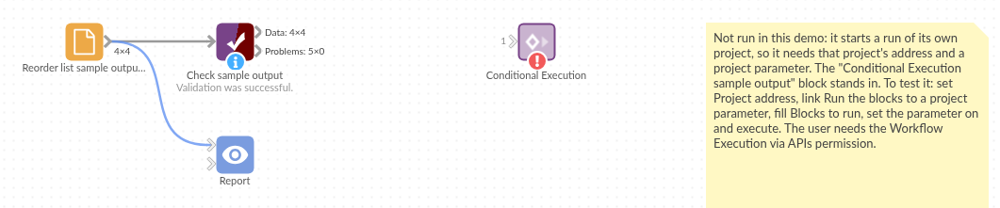

# Conditional Execution

*Omniscope custom block · Preparation*

**A yes/no project parameter decides whether the reorder list is rebuilt: flip it in the report or from the scheduler, and this block starts the blocks, or does nothing.**

**Python** · urllib3 · installed on first run if missing

## The problem it solves

A stock project keeps a reorder list of the products below their reorder level. Rebuilding it reloads the stock file, which is slow and should only happen when the warehouse team asks for it, by ticking a box in the report.

This block reads that box, a yes/no project parameter, and starts the reorder list blocks only when it is ticked.

- **1** yes/no parameter, Refresh reorder list, linked to the block's Run the blocks option
- **1** request when the parameter is on, **0** when it is off
- **2** blocks started by name, Stock levels and Reorder list, as a run of their own
- **4** products below their reorder level in the rebuilt list, from **8** in the stock file

### How it works

- Off: nothing is sent, and the block's message says nothing was started.
- On: one request to the project's Workflow REST API (`w/execute`) with the block names; the block finishes as soon as the server has accepted it, with the job ID in its message.
- A refused request (a block name that doesn't exist, no permission) stops the block with the server's message.

## What goes in

Nothing from the workflow: the block reads its options. The Stock levels block it starts reads this invented stock file:

| SKU | Product | In stock | Reorder level |
|---|---|---|---|
| GP-101 | Terracotta pot 30cm | 14 | 20 |
| GP-102 | Terracotta pot 45cm | 32 | 10 |
| CP-201 | Compost 50L | 8 | 25 |
| CP-202 | Bark mulch 70L | 41 | 15 |
| TL-301 | Hand trowel | 6 | 12 |
| TL-302 | Border fork | 19 | 8 |
| HS-401 | Hose reel | 3 | 5 |
| HS-402 | Spray nozzle | 27 | 10 |

*8 rows in the sample file.*

## The options

| Option | Example setting | What it does |
|---|---|---|
| Project address | the project's own address (empty in the demo) | The project whose blocks to start. |
| Username, Password | (empty) | Only for a server that asks for sign-in. |
| Run the blocks | linked to the parameter Refresh reorder list (not linked in the demo) | On: start the blocks. Off: do nothing. |
| Blocks to run | `Stock levels, Reorder list` | The blocks to start, by name. |
| Refresh from source | on | Reload the stock file rather than reuse the data already loaded. |

## What comes out

No output: the block starts a run and says so in its message, for example "Started Stock levels, Reorder list (job ...). This block does not wait for them to finish." The started run rebuilds the Reorder list: 4 products below their reorder level (GP-101, CP-201, TL-301, HS-401).

## Where it pays off

### Operations: Refresh on request

Let users trigger a slow refresh from a report, by setting a parameter, instead of on every scheduled run.

### Publishing: Export only when approved

Start the blocks that write files or update a database only once someone has set an Approved parameter.

### Several projects: One switch

From a control project, start blocks in other projects when a switch is on, without connecting the projects.

*Use cases describe typical scenarios and are illustrative; the sample data is invented.*

## Why do this in Omniscope

- **A switch anyone can flip.** The condition is a project parameter, so it can be set from a report view, the scheduler, the REST API or another block, and the blocks it guards stay in the same project as the data and the report they feed.
- **Fails loudly.** A misspelt block name or a missing permission stops the block with the server's message, rather than reporting that something started.
- **Easy to extend.** The request takes a few lines of Python; waiting for the run, or switching the parameter back off afterwards, is a few lines.

## How it fits into an Omniscope workflow

Parameter Refresh reorder list (set in the report) → **Conditional Execution** (Run the blocks linked to it) → starts: Stock levels (File) → Reorder list (Record filter: In stock below Reorder level) → Report

## Try it

1. Open the demo project (`demo.iox` on the demo server, or import `demo.ioz` from this folder). It holds the Conditional Execution block with Blocks to run filled in but no Project address and Run the blocks not linked, so it is not run (a demo can't carry the address of the project it sits in, or its parameter links); and a File block with `placeholder.csv`: the Reorder list a started run rebuilds, the 4 products below their reorder level.
2. The question: can a parameter decide whether the reorder list is rebuilt?
3. Follow the File block into the rest of the workflow: GP-101, CP-201, TL-301 and HS-401.
4. To use it in your own project: add a File block named Stock levels reading `sample-data/stock-levels.csv` and a Record filter named Reorder list (In stock below Reorder level), a yes/no parameter Refresh reorder list linked to **Run the blocks**, and the project's own address in **Project address** (as the server reaches itself, for example `http://127.0.0.1:24679/<folder>/<project>.iox/`). With the parameter on, run only the Conditional Execution block: its message says it started Stock levels and Reorder list, and a moment later those blocks run on their own. Turn the parameter off and run it again: nothing is started.

## Running in Omniscope

*The demo project's workflow: the placeholder data (the Reorder list a started run rebuilds), the block, and a Validate data check on the placeholder.*

<!--language-->
## Language and libraries

Python. It uses urllib3 (MIT licence).

urllib3 is listed in the block's dependencies, so Omniscope installs it with pip on first run if it is missing.
<!--/language-->

## Tested

The block is covered by automated tests that run its script against a stand-in for Omniscope's Python API and a stand-in for the Workflow REST API (no server is called): the request sent when on, none when off, the option linked to a text parameter, refresh as a true/false value, the server's refusals (unknown block, no permission, server error), an unreachable server, an empty or blank block list, malformed and pasted addresses, and sign-in. Not tested: how the server treats the request when the project is the one running this block.
