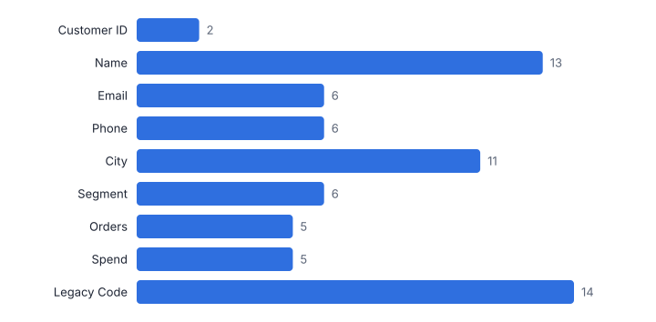
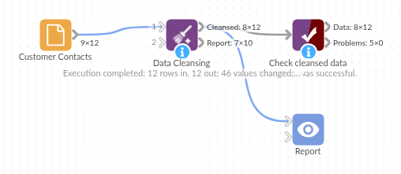

# Data Cleansing

*Omniscope custom block · Preparation*

**Every routine clean-up step in one block: empty rows, placeholders, stray spaces, invisible characters, case and number text, with a report of exactly what changed.**

**Python** · pandas · nothing extra to install

## The problem it solves

Exported data is rarely clean. Names arrive as *  jane SMITH *, cities as *LEEDS* and *leeds *, missing values as *N/A*, *NULL* or a dash, and copy-pasted text carries non-breaking and zero-width spaces that break joins and filters without being visible.

Each fix is easy on its own, but doing them all means a chain of blocks and formulas per field. Data Cleansing is a single checklist, with extras such as invisible-character removal, name-aware Title Case and number conversion.

- **14 → 12** rows (empty rows removed)
- **68** values cleaned in one pass
- **1** text field converted to numbers
- **1** empty legacy field dropped

### How it works

- Choose the fields to cleanse, or leave the list empty for all of them; tick the steps you want.
- Placeholders you list (such as `NULL, N/A, -`) become real missing values first, so the later steps and the number conversion treat them correctly.
- Title Case respects names: *o'brien* becomes *O'Brien*, *anne-marie* becomes *Anne-Marie*, and deliberate mixed case such as *MacLeod* is kept.
- Number conversion only happens when every value in a field is a number (currency symbols and thousands separators allowed); fields with leading zeros, such as phone numbers, stay text.
- The second output is an audit trail: per field, how many values changed, how many placeholders became missing and how many gaps were filled.

## What goes in

### A messy customer contact export

Stray and repeated spaces, inconsistent case, N/A / NULL / - placeholders, a non-breaking space, a zero-width space, two empty rows and an empty legacy field.

| Customer ID | Name | Email | Phone | City | Segment | Orders | Spend | Legacy Code |
|---|---|---|---|---|---|---|---|---|
| C-1001 |   jane SMITH  | Jane.Smith@Example.com  | +44 (0)113 496 0001 | leeds | Retail | 4 | 1250.5 |  |
| C-1002 | MOHAMMED   ali | m.ali@example.com | 0113-496-0002 |   LEEDS | retail |  |  |  |
| C-1003 | o'brien, siobhan | N/A | 0161 496 0003 | manchester  | Trade | 12 | 8840 |  |
|  |  |  |  |  |  |  |  |  |
| C-1004 | Li Wei | li.wei@example.com​ | 07700 900004 | Manchester | TRADE | 7 | 3020.75 |  |
| C-1005 | anne-marie jones | annemarie@example.com | NULL | Bristol | Retail | 1 | 89.99 |  |
| C-1006 |    | - |  |  |  |  |  |  |
| C-1007 | DAVID	O'NEILL | david.oneill@example.com | 0117 496 0007 | bristol | Online | 3 | 410 |  |
| C-1008 | priya patel | priya@example.com | (020) 7946 0008 | LONDON | Online | N/A |  |  |
| C-1009 | tomasz   nowak  | tomasz.nowak@example.com | 020 7946 0009 | london | Trade | 22 | 15400 |  |
| C-1010 | Fiona MacLeod | fiona@example.com |  0131 496 0010  | Edinburgh | retail | 5 | 775.2 |  |
|  |  |  |  |  |  |  |  |  |
| C-1011 | ahmed hassan | ahmed.h@example.com | n/a | glasgow | Online | 2 | 120 |  |
| C-1012 |   chloe  dupont | chloe@example.com | 0141 496 0012 | Glasgow  | Retail | 9 | 2210 |  |

*14 rows in the sample file.*

## The options

| Option | Demo setting | What it does |
|---|---|---|
| Placeholders to treat as missing | `NULL, N/A, -` | Comma-separated values that mean 'no value', such as NULL, N/A, #N/A, -. Matched ignoring case and surrounding spaces. |
| Tabs, line breaks and repeated spaces | `On` | Replaced by a single space. |
| Invisible and non-printable characters | `On` | Zero-width spaces, control characters and byte-order marks are removed; non-breaking spaces become normal spaces. |
| Change case | `Title Case` | Changes the case of text, in every cleansed text field or only those chosen below. |
| Change case only in | `Name, City, Segment` | Leave empty to change case in every cleansed text field. |
| Convert number text to numbers | `On` | After cleansing, a text field whose values are all numbers (currency symbols and thousands separators allowed) becomes a number field. Values with leading zeros keep the field as text. |
| Remove empty fields | `On` | Drop cleansed fields that have no values at all. |
| Leading and trailing whitespace | `On` | Removes spaces at the start and end of text. |
| Remove empty rows | `On` | Drop rows where every field is empty or a placeholder. |

## What comes out

### Cleansed data

Orders is now a whole-number field; Phone stays text because of its leading zeros.

| Customer ID | Name | Email | Phone | City | Segment | Orders | Spend |
|---|---|---|---|---|---|---|---|
| C-1001 | Jane Smith | Jane.Smith@Example.com | +44 (0)113 496 0001 | Leeds | Retail | 4 | 1,250.50 |
| C-1002 | Mohammed Ali | m.ali@example.com | 0113-496-0002 | Leeds | Retail | 0 | 0 |
| C-1003 | O'Brien, Siobhan |  | 0161 496 0003 | Manchester | Trade | 12 | 8,840 |
| C-1004 | Li Wei | li.wei@example.com | 07700 900004 | Manchester | Trade | 7 | 3,020.75 |
| C-1005 | Anne-Marie Jones | annemarie@example.com |  | Bristol | Retail | 1 | 89.99 |
| C-1006 |  |  |  |  |  | 0 | 0 |
| C-1007 | David O'Neill | david.oneill@example.com | 0117 496 0007 | Bristol | Online | 3 | 410 |
| C-1008 | Priya Patel | priya@example.com | (020) 7946 0008 | London | Online | 0 | 0 |
| C-1009 | Tomasz Nowak | tomasz.nowak@example.com | 020 7946 0009 | London | Trade | 22 | 15,400 |
| C-1010 | Fiona MacLeod | fiona@example.com | 0131 496 0010 | Edinburgh | Retail | 5 | 775.20 |
| C-1011 | Ahmed Hassan | ahmed.h@example.com |  | Glasgow | Online | 2 | 120 |
| C-1012 | Chloe Dupont | chloe@example.com | 0141 496 0012 | Glasgow | Retail | 9 | 2,210 |

### Cleansing report

| Field | Type | Values Changed | Placeholders Set To Missing | Missing Values Filled | Field Removed | Converted To Number |
|---|---|---|---|---|---|---|
| Customer ID | Text | 2 | 0 | 2 | No | No |
| Name | Text | 13 | 0 | 2 | No | No |
| Email | Text | 6 | 2 | 4 | No | No |
| Phone | Text | 6 | 2 | 5 | No | No |
| City | Text | 11 | 0 | 3 | No | No |
| Segment | Text | 6 | 0 | 3 | No | No |
| Orders | Text to number | 5 | 1 | 5 | No | Yes |
| Spend | Number | 5 | 0 | 5 | No | No |
| Legacy Code | Number | 14 | 0 | 14 | Yes | No |
| (empty rows removed) |  | 2 | 0 | 0 |  |  |

*Cleansing report for the demo: how many values each step touched, per field.*

## Where it pays off

### Marketing: Campaign-ready contact lists

Clean names, emails and towns before a mail-merge or CRM import, so personalisation looks right and segment filters catch everyone.

### Finance: Reliable joins on ledger and bank data

Invisible spaces and inconsistent case are a common reason reconciliations fail to match. Cleanse both sides first and the join keys line up.

### Retail and supply chain: Product and supplier masters

Standardise descriptions and codes from several suppliers' files, turn price text such as £1,250.50 into numbers and drop empty columns from template exports.

### Public sector and healthcare: Survey and form returns

Normalise free-text answers and placeholder values before analysis, with the report as evidence of what was changed for data-governance reviews.

*Use cases describe typical scenarios and are illustrative; the sample data is synthetic.*

## Why do this in Omniscope

- **Cleaned before anything is matched on it.** The checklist sits between the input block and the joins or Fuzzy Match that follow, so each new export is cleaned the same way before a join key is compared.
- **A count of what each step touched.** The Cleansing report is rebuilt from the source on every run (68 values in the demo), and a text field only becomes a number when every value in it is one, so phone numbers with leading zeros stay text.
- **Placeholders and patterns you can extend.** The placeholder list and the fields to Title Case are options; the invisible-character and number patterns sit at the top of the block's Python script, ready for a character your source system produces.

## How it fits into an Omniscope workflow

File / Database input → **Data Cleansing** → Fuzzy Match → Report

Put Data Cleansing straight after an input block and before joins, de-duplication or reporting. It pairs naturally with Fuzzy Match: clean first, then match.

Route the Cleansing report output to a Report tab or a Data table so each refresh leaves an audit trail of how much cleaning the source needed.

## In one step

Removes empty rows and fields, replaces missing values, strips unwanted characters and changes case together. Note that Omniscope's File and Text Input blocks already read common placeholders such as N/A as missing.

## Try it

1. Open the demo project (`demo.iox` on the demo server, or import `demo.ioz` from this folder): the raw Customer Contacts have stray spaces, LEEDS vs leeds, N/A and NULL, an empty legacy column.
2. Some problems cannot be seen: a non-breaking space and a zero-width space that would break a join on email.
3. Open the Data Cleansing block: one checklist, plus placeholders, invisible characters and number conversion.
4. Run it and look at the cleansed output: proper-case names including O'Brien and MacLeod, consistent towns, Orders now a number field.
5. Look at the Cleansing report output: per field, how many values changed. That is the audit trail.
6. A natural next step is to feed the clean data into Fuzzy Match to find duplicate customers.

## Running in Omniscope

*The demo project's workflow: the sample data, the block, and a Validate data check on its output.*

<!--language-->
## Language and libraries

Python. It uses pandas, plus the Python standard library (re).

pandas and numpy are part of Omniscope's Docker Python image, and the block was run in both host mode and Docker mode on an Omniscope server, with the same results. It needs nothing else installed.
<!--/language-->

## Tested

Run on an Omniscope server, the demo workflow finished without errors (12 records in Cleansed data and 10 in Cleansing report). Automated tests also cover normal data, empty input, wrong types and large input.
