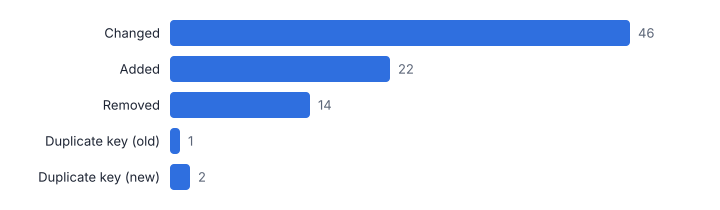
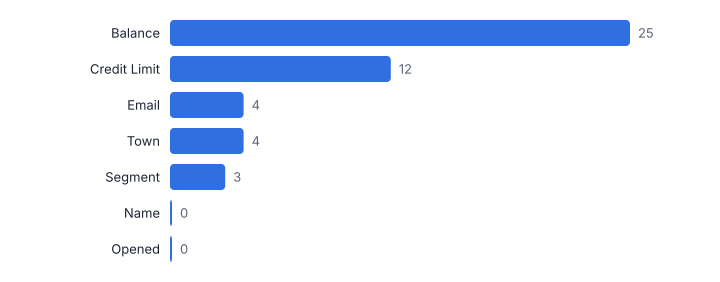
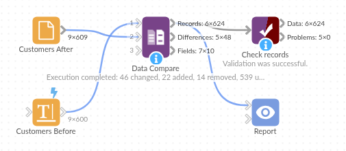

# Data Compare

*Omniscope custom block · Preparation*

**Compare two versions of a dataset by key: what was added, removed and changed, value by value, with tolerances so cosmetic differences do not hide the real ones.**

**Python** · pandas, numpy · nothing extra to install

## The problem it solves

Migrations, system upgrades, month-end extracts and supplier files all raise the same question: what is different between this version and the last one? Joins and calculated fields can answer it for one field at a time, but a full comparison across every field, with sensible rules for rounding, case and spaces, takes a lot of building.

This block compares the two inputs in one step and returns three tables: a status per record, one row per changed value, and a field-by-field summary including schema changes.

- **22 / 14** customers added / removed
- **46** customers with real changes
- **101** more would be flagged without the tolerance, case and space rules
- **2 + 1** fields on one side only (a rename) and a duplicated key, reported rather than guessed at

### How it works

- Connect the old (before) data to input 1 and the new (after) data to input 2.
- Choose the key fields that identify a record (or none, to match whole rows), and optionally which fields to compare or ignore.
- Set a numeric tolerance (absolute or relative), and whether to ignore case, trim spaces and treat blank text as null.
- Outputs: records with status and changed fields, one row per changed value with old, new and numeric change, and the field summary.

## What goes in

### Input 1: customers before

Invented CRM extract, 600 customers.

| Customer ID | Name | Email | Town | Segment | Credit Limit | Balance | Opened | Postcode Area |
|---|---|---|---|---|---|---|---|---|
| CU10000 | Isla Taylor | isla.taylor@example.com | Exeter | Retail | 1000.0 | 216.24 | 2019-08-14 | DE |
| CU10001 | Jack Robinson | jack.robinson@example.com | Oxford | Retail | 5000.0 | 243.3 | 2019-09-25 | NR |
| CU10002 | Oscar Evans | oscar.evans@example.com | Bath | Trade | 5000.0 | 147.28 | 2024-04-26 | YO |
| CU10003 | Grace Smith | grace.smith@example.com | Bristol | Retail | 1000.0 | 1636.98 | 2022-05-19 | CF |
| CU10004 | Arthur Taylor | arthur.taylor@example.com | Norwich | Retail | 10000.0 | 582.89 | 2018-11-24 | EX |

*600 rows in the sample file.*

### Input 2: customers after

The same extract after a migration: 609 rows, with real and cosmetic changes, a renamed field and a duplicated key.

| Customer ID | Name | Email | Town | Segment | Credit Limit | Balance | Opened | Postcode District Prefix |
|---|---|---|---|---|---|---|---|---|
| CU10000 | Isla Taylor | isla.taylor@example.com | Exeter | Retail | 1000.0 | 216.244 | 2019-08-14 | DE |
| CU10001 | Jack Robinson | jack.robinson@example.com | Oxford | Retail | 5000.0 | 243.3 | 2019-09-25 | NR |
| CU10002 | Oscar Evans | oscar.evans@example.com | Bath | Trade | 5000.0 | 398.84 | 2024-04-26 | YO |
| CU10003 | Grace Smith | grace.smith@example.com | Bristol | Trade | 1000.0 | 1636.984 | 2022-05-19 | CF |
| CU10004 | Arthur Taylor | arthur.taylor@example.com | Norwich | Retail | 10000.0 | 582.89 | 2018-11-24 | EX |

*609 rows in the sample file.*

## The options

| Option | Demo setting | What it does |
|---|---|---|
| Key fields | `Customer ID` | Identify a record in both inputs. Leave empty to match whole rows. |
| Numeric tolerance | `0.01` | Differences up to this amount are not changes. |
| Ignore case | `On` | Text that differs only in upper and lower case is not a change. |
| Trim spaces | `On` | Spaces at the start or end of text are ignored. |
| Blank text equals null | `On` | Empty text and a missing value count as the same. |

## What comes out

### Records (excluding unchanged)

| Customer ID | Status | Fields Changed | Changed Fields | Old Row | New Row |
|---|---|---|---|---|---|
| CU10002 | Changed | 1 | Balance | 3 | 3 |
| CU10003 | Changed | 1 | Segment | 4 | 4 |
| CU10022 | Changed | 1 | Credit Limit | 23 | 23 |
| CU10026 | Changed | 1 | Balance | 27 | 27 |
| CU10057 | Changed | 1 | Credit Limit | 58 | 57 |
| CU10067 | Changed | 1 | Email | 68 | 67 |
| CU10073 | Changed | 1 | Town | 74 | 73 |
| CU10092 | Changed | 1 | Balance | 93 | 91 |
| CU10105 | Changed | 1 | Balance | 106 | 104 |
| CU10108 | Changed | 1 | Town | 109 | 107 |
| CU10112 | Changed | 1 | Balance | 113 | 111 |
| CU10120 | Changed | 1 | Segment | 121 | 119 |

### Differences

| Customer ID | Field | Old Value | New Value | Change |
|---|---|---|---|---|
| CU10002 | Balance | 147.28 | 398.84 | 251.56 |
| CU10003 | Segment | Retail | Trade |  |
| CU10022 | Credit Limit | 2500 | 5000 | 2,500 |
| CU10026 | Balance | 465.28 | 718.89 | 253.61 |
| CU10057 | Credit Limit | 5000 | 10000 | 5,000 |
| CU10067 | Email | isla.thompson@example.com | isla.thompson@example.org |  |
| CU10073 | Town | Oxford | Bristol |  |
| CU10092 | Balance | 313.98 | 428.67 | 114.69 |
| CU10105 | Balance | 537.86 | 968.04 | 430.18 |
| CU10108 | Town | Cardiff | York |  |
| CU10112 | Balance | 250.43 | 483.98 | 233.55 |
| CU10120 | Segment | Retail | Trade |  |

### Field summary

| Field | Status | Old Type | New Type | Records Compared | Values Changed | Share Changed |
|---|---|---|---|---|---|---|
| Name | Compared | Text | Text | 585 | 0 | 0 |
| Email | Compared | Text | Text | 585 | 4 | 0.006838 |
| Town | Compared | Text | Text | 585 | 4 | 0.006838 |
| Segment | Compared | Text | Text | 585 | 3 | 0.005128 |
| Credit Limit | Compared | Decimal number | Decimal number | 585 | 12 | 0.02051 |
| Balance | Compared | Decimal number | Decimal number | 585 | 25 | 0.04274 |
| Opened | Compared | Date | Date | 585 | 0 | 0 |
| Customer ID | Key | Text | Text | 585 | 0 |  |
| Postcode Area | Only in old | Text |  | 0 | 0 |  |
| Postcode District Prefix | Only in new |  | Text | 0 | 0 |  |

*What happened to each customer between the two extracts (illustrative data).*

*Name shows no changes: its trailing spaces were trimmed. Balance changes under 0.01 were within tolerance (illustrative data).*

## Where it pays off

### IT and data teams: Migration and upgrade testing

Compare the old and new system's output table by table, with tolerances for rounding, to sign off a migration.

### Finance: Month-end change reports

What changed in the supplier master, the price list or the chart of accounts since last month, for review and audit.

### Data products: Regression tests for workflows

Compare a workflow's output with a saved expected result after every change, and fail the run if anything differs.

### Supply chain: Supplier file updates

See exactly which products, prices and lead times a supplier's new file changes before loading it.

*Use cases describe typical scenarios and are illustrative.*

## Why do this in Omniscope

- **Last run's output as the baseline.** An IOD or file output keeps this run's extract, the next scheduled run compares against it, and the records output drives an email listing what was added, removed or changed.
- **Cosmetic differences kept out.** The tolerance, case and space rules stop 101 demo customers being reported as changed, while the renamed field and the duplicated key are reported rather than guessed at; the tests cover tolerance, schema differences and duplicates.
- **A report that can also stop the run.** The field summary can halt the workflow when an unexpected field changes, and the pairing and comparison rules are in the block's Python script if your records need another one.

## How it fits into an Omniscope workflow

Old extract (file / database / saved snapshot) → New extract → **Data Compare** → Report (changes) / Email output

Feed both versions into the block; for a scheduled change report, keep last run's output with an IOD or file output and compare against it next time.

Use the records output to drive an email of changes, or the field summary to stop a workflow when an unexpected field changes.

Both extracts, the keyed comparison and the change report are steps of one workflow, so a scheduled run can compare against the previous output and email the differences without any hand-made comparison.

## In one step

A full keyed comparison with tolerances and schema checks.

## Try it

1. Open the demo project (`demo.iox` on the demo server, or import `demo.ioz` from this folder): a customer extract before and after an invented migration.
2. The question: did the migration change anything it should not have?
3. Open the block: key Customer ID, tolerance 0.01, ignore case, trim spaces. Run it.
4. Look at the records output: 22 added, 14 removed, 46 changed, and a duplicated key that needs a decision.
5. Look at the differences and the field summary: the renamed field shows as one field only in old and one only in new, and without the case and space rules 147 customers would have looked changed.

## Running in Omniscope

*The demo project's workflow: the sample data, the block, and a Validate data check on its output.*

<!--language-->
## Language and libraries

Python. It uses pandas and numpy.

pandas and numpy are part of Omniscope's Docker Python image, and the block was run in both host mode and Docker mode on an Omniscope server, with the same results. It needs nothing else installed.
<!--/language-->

## Tested

The demo workflow gave the same result in host mode and Docker mode on an Omniscope server: 624 records in Records, 48 in Differences and 10 in Field summary. The automated tests check normal data, empty input, wrong types and large input.
