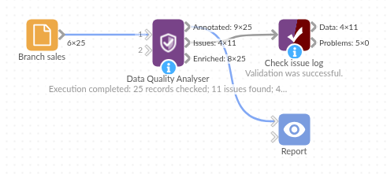

# Data Quality Analyser

*Omniscope custom block · Preparation*

**Duplicates, gaps and odd numbers in a new extract? One record per issue, each record tagged with its issues, and a filled-in copy to carry on with.**

**Python** · pandas · nothing extra to install

## The problem it solves

A new extract arrives: before it is trusted, someone needs to know whether records were exported twice, which values are missing and whether any number is wildly out of line. Checking field by field with filters and charts is slow, and the result is a judgement rather than a list.

This block checks every field of every record and writes the findings down: an issue log with one record per issue, the data with each record's issues alongside it, and, if wanted, a copy with the gaps filled so the analysis can go on while the source is fixed.

- **25** order lines checked from three branches
- **2** orders exported twice: all **4** copies flagged
- **5** missing values found, in four fields
- **2** outliers: 240 units on one line, a unit price of 185.00 on another
- **4** gaps filled in the enriched copy; the missing date is reported but left empty

### How it works

- **Duplicates**: every field the same as in another record. All copies are flagged.
- **Missing values**: any empty value, in any field.
- **Outliers**: per numeric field, a value more than 1.5 times the interquartile range beyond the first or third quartile.
- **Filling**: numbers with the field's median, text with its most common value. Dates are not filled.
- Every output starts with a **Row ID** (position in the input, from 1), so the outputs join to each other.

## What goes in

### Branch sales

25 invented order lines from a garden supplies business with three branches.

| Order | Branch | Product | Units | Unit Price | Order Date |
|---|---|---|---|---|---|
| SO-3005 | York | Garden hose 15m | 5 | 18.50 | 2025-04-03 |
| SO-3006 | | Plant labels (100) | 8 | 3.40 | 2025-04-03 |
| SO-3010 | Leeds | Watering can 10L | 4 | 12.00 | 2025-04-05 |
| SO-3010 | Leeds | Watering can 10L | 4 | 12.00 | 2025-04-05 |
| SO-3013 | Leeds | Garden hose 15m | 240 | 18.50 | 2025-04-08 |
| SO-3014 | Harrogate | Pruning shears | 3 | | 2025-04-08 |
| SO-3018 | Harrogate | Garden hose 15m | 6 | 185.00 | 2025-04-10 |

*25 rows in the sample file.*

## The options

| Option | Demo setting | What it does |
|---|---|---|
| Output annotated data | Ticked | The input with Row ID, Issue Flags and Issue Count. |
| Output issue log | Ticked | One record per issue: Row ID, Issue Type, Issue Field, Issue Details. |
| Output enriched data | Ticked | Missing numbers filled with the median, missing text with the most common value, and a Was Enriched field. |

## What comes out

### Issue log (11 records)

| Row ID | Issue Type | Issue Field | Issue Details |
|---|---|---|---|
| 10 | DUPLICATE_ROW | | Every field is the same as in at least one other record. |
| 11 | DUPLICATE_ROW | | Every field is the same as in at least one other record. |
| 21 | DUPLICATE_ROW | | Every field is the same as in at least one other record. |
| 22 | DUPLICATE_ROW | | Every field is the same as in at least one other record. |
| 6 | MISSING_VALUE | Branch | Value is missing. |
| 18 | MISSING_VALUE | Branch | Value is missing. |
| 8 | MISSING_VALUE | Units | Value is missing. |
| 15 | MISSING_VALUE | Unit Price | Value is missing. |
| 24 | MISSING_VALUE | Order Date | Value is missing. |
| 14 | OUTLIER | Units | Value outside the range -4.875 to 16.12 (1.5 times the interquartile range beyond the quartiles). |
| 19 | OUTLIER | Unit Price | Value outside the range -12.78 to 37.27 (1.5 times the interquartile range beyond the quartiles). |

### Annotated data (selected records)

| Row ID | Order | Branch | Units | Unit Price | Issue Flags | Issue Count |
|---|---|---|---|---|---|---|
| 5 | SO-3005 | York | 5 | 18.50 | | 0 |
| 6 | SO-3006 | | 8 | 3.40 | MISSING_VALUE:Branch | 1 |
| 10 | SO-3010 | Leeds | 4 | 12.00 | DUPLICATE_ROW | 1 |
| 14 | SO-3013 | Leeds | 240 | 18.50 | OUTLIER:Units | 1 |

25 records, 11 of them with an issue.

### Enriched data (the filled records)

| Row ID | Order | Branch | Units | Unit Price | Was Enriched |
|---|---|---|---|---|---|
| 6 | SO-3006 | Leeds | 8 | 3.40 | true |
| 8 | SO-3008 | Harrogate | 5 | 5.99 | true |
| 15 | SO-3014 | Harrogate | 3 | 9.625 | true |
| 18 | SO-3017 | Leeds | 2 | 12.00 | true |

Leeds is the most common branch, 5 the median of Units and 9.625 the median of Unit Price. SO-3022's missing date stays empty, so Was Enriched is false for it.

## Where it pays off

### Finance: Month-end extracts

Check a ledger or sales extract for lines exported twice and amounts far out of line before the figures are reported.

### Operations: Supplier and stock files

List missing product codes, quantities and prices in a supplier's file, to send back with the Row IDs to fix.

### Data migration: Before and after a load

Run the same check on the source and the loaded data and compare the issue counts by type and field.

### Surveys and forms: Incomplete responses

Count missing answers per question, and fill the gaps for a first look while follow-ups go out.

*Use cases describe typical scenarios and are illustrative; the sample data is invented.*

## Why do this in Omniscope

- **The issue log is data, not a report.** Aggregate it by Issue Type and Issue Field into a quality panel in the same Report as the sales figures, or join it back on Row ID to filter the problem records, without leaving the workflow.
- **Every new extract gets the same checks.** The block recomputes the fences, medians and duplicates from the data on each run, so a scheduled workflow re-checks each month's file the same way; add Validate data on the issue log to stop the workflow when, for example, duplicates appear.
- **The rules are a short script you can open.** Change 1.5 to 3 for only the extreme outliers, add a check for negative quantities, or exclude a field, once the block's design is unlocked.

## How it fits into an Omniscope workflow

Sales extract (File) → **Data Quality Analyser** → Issue log → Aggregate (by Issue Type, Issue Field) → Report

The enriched output can feed the analysis directly while the issue log goes to whoever owns the source. Annotated data with a Record filter on Issue Count > 0 gives the records to review.

## Try it

1. Open the demo project (`demo.iox` on the demo server, or import `demo.ioz` from this folder): 25 order lines from three branches.
2. The question: can these figures be trusted as they are?
3. Open Data Quality Analyser: all three outputs ticked. Run it.
4. Look at the Issues output: 11 records, 4 duplicates, 5 missing values and 2 outliers (rows 14 and 19).
5. Look at the Enriched output: Branch, Units and Unit Price filled on four records, the missing Order Date still empty.
6. Untick Output enriched data and run again: the Enriched output is empty; the other two are unchanged.

## Running in Omniscope

*The demo project's workflow: the sample data, the block, and a Validate data check on its output.*

<!--language-->
## Language and libraries

Python. It uses pandas.

pandas is part of Omniscope's Python environment. It needs nothing else installed.
<!--/language-->

## Tested

The block is covered by automated tests that run its script against a stand-in for Omniscope's Python API: the sample data in all three outputs, each output on its own, filling integer, decimal and text fields (ties, half-way medians, fields with no values), boolean and date fields, a field name with a comma, an input that already has a Row ID field, empty input, no input, no output ticked, and 200,000 records with up to 800,000 issues.
