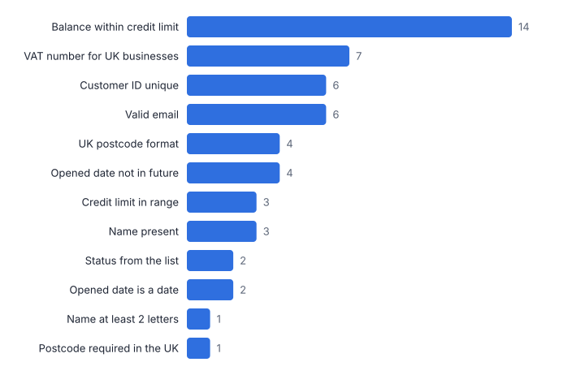
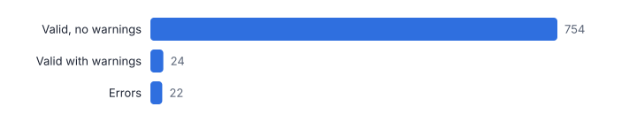
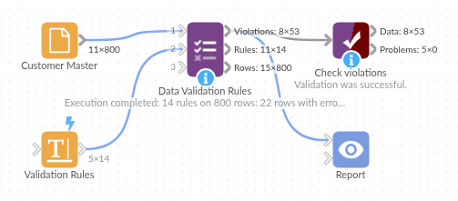

# Data Validation Rules

*Omniscope custom block · Preparation*

**Check data against a rules table that business users can maintain, and get every violation, a summary per rule and a pass / fail flag per row.**

**Python** · pandas, numpy · nothing extra to install

## The problem it solves

Data quality checks tend to live in many filter and formula steps, written once and hard for anyone else to read or change. When a new rule is needed, someone has to edit the workflow.

This block reads the rules from a table (field, check, value, severity) and applies them all: presence, uniqueness, ranges, allowed values, patterns, emails, UK postcodes, comparisons between fields and conditional requirements. The output says which rows fail which rules, with the values found.

- **14** rules in an editable table
- **800** customer records checked (illustrative)
- **22** records with errors
- **24** more with warnings only

### How it works

- Connect the data to input 1 and a rules table to input 2 with columns for the field, the check, the value and the severity (and optionally a rule name). Or type rules in the options, one per line.
- Choose key fields (for example Customer ID) to identify rows in the violations list.
- Outputs: one row per violation, one row per rule with failure counts, rates, status and examples, and the data with error and warning counts and a Valid flag.

## What goes in

### Input 1: customer master

800 invented customer records with planted problems.

| Customer ID | Name | Customer Type | Country | Postcode | Email | Date Opened | Credit Limit | Balance | Status | VAT Number |
|---|---|---|---|---|---|---|---|---|---|---|
| C20000 | Noah Evans | Personal | FR |  | noah.evans0@example.com | 2021-05-13 | 1000.0 | 263.08 | Active |  |
| C20001 | Oscar Taylor | Business | IE |  | oscar.taylor1@example.com | 2018-10-29 | 500.0 | 475.0 | Active | GB686643095 |
| C20002 | Oliver Patel | Personal | UK | DE1 2FS | oliver.patel2@example.com | 2025-05-27 | 500.0 | 475.0 | Active |  |
| C20003 | Ivy Davies | Personal | UK | EX4 3SR | ivy.davies3@example.com | 2019-10-09 | 5000.0 | 1011.84 | Closed |  |
| C20004 | Leo Davies | Business | IE |  | leo.davies4@example.com | 2020-04-14 | 500.0 | 136.99 | Active | GB878841991 |
| C20005 | Freya Walker | Personal | UK | NR2 1BD | freya.walker5@example.com | 2023-01-25 | 5000.0 | 1147.11 | Active |  |

*800 rows in the sample file.*

### Input 2: rules

| Rule Name | Field | Check | Value | Severity |
|---|---|---|---|---|
| Customer ID present | Customer ID | NOT_EMPTY |  | Error |
| Customer ID unique | Customer ID | UNIQUE |  | Error |
| Name present | Name | NOT_EMPTY |  | Error |
| Name at least 2 letters | Name | MIN_LENGTH | 2 | Warning |
| Valid email | Email | EMAIL |  | Error |
| UK postcode format | Postcode | UK_POSTCODE |  | Warning |
| Postcode required in the UK | Postcode | REQUIRED_IF | Country = UK | Error |
| Opened date is a date | Date Opened | IS_DATE |  | Error |
| Opened date not in future | Date Opened | NOT_FUTURE |  | Error |
| Credit limit in range | Credit Limit | BETWEEN | 100..50000 | Error |
| Balance within credit limit | Balance | COMPARE | <= Credit Limit | Warning |
| Status from the list | Status | ALLOWED | Active\|Dormant\|Closed | Error |
| VAT number for UK businesses | VAT Number | REQUIRED_IF | Customer Type = Business | Warning |
| VAT number format | VAT Number | PATTERN | GB[0-9]{9} | Error |

*14 rows in the sample file.*

## The options

| Option | Demo setting | What it does |
|---|---|---|
| Key fields for the violations list | `Customer ID` | For example Customer ID. |
| Field column | `Field` | Column of the rules table naming the field to check. |
| Check column | `Check` | Column naming the check, such as NOT_EMPTY or BETWEEN. |
| Value column | `Value` | Column with the check's value, such as a range or list. |
| Severity column | `Severity` | Column with Error or Warning. |
| Rule name column | `Rule Name` | Column with a readable name for each rule. |

## What comes out

### Rule summary

| Rule | Field | Check | Rule Value | Severity | Rows Failing | Failure Rate | Status | Example Values |
|---|---|---|---|---|---|---|---|---|
| Customer ID present | Customer ID | NOT_EMPTY |  | Error | 0 | 0 | Pass |  |
| Customer ID unique | Customer ID | UNIQUE |  | Error | 6 | 0.0075 | Fail | C20011; C20436; C20647 |
| Name present | Name | NOT_EMPTY |  | Error | 3 | 0.00375 | Fail | (empty) |
| Name at least 2 letters | Name | MIN_LENGTH | 2 | Warning | 1 | 0.00125 | Warning | X |
| Valid email | Email | EMAIL |  | Error | 6 | 0.0075 | Fail | no email; isla@@example.com; george.brown.example.com |
| UK postcode format | Postcode | UK_POSTCODE |  | Warning | 4 | 0.005 | Warning | YO1-7HH; 123 456; LS1 |
| Postcode required in the UK | Postcode | REQUIRED_IF | Country = UK | Error | 1 | 0.00125 | Fail | (empty) |
| Opened date is a date | Date Opened | IS_DATE |  | Error | 2 | 0.0025 | Fail | not known; 31/02/2024 |
| Opened date not in future | Date Opened | NOT_FUTURE |  | Error | 4 | 0.005 | Fail | not known; 2031-02-01; 31/02/2024 |
| Credit limit in range | Credit Limit | BETWEEN | 100..50000 | Error | 3 | 0.00375 | Fail | 250000.0; -500.0; 0.0 |
| Balance within credit limit | Balance | COMPARE | <= Credit Limit | Warning | 14 | 0.0175 | Warning | 617.05; 1486.86; 7788.22 |
| Status from the list | Status | ALLOWED | Active\|Dormant\|Closed | Error | 2 | 0.0025 | Fail | Suspended; Live |
| VAT number for UK businesses | VAT Number | REQUIRED_IF | Customer Type = Business | Warning | 7 | 0.00875 | Warning | (empty) |
| VAT number format | VAT Number | PATTERN | GB[0-9]{9} | Error | 0 | 0 | Pass |  |

### Violations (first rows)

| Row Number | Customer ID | Rule | Field | Check | Rule Value | Severity | Value Found |
|---|---|---|---|---|---|---|---|
| 8 | C20007 | Balance within credit limit | Balance | COMPARE | <= Credit Limit | Warning | 617.05 |
| 12 | C20011 | Customer ID unique | Customer ID | UNIQUE |  | Error | C20011 |
| 12 | C20011 | Valid email | Email | EMAIL |  | Error | no email |
| 19 | C20018 | VAT number for UK businesses | VAT Number | REQUIRED_IF | Customer Type = Business | Warning |  |
| 24 | C20023 | VAT number for UK businesses | VAT Number | REQUIRED_IF | Customer Type = Business | Warning |  |
| 30 | C20029 | UK postcode format | Postcode | UK_POSTCODE |  | Warning | YO1-7HH |
| 32 | C20031 | VAT number for UK businesses | VAT Number | REQUIRED_IF | Customer Type = Business | Warning |  |
| 33 | C20032 | VAT number for UK businesses | VAT Number | REQUIRED_IF | Customer Type = Business | Warning |  |
| 41 | C20040 | VAT number for UK businesses | VAT Number | REQUIRED_IF | Customer Type = Business | Warning |  |
| 44 | C20043 | VAT number for UK businesses | VAT Number | REQUIRED_IF | Customer Type = Business | Warning |  |
| 46 | C20045 | VAT number for UK businesses | VAT Number | REQUIRED_IF | Customer Type = Business | Warning |  |
| 68 | C20067 | Opened date is a date | Date Opened | IS_DATE |  | Error | not known |

*The rule summary as a chart: where the data problems are (illustrative data).*

*Rows with errors can be routed to a fix list; warnings are reported but do not fail the row.*

## Where it pays off

### Master data: Customer, supplier and product records

Check new and changed records before they are loaded into the ERP or CRM, with rules owned by the data steward.

### Finance: Journal and payment files

Mandatory fields, valid codes, amounts within limits and dates in the period, before posting.

### Regulated industries: Submission checks

Validate a regulatory return or data submission against the published rules and keep the results as evidence.

### Data migration: Load readiness

Run the target system's rules over the migrated data and fix failures before cut-over.

*Use cases describe typical scenarios and are illustrative.*

## Why do this in Omniscope

- **The data steward owns the rules.** Rules are rows in a Data Table block or spreadsheet; a new row is a new check on the next run, with no edit to the workflow, and the violations can go to the data owner through an email output.
- **Only valid rows go on to the load.** The rows output carries error and warning counts and a Valid flag, so a filter passes the clean records while the 22 demo records with errors go to a fix list.
- **More checks can be added.** The 17 check types, from NOT_EMPTY to REQUIRED_IF, are defined in the block's Python script, where a check for another reference or postcode format can be added beside them.

## How it fits into an Omniscope workflow

Data (file, database, form) → Rules table (Data Table block or spreadsheet) → **Data Validation Rules** → Email output / Report (violations)

Keep the rules in a spreadsheet or Data Table block so they can change without editing the workflow; Data Cleansing upstream can fix the easy problems first.

Filter the rows output on Valid to load only clean records, and send the violations list to the data owner.

The rules table is ordinary Omniscope data, so a rule change reaches the checks and the violation emails with no edit to the workflow, and the same rules give the same verdict on the same data.

## In one step

Rules kept in a table, with a violation list and a summary for each rule.

## Try it

1. Open the demo project (`demo.iox` on the demo server, or import `demo.ioz` from this folder): an invented customer master file and a rules table with 14 rules.
2. The question: how clean is this file, and can the business own the rules?
3. Look at the rules table: plain field, check, value and severity columns. Then run the block.
4. Look at the rule summary: duplicate IDs, bad emails, out-of-range limits and balances over the limit, with examples; 22 records have errors.
5. Add a rule to the table and re-run: no change to the workflow.

## Running in Omniscope

*The demo project's workflow: the sample data, the block, and a Validate data check on its output.*

<!--language-->
## Language and libraries

Python. It uses pandas and numpy, plus the Python standard library (re).

pandas and numpy are part of Omniscope's Docker Python image, and the block was run in both host mode and Docker mode on an Omniscope server, with the same results. It needs nothing else installed.
<!--/language-->

## Tested

On an Omniscope server the demo workflow ran cleanly: 53 records in Violations, 14 in Rule summary and 800 in Rows. The automated tests check normal data, empty input, wrong types and large input.
