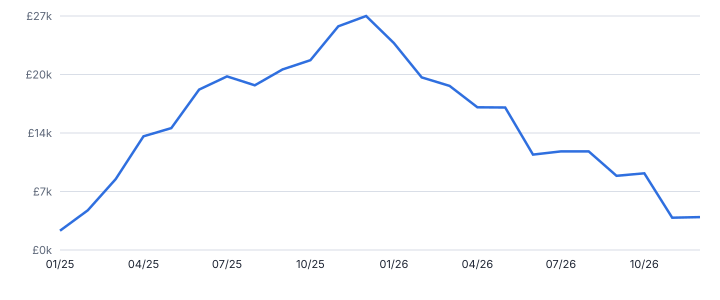
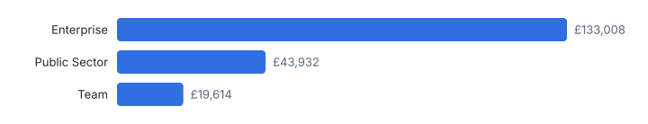
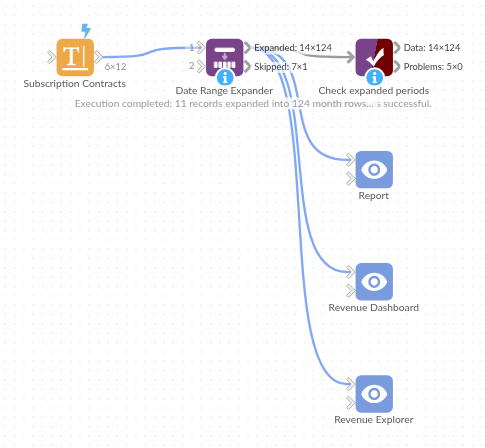

# Date Range Expander

*Omniscope custom block · Preparation*

**Turn start and end dates into one row per day, week, month, quarter or year, with amounts split by days. Revenue recognition, budget phasing and occupancy in one block.**

**Python** · pandas, numpy · nothing extra to install

## The problem it solves

Contracts, subscriptions, leases, bookings, absences and projects are stored as one row with a start and an end date. But finance reports by month, operations by week and HR by day. To answer *how much revenue falls into March?* or *how many rooms were occupied each night?* every record has to be expanded into the periods it covers, with the amount split fairly.

Done by hand, this is a row-generation step plus formulas for period boundaries and proration. Date Range Expander does it in one step, for any number of records.

- **11 → 124** contracts become monthly rows
- **£363k** contract value booked in 2025
- **£197k** of it recognised within 2025
- **1** record sent to review (end before start)

### How it works

- Pick the start and end date fields (real dates or text such as 31/01/2025) and the period: day, week (Monday to Sunday), month, quarter or year.
- Each output row has the period label, start and end, the days of the range inside the period, the total days and the share.
- Amount fields you choose are prorated by days, so the pieces always add back up to the original amount.
- End date inclusive (contracts) or exclusive (hotel check-out); open-ended records can run to today.
- Records that cannot be expanded go to a second output with the reason, rather than silently disappearing.

## What goes in

### Subscription contracts

SUB-011 has no end date (still active) and SUB-012 ends before it starts, to show both edge cases.

| Contract ID | Customer | Plan | Start Date | End Date | Contract Value |
|---|---|---|---|---|---|
| SUB-001 | Northwind Analytics | Enterprise | 2025-01-15 | 2026-01-14 | 48000 |
| SUB-002 | Blue Harbour Retail | Team | 2025-02-01 | 2025-07-31 | 6000 |
| SUB-003 | Kestrel Logistics | Enterprise | 2025-03-10 | 2026-03-09 | 52000 |
| SUB-004 | Greenfield Councils | Public Sector | 2025-04-01 | 2027-03-31 | 90000 |
| SUB-005 | Oakridge Dental Group | Team | 2025-04-20 | 2025-10-19 | 4800 |
| SUB-006 | Pinnacle Insurance | Enterprise | 2025-06-01 | 2026-05-31 | 60000 |
| SUB-007 | Marlow Foods | Team | 2025-07-01 | 2025-12-31 | 5400 |
| SUB-008 | Arden Housing | Public Sector | 2025-09-01 | 2026-08-31 | 30000 |
| SUB-009 | Corvid Security | Team | 2025-10-15 | 2026-04-14 | 7200 |
| SUB-010 | Thistle Energy | Enterprise | 2025-11-01 | 2026-10-31 | 56000 |
| SUB-011 | Harbourside Clinic | Team | 2025-12-01 |  | 3600 |
| SUB-012 | Lumen Media | Team | 2025-08-01 | 2025-06-30 | 3000 |

*12 rows in the sample file.*

## The options

| Option | Demo setting | What it does |
|---|---|---|
| Start date | `Start Date` | Date (or date text) the range starts on. |
| End date | `End Date` | Date (or date text) the range ends on. |
| End date is included | `On` | Ticked: a range 1 to 3 January covers 3 days (contracts, absences). Unticked: it covers 2 days (hotel nights, rentals). |
| When the end date is missing | `Use today (still active)` | What to do with a range that has no end date. |
| One row per | `Month` | Size of the periods each range is split into. |
| Amounts to prorate | `Contract Value` | Number fields split across periods in proportion to the days in each period. Each gets a new field '<name> (prorated)'. |

## What comes out

### Expanded periods

SUB-001 runs 15 January 2025 to 14 January 2026: 17 days in January, a full February, and so on, adding back up to £48,000.

| Contract ID | Customer | Period | Period Start | Period End | Days In Period | Days In Range | Share Of Range | Contract Value (prorated) |
|---|---|---|---|---|---|---|---|---|
| SUB-001 | Northwind Analytics | 2025-01 | 2025-01-01 | 2025-01-31 | 17 | 365 | 0.04657 | 2,235.62 |
| SUB-001 | Northwind Analytics | 2025-02 | 2025-02-01 | 2025-02-28 | 28 | 365 | 0.07671 | 3,682.19 |
| SUB-001 | Northwind Analytics | 2025-03 | 2025-03-01 | 2025-03-31 | 31 | 365 | 0.08493 | 4,076.71 |
| SUB-001 | Northwind Analytics | 2025-04 | 2025-04-01 | 2025-04-30 | 30 | 365 | 0.08219 | 3,945.21 |
| SUB-001 | Northwind Analytics | 2025-05 | 2025-05-01 | 2025-05-31 | 31 | 365 | 0.08493 | 4,076.71 |
| SUB-001 | Northwind Analytics | 2025-06 | 2025-06-01 | 2025-06-30 | 30 | 365 | 0.08219 | 3,945.21 |
| SUB-001 | Northwind Analytics | 2025-07 | 2025-07-01 | 2025-07-31 | 31 | 365 | 0.08493 | 4,076.71 |
| SUB-001 | Northwind Analytics | 2025-08 | 2025-08-01 | 2025-08-31 | 31 | 365 | 0.08493 | 4,076.71 |
| SUB-001 | Northwind Analytics | 2025-09 | 2025-09-01 | 2025-09-30 | 30 | 365 | 0.08219 | 3,945.21 |
| SUB-001 | Northwind Analytics | 2025-10 | 2025-10-01 | 2025-10-31 | 31 | 365 | 0.08493 | 4,076.71 |
| SUB-001 | Northwind Analytics | 2025-11 | 2025-11-01 | 2025-11-30 | 30 | 365 | 0.08219 | 3,945.21 |
| SUB-001 | Northwind Analytics | 2025-12 | 2025-12-01 | 2025-12-31 | 31 | 365 | 0.08493 | 4,076.71 |
| SUB-001 | Northwind Analytics | 2026-01 | 2026-01-01 | 2026-01-31 | 14 | 365 | 0.03836 | 1,841.10 |
| SUB-002 | Blue Harbour Retail | 2025-02 | 2025-02-01 | 2025-02-28 | 28 | 181 | 0.1547 | 928.18 |

### Skipped records

| Contract ID | Customer | Plan | Start Date | End Date | Contract Value | Reason |
|---|---|---|---|---|---|---|
| SUB-012 | Lumen Media | Team | 2025-08-01 00:00:00+00:00 | 2025-06-30 00:00:00+00:00 | 3000 | End date before start date |

*Monthly recognised revenue from the 11 valid synthetic contracts: an Aggregate block on the expanded output, by Period.*

*The same output aggregated by plan for calendar 2025.*

## Where it pays off

### SaaS and subscriptions: Revenue recognition and deferred revenue

Spread annual and multi-year contract values across months by days, then aggregate to get recognised revenue per month and the deferred balance still to come.

### Hospitality and travel: Nightly occupancy

Expand bookings into one row per night (end date exclusive) to count rooms occupied, revenue per available room and peak nights.

### HR and workforce: Absence and headcount by period

Expand leave and sickness records into days, or employment spells into months, for absence rates and monthly headcount that match payroll.

### Property and fleet: Lease and rental phasing

Phase lease costs or vehicle hire across quarters for budgets and accruals, and see exactly how many days fall into each period.

*Use cases describe typical scenarios and are illustrative.*

## Why do this in Omniscope

- **Billing extract to monthly revenue.** The block sits between the contract data and an Aggregate by Period, so the recognised-revenue chart follows each new extract, and contracts that end before they start go to a review tab in the same project.
- **Splits that sum back to the contract.** Amounts are prorated by days, and the tests check that the monthly pieces add back up to each contract value, as SUB-001's £48,000 does from its 17 days in January onwards.
- **Proration you can change.** Inclusive or exclusive end dates and open-ended records are options; the period boundaries and day shares are worked out in the block's script, if your policy splits by whole months instead.

## How it fits into an Omniscope workflow

Contracts (CRM / billing) → **Date Range Expander** → Aggregate (by Period) → Report

Connect any data with a start and end date. The expanded output usually feeds an Aggregate block (sum the prorated amount by Period, or count records per day for occupancy) and then a Report with a line or bar chart.

Use the Skipped records output as a data-quality check: route it to a Report tab or an email output so bad dates get fixed at source.

The expansion sits between the contract data and the Aggregate, so the period report follows the billing extract, and the Skipped records output can go to a review tab in the same project.

## In one step

No loop and no expression to write: one block with a period choice and a field list.

## Try it

1. Open the demo project (`demo.iox` on the demo server, or import `demo.ioz` from this folder): 12 subscription contracts, one row each, with start date, end date and value.
2. The question: how much of this revenue belongs to March 2025? With one row per contract you cannot answer that in a chart.
3. Look at the block options: start, end, *One row per: Month*, prorate Contract Value. Nothing else to configure.
4. Run it: 124 rows, one per contract per month, with days in period and the prorated value. Look at SUB-001: 17 days in January, a full year adding back to £48,000.
5. Look at the Skipped records output: the contract whose end is before its start is flagged, not lost.
6. Finish with the monthly revenue line chart, built from the expanded output.

## Running in Omniscope

*The demo project's workflow: the sample data, the block, and a Validate data check on its output.*

<!--language-->
## Language and libraries

Python. It uses pandas and numpy.

pandas and numpy are part of Omniscope's Docker Python image, and the block was run in both host mode and Docker mode on an Omniscope server, with the same results. It needs nothing else installed.
<!--/language-->

## Tested

Run on an Omniscope server, the demo workflow finished without errors (124 records in Expanded periods and 1 in Skipped records). Automated tests also cover normal data, empty input, wrong types and large input.
