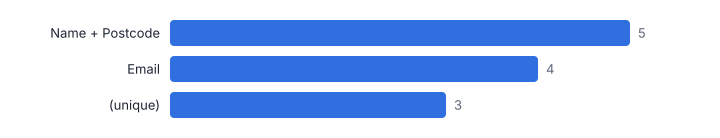
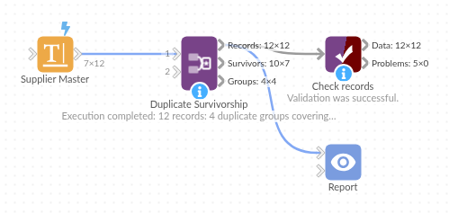

# Duplicate Survivorship

*Omniscope custom block · Preparation*

**Find duplicates within a master file on several match keys, keep the best record of each group, and fill its gaps from the others.**

**Python** · pandas, numpy · nothing extra to install

## The problem it solves

Customer and supplier masters collect duplicates: the same company typed in capitals, with or without Ltd, with a phone number in a different format, one record with the VAT number and another with the email. Deleting duplicates is easy; choosing which record survives, and not losing the details held only by the others, is the hard part.

This block links records on any of several keys, chains the links into groups, picks a survivor by your rule, and completes it from the rest of the group.

- **12** supplier records (invented)
- **4** duplicate groups found
- **7** records after de-duplication
- **3** survivors completed from their duplicates

### How it works

- Connect the records and give the match keys in order, separated by ';' (fields within a key joined by '+'). Choose fields to compare on digits only.
- Choose the survivor rule (most complete, latest, earliest, highest, lowest) and whether to fill gaps.
- Outputs: all records with groups and survivor flags, the de-duplicated table, and the groups.

## What goes in

### Supplier master

Invented suppliers with planted duplicates.

| Supplier ID | Name | Email | Phone | Postcode | VAT Number | Last Updated |
|---|---|---|---|---|---|---|
| S001 | Northgate Packaging | orders@northgate-example.co.uk | 0113 496 0001 | LS1 4AP | GB123456789 | 2024-03-01 |
| S002 | NORTHGATE PACKAGING LTD | Orders@Northgate-Example.co.uk |  | LS1 4AP |  | 2025-06-12 |
| S003 | Northgate Packaging |  | (0113) 4960001 | LS14AP | GB123456789 | 2023-11-20 |
| S004 | Riverside Logistics | info@riverside-example.com | 0161 496 0222 | M1 1AE | GB987654321 | 2025-01-15 |
| S005 | Riverside Logistics | accounts@riverside-example.com | 0161 4960222 | M1 1AE |  | 2024-09-02 |
| S006 | Elm Office Supplies | sales@elm-example.co.uk | 020 7946 0333 | EC1A 1BB | GB555666777 | 2025-02-28 |
| S007 | Oak Tree Catering | hello@oaktree-example.co.uk | 0117 496 0444 | BS1 5TR |  | 2025-04-10 |
| S008 | Oak Tree Catering Ltd | hello@oaktree-example.co.uk |  | BS1 5TR | GB222333444 | 2023-05-05 |
| S009 | Birch Cleaning Co | birch@example.org | 0131 496 0555 | EH1 1YZ | GB111222333 | 2025-07-01 |
| S010 | Willow IT Services | support@willow-example.com | 029 2018 0666 | CF10 1EP | GB444555666 | 2024-12-12 |
| S011 | Willow I.T. Services |  | 029 20180666 | CF10 1EP | GB444555666 | 2025-08-30 |
| S012 | Ash Print Works | print@ash-example.co.uk | 0114 496 0777 | S1 2HE |  | 2025-03-03 |

*12 rows in the sample file.*

## The options

| Option | Demo setting | What it does |
|---|---|---|
| Match keys | `Email; Name + Postcode; Phone; VAT Number` | Keys separated by ';', fields within a key by '+', for example: Email; Name + Postcode |
| Compare on digits only | `Phone` | For example Phone. |
| Keep | `Latest by a date` | Which record in each duplicate group is kept. |
| Date or value for the rule | `Last Updated` | The date or number the Keep rule looks at, such as Last Updated. |
| Fill gaps in the survivor from its duplicates | `On` | Empty fields in the kept record take a value from its duplicates. |

## What comes out

### Records with groups

| Supplier ID | Name | Email | Phone | Last Updated | Duplicate Group | Group Size | Survivor | Linked By |
|---|---|---|---|---|---|---|---|---|
| S001 | Northgate Packaging | orders@northgate-example.co.uk | 0113 496 0001 | 2024-03-01 | 1 | 3 | No | Email |
| S002 | NORTHGATE PACKAGING LTD | Orders@Northgate-Example.co.uk |  | 2025-06-12 | 1 | 3 | Yes | Email |
| S003 | Northgate Packaging |  | (0113) 4960001 | 2023-11-20 | 1 | 3 | No | Name + Postcode |
| S004 | Riverside Logistics | info@riverside-example.com | 0161 496 0222 | 2025-01-15 | 2 | 2 | Yes | Name + Postcode |
| S005 | Riverside Logistics | accounts@riverside-example.com | 0161 4960222 | 2024-09-02 | 2 | 2 | No | Name + Postcode |
| S006 | Elm Office Supplies | sales@elm-example.co.uk | 020 7946 0333 | 2025-02-28 | 3 | 1 | Yes |  |
| S007 | Oak Tree Catering | hello@oaktree-example.co.uk | 0117 496 0444 | 2025-04-10 | 4 | 2 | Yes | Email |
| S008 | Oak Tree Catering Ltd | hello@oaktree-example.co.uk |  | 2023-05-05 | 4 | 2 | No | Email |
| S009 | Birch Cleaning Co | birch@example.org | 0131 496 0555 | 2025-07-01 | 5 | 1 | Yes |  |
| S010 | Willow IT Services | support@willow-example.com | 029 2018 0666 | 2024-12-12 | 6 | 2 | No | Name + Postcode |
| S011 | Willow I.T. Services |  | 029 20180666 | 2025-08-30 | 6 | 2 | Yes | Name + Postcode |
| S012 | Ash Print Works | print@ash-example.co.uk | 0114 496 0777 | 2025-03-03 | 7 | 1 | Yes |  |

### Survivors

| Supplier ID | Name | Email | Phone | Postcode | VAT Number | Records Merged | Fields Filled From Duplicates |
|---|---|---|---|---|---|---|---|
| S002 | NORTHGATE PACKAGING LTD | Orders@Northgate-Example.co.uk | 0113 496 0001 | LS1 4AP | GB123456789 | 3 | Phone; VAT Number |
| S004 | Riverside Logistics | info@riverside-example.com | 0161 496 0222 | M1 1AE | GB987654321 | 2 |  |
| S006 | Elm Office Supplies | sales@elm-example.co.uk | 020 7946 0333 | EC1A 1BB | GB555666777 | 1 |  |
| S007 | Oak Tree Catering | hello@oaktree-example.co.uk | 0117 496 0444 | BS1 5TR | GB222333444 | 2 | VAT Number |
| S009 | Birch Cleaning Co | birch@example.org | 0131 496 0555 | EH1 1YZ | GB111222333 | 1 |  |
| S011 | Willow I.T. Services | support@willow-example.com | 029 20180666 | CF10 1EP | GB444555666 | 2 | Email |
| S012 | Ash Print Works | print@ash-example.co.uk | 0114 496 0777 | S1 2HE |  | 1 |  |

*Email and name with postcode find most duplicates; capitalisation and punctuation are ignored (invented data).*

## Where it pays off

### Master data: Supplier and customer masters

A golden record per supplier or customer before migration or a CRM clean-up.

### Marketing: Mailing lists

One contact per person across sign-up sources, keeping the latest consent and details.

### Healthcare and public sector: Person records

Records for the same person linked on several identifiers, with the most complete kept.

### Retail: Product catalogues

Duplicate products from several feeds merged on barcode or supplier code.

*Use cases describe typical scenarios and are illustrative.*

## Why do this in Omniscope

- **Clean, merge and check in one project.** Data Cleansing before and Data Compare after sit alongside it, so the clean master can be rebuilt from the source and compared with the original whenever it is reloaded.
- **Survivors chosen by a stated rule.** Most complete, latest, earliest, highest or lowest is a setting, and the records output keeps every original row with its group and survivor flag as the audit of what was merged.
- **Match keys as text.** Keys such as `Email; Name + Postcode; Phone` are typed in the options, so adding one is a settings change; the gap-filling logic is in the script if a field should never be copied from a duplicate.

## How it fits into an Omniscope workflow

Master data → Data Cleansing / Name Parser → **Duplicate Survivorship** → Data Compare (before and after)

Clean first; for typos, use Fuzzy Match to produce a match key. Data Compare shows what the de-duplication changed.

Load the survivors output as the clean master; keep the records output as the audit of which records were merged.

## In one step

Duplicate groups on several keys, a survivor chosen by rule, and its gaps filled.

## Try it

1. Open the demo project (`demo.iox` on the demo server, or import `demo.ioz` from this folder): twelve invented supplier records.
2. The question: how many suppliers do we really have, and which record should we keep for each?
3. Run the block: email, name with postcode, phone digits and VAT number as keys; keep the latest.
4. Look at the groups: 12 records become 7, and the survivors pick up phone and VAT numbers from their duplicates.
5. Switch the rule to most complete and compare.

## Running in Omniscope

*The demo project's workflow: the sample data, the block, and a Validate data check on its output.*

<!--language-->
## Language and libraries

Python. It uses pandas and numpy, plus the Python standard library (re).

pandas and numpy are part of Omniscope's Docker Python image, and the block was run in both host mode and Docker mode on an Omniscope server, with the same results. It needs nothing else installed.
<!--/language-->

## Tested

Run on an Omniscope server, the demo workflow finished without errors (12 records in Records, 7 in Survivors and 4 in Groups). Automated tests also cover normal data, empty input, wrong types and large input.
