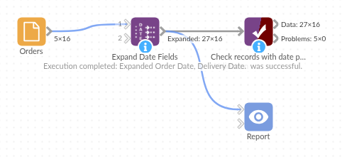

# Expand Date Fields

*Omniscope custom block · Preparation*

**Orders by quarter, deliveries on a Saturday, sales per ISO week? Every part of a date as a field of its own, for each date field you choose, in one step.**

**Python** · pandas · nothing extra to install

## The problem it solves

A Date field answers "when?", but reports usually ask about a part of it: which quarter, which month, which day of the week, which week of the year. Charts and filters can group by some of these, but a Pivot by weekday, a filter for month-end deliveries or a join to a weekly target table needs the part as a field of its own.

This block adds the parts for each chosen date field, named after it, so `Order Date` gets `Order Date_year`, `Order Date_quarter`, `Order Date_day_name` and the rest.

- **16** orders in, **16** out, each with **22** new fields (11 per date field, for two date fields)
- **2** December orders placed in ISO **week 1 of 2026**, and labelled so: their week comes with its own year
- **1** delivery on the last day of a month, flagged
- **1** order with no delivery date: its delivery parts are empty, not "false" or "1970"

### How it works

- Choose one or more Date fields. Each gets year, month, month name, day, day name, day of year, quarter, month start and end flags, ISO week and the ISO week's year.
- The time of day is ignored; names are in English whatever the server's language.
- Every chosen field always gets every new field, so the output's fields don't depend on the data.

## What goes in

### Orders

16 invented orders from a garden supplies wholesaler, placed between late December 2025 and March 2026, with their order time and delivery date.

| Order | Customer | Order Date | Delivery Date | Value |
|---|---|---|---|---|
| WO-3001 | Fernhill Garden Centre | 2025-12-22 09:15 | 2025-12-24 | 412.50 |
| WO-3002 | Marsh Lane Hardware | 2025-12-29 14:40 | 2026-01-02 | 96.00 |
| WO-3003 | Brookside Allotment Society | 2025-12-31 16:05 | 2026-01-05 | 58.20 |
| WO-3008 | Hollin Park Estates | 2026-01-30 09:05 | 2026-01-31 | 2210.00 |
| WO-3015 | Willow Bank Landscapes | 2026-03-24 11:55 | | 1020.00 |

*16 rows in the sample file.*

## The options

| Option | Demo setting | What it does |
|---|---|---|
| Date fields to expand | `Order Date`, `Delivery Date` | Each chosen field gets its own set of date-part fields, named after it. |
| Time zones | Keep local date and time | Matters only for dates reaching the block in a zone other than UTC; Omniscope passes Date fields in UTC, so the choices agree for ordinary Date fields. |

## What comes out

### Records with date parts (selected orders and fields)

| Order | Order Date_year | Order Date_quarter | Order Date_day_name | Order Date_weekofyear | Order Date_week_year | Delivery Date_day_name | Delivery Date_is_month_end |
|---|---|---|---|---|---|---|---|
| WO-3001 | 2025 | 4 | Monday | 52 | 2025 | Wednesday | false |
| WO-3002 | 2025 | 4 | Monday | 1 | 2026 | Friday | false |
| WO-3003 | 2025 | 4 | Wednesday | 1 | 2026 | Monday | false |
| WO-3008 | 2026 | 1 | Friday | 5 | 2026 | Saturday | true |
| WO-3015 | 2026 | 1 | Tuesday | 13 | 2026 | | |

16 records and 27 fields in all. WO-3002 was ordered in December 2025 but in ISO week 1 of 2026: grouping by `_year` and `_weekofyear` would put it with the first days of January 2025, grouping by `_week_year` and `_weekofyear` puts it in the right week.

## Where it pays off

### Retail and wholesale: Trading patterns

Count orders and takings by day of the week, or compare quarters, from the order date alone.

### Logistics: Delivery days

Flag deliveries landing on a Saturday or a month end, from the delivery date, beside the order date's own parts.

### Finance: Weekly and monthly reporting

Total transactions by ISO week and its year for weekly packs, or pick out month-end postings for checks.

### Service and HR: Calendar breakdowns

Break tickets, absences or bookings down by month, weekday or week, ready for a Pivot or a filter.

*Use cases describe typical scenarios and are illustrative; the sample data is invented.*

## Why do this in Omniscope

- **One step for many dates**: the eleven parts for both the order and the delivery date come from one block, not twenty-two formulas, and feed the Pivot, filters and charts of the report directly.
- **Weeks that add up across New Year**: the ISO week arrives with its own year, so a weekly total built on the output puts the last days of December in the right week on every run.
- **Open to change**: the parts are a few lines of pandas, which you edit after unlocking the block's design; add a financial quarter or a week starting on Sunday there if your reporting needs one.

## How it fits into an Omniscope workflow

Orders (File or Database) → **Expand Date Fields** → Aggregate (by `Order Date_week_year`, `Order Date_weekofyear`) → Report

## Try it

1. Open the demo project (`demo.iox` on the demo server, or import `demo.ioz` from this folder): 16 orders with an order date and a delivery date.
2. The question: how many orders were placed in each ISO week, and on which weekdays do deliveries land?
3. Open Expand Date Fields: Date fields to expand = `Order Date` and `Delivery Date`. Run it.
4. Look at the output: 27 fields; WO-3002 and WO-3003, ordered in December 2025, are in week 1 of 2026; WO-3008's delivery is flagged as a month end; WO-3015 has empty delivery parts.
5. Remove `Delivery Date` from the option and run again: only the order date's eleven fields are added.

## Running in Omniscope

*The demo project's workflow: the sample data, the block, and a Validate data check on its output.*

<!--language-->
## Language and libraries

Python. It uses pandas.

pandas is part of Omniscope's Python environment. It needs nothing else installed.
<!--/language-->

## Tested

The block is covered by automated tests that run its script against a stand-in for Omniscope's Python API: the sample data, ISO weeks across New Year, missing dates, times just before midnight, the three time-zone choices (on UTC dates and on dates in other zones), empty input, a field with no dates, non-date fields and bad options, text holding dates, and 1,000,000 records.
