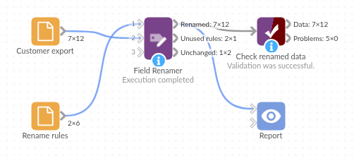

# Field Renamer

*Omniscope custom block · Preparation*

**Rename dozens of fields from a list kept as data, and see straight away which renames no longer fit the data.**

**R** · data.table · install data.table if missing

## The problem it solves

A customer export arrives with technical field names (`cust_no`, `cust_nm`, `pcode`, `last_ord_dt`). Reports and joins need readable, consistent names, and the same renames are needed every month, in several projects. Typing them into a Field Organiser each time is slow, and when the export changes (a field dropped, a new one added) nothing tells you the renames are out of date.

This block reads the renames from a rules table and applies them, then lists the rules that found no field and the fields no rule touched.

- **6** rules in, **5** of them used: one rule, `credit_lim`, names a field the export doesn't have
- **7** fields in the export: **5** renamed, **2** (`town`, `ytd_sales`) left as they were
- **12** records out, values and types unchanged

### How it works

- Connect the rules to the first input and the data to the second; choose the rules' current-name and new-name fields.
- Names are matched exactly, including capitals; spaces at either end of a name in the rules are ignored.
- Rules with no current name are skipped. A rule with no new name, a current name listed twice, or a rename that would give two fields the same name stops the block with a message saying which.

## What goes in

### Rename rules (first input)

6 invented rules for a customer export.

| Current Name | New Name |
|---|---|
| cust_no | Customer Number |
| cust_nm | Customer Name |
| pcode | Postcode |
| acct_mgr | Account Manager |
| last_ord_dt | Last Order Date |
| credit_lim | Credit Limit |

### Customer export (second input)

12 invented customers of a building and garden supplies wholesaler.

| cust_no | cust_nm | town | pcode | acct_mgr | last_ord_dt | ytd_sales |
|---|---|---|---|---|---|---|
| C-1001 | Fernhill Garden Centre | Leominster | HR6 8AA | Priya Shah | 2025-02-27 | 18240.50 |
| C-1002 | Marsh Lane Hardware | Spalding | PE11 2BB | Tom Hughes | 2025-03-03 | 6420.00 |
| C-1003 | Kestrel Builders Merchants | Skipton | BD23 1CC | Priya Shah | 2025-01-14 | 42915.75 |

*12 rows in the sample file.*

## The options

| Option | Demo setting | What it does |
|---|---|---|
| Current field names | `Current Name` | The rules field holding each field's current name. |
| New field names | `New Name` | The rules field holding the name to give it. |

## What comes out

### Renamed data

| Customer Number | Customer Name | town | Postcode | Account Manager | Last Order Date | ytd_sales |
|---|---|---|---|---|---|---|
| C-1001 | Fernhill Garden Centre | Leominster | HR6 8AA | Priya Shah | 2025-02-27 | 18240.50 |
| C-1002 | Marsh Lane Hardware | Spalding | PE11 2BB | Tom Hughes | 2025-03-03 | 6420.00 |
| C-1003 | Kestrel Builders Merchants | Skipton | BD23 1CC | Priya Shah | 2025-01-14 | 42915.75 |

12 records, the fields in their original order.

### Unused rules

| Current Name | New Name |
|---|---|
| credit_lim | Credit Limit |

### Unchanged

| Field |
|---|
| town |
| ytd_sales |

`town` and `ytd_sales` have no rule; add two rules to rename them too.

## Where it pays off

### Recurring exports: Same renames every month

Keep the renames for a system's export in one rules table and apply them to every new file, in every project that uses the export.

### Many sources: One naming standard

Map the field names of several regional or departmental files to one company standard, with one rules table per source.

### Changing exports: Spot what moved

When a supplier adds, drops or renames a field, the Unused rules and Unchanged outputs show it on the next run instead of a report quietly losing a column.

### Shared naming: Business users own the names

Let the people who know the data maintain the rules in a spreadsheet, without opening the workflow.

*Use cases describe typical scenarios and are illustrative; the sample data is invented.*

## Why do this in Omniscope

- **Rules as a data source**: the rules table can come from any input block (a File, a database query, a shared spreadsheet), so updating a name is a data change, not a workflow edit, and the renamed fields flow straight into the joins and Report that use them.
- **A check on every run**: connect a Validate data block to **Unused rules** or **Unchanged** and expect no records, so a scheduled run stops when the export no longer matches the rules instead of publishing a report with missing fields.
- **Open R**: the script is about 60 lines in the block's editor; changing how names are matched (to ignore capitals, say) takes a couple of lines.

## How it fits into an Omniscope workflow

Rename rules (File) + Customer export (File) → **Field Renamer** → Join (sales by customer) → Report

Unused rules → Validate data (expect 0 records)

## Try it

1. Open the demo project (`demo.iox` on the demo server, or import `demo.ioz` from this folder): a rules file and a customer export.
2. The question: does every field in the export get its readable name?
3. Open Field Renamer: Current field names `Current Name`, New field names `New Name`. Run it.
4. Look at the outputs: 12 records with 5 fields renamed; Unused rules lists `credit_lim`; Unchanged lists `town` and `ytd_sales`.
5. Add a rule `town` → `Town` to the rules file and run again: Unchanged now lists only `ytd_sales`.

## Running in Omniscope

*The demo project's workflow: the sample data, the block, and a Validate data check on its output.*

<!--language-->
## Language and libraries

R. It uses the data.table package (MPL-2.0 licence).

data.table is not part of base R: install it on the Omniscope server's R if it is missing (`install.packages("data.table")`).
<!--/language-->

## Tested

The block is covered by automated tests that run its script against a stand-in for Omniscope's R API: the sample data, values and types kept, trimmed names and exact matching, renames that would clash, swapped names, incomplete and duplicate rules, rules held in number fields, empty data and empty rules, missing inputs and options, and 2,000 fields over 20,000 records.
