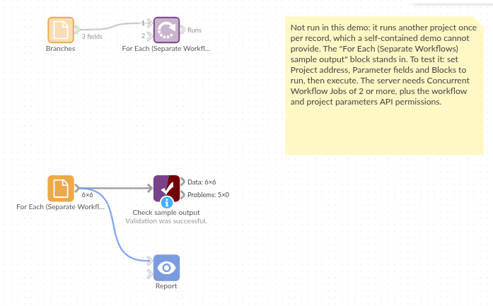

# For Each (Separate Workflows)

*Omniscope custom block · Preparation*

**One branch report project, six branches: set the project's parameters, run it, wait, and go on to the next branch, with a record of how each run went.**

**Python** · urllib3, pandas · urllib3 installed on first run if missing

## The problem it solves

A branch report project filters the sales to one branch, applies that branch's minimum order and writes a PDF. Producing it for six branches by hand means changing three parameters and pressing Execute six times, and checking each run finished before starting the next.

This block reads one record per branch, sets the report project's parameters from it, starts the project's workflow and waits for the run to end before moving on.

- **6** branch records in, **6** runs of the other project, one after another
- **3** parameters set before each run: Branch, Quarter and Minimum order
- **1** output record per run with its result, so a failed branch is easy to find
- **10** minutes' wait, by default, if the other project is busy when a run should start

### How it works

- For each record: set the parameters (`w/updateparams`), start the workflow (`w/execute`), check its state (`w/job/<id>/state`) every second, then every 5 seconds after the first half-minute, until it is COMPLETED, FAILED or CANCELLED.
- A failed or cancelled run stops the block, naming the record, unless **Carry on after a failed run** is ticked.
- List block names to run only part of the other project; blocks they depend on run as needed.

## What goes in

### Branches

6 invented branches of a wholesale business, with the quarter to report and each branch's minimum order.

| Branch | Quarter | Minimum order |
|---|---|---|
| Leeds | 2025-Q1 | 250 |
| York | 2025-Q1 | 250 |
| Hull | 2025-Q1 | 150 |
| Sheffield | 2025-Q1 | 250 |
| Harrogate | 2025-Q1 | 100 |
| Wakefield | 2025-Q1 | 150 |

*6 rows in the sample file.*

## The options

| Option | Example setting | What it does |
|---|---|---|
| Project address | `http://127.0.0.1:24679/Reports/Branch report.iox/` | The project to run. On the same server, the internal address. |
| Username, Password | (empty) | Only for a server that asks for sign-in. |
| Parameter fields | `Branch`, `Quarter`, `Minimum order` | Fields named like the other project's parameters. |
| Blocks to run | (empty) | Empty: the whole workflow; or a comma-separated list. |
| Refresh from source | off | Reload the sources on every run. |
| Carry on after a failed run | off | Off: stop at the first failed run. |
| Wait for a busy project (minutes) | 10 | How long to wait if the project is already running. |

## What comes out

### Runs

| Run | Branch | Quarter | Minimum order | Result | Job ID |
|---|---|---|---|---|---|
| 1 | Leeds | 2025-Q1 | 250 | COMPLETED | JOB_1 |
| 2 | York | 2025-Q1 | 250 | COMPLETED | JOB_2 |
| 3 | Hull | 2025-Q1 | 150 | COMPLETED | JOB_3 |
| 4 | Sheffield | 2025-Q1 | 250 | COMPLETED | JOB_4 |
| 5 | Harrogate | 2025-Q1 | 100 | COMPLETED | JOB_5 |
| 6 | Wakefield | 2025-Q1 | 150 | COMPLETED | JOB_6 |

6 records, one per run (as in `placeholder.csv`; a real server gives its own job IDs). With **Carry on after a failed run**, a failed branch shows FAILED here and the others still run.

## Where it pays off

### Reporting: One report per branch, region or client

Run a report project once per branch with its own filter and output file name, from a list kept in a spreadsheet.

### Data loading: One load per source

Load each file or table of a list into a database through a project whose File and Database blocks take their path and table name from parameters.

### Shared templates: Several workflows, one project

Keep one maintained project and run it from several workflows, each with its own list of settings, instead of copying its blocks.

### Scenario runs: Settings that must stay

Run a model project once per scenario where each run publishes its own results, and the project keeps the last scenario's settings for its report.

*Use cases describe typical scenarios and are illustrative; the sample data is invented.*

## Why do this in Omniscope

- **The run list is data.** The branches to run come from a File, a database or a Formula in the same workflow, so adding a branch is a new record, not a new copy of the report project, and the Runs output can go into a Validate data block that stops the schedule if any run failed.
- **Each run waits for the one before.** Parameters are set only when the previous run has finished, so two branches never mix, and a run that fails is named with its parameter values.
- **Plain Python underneath.** The requests are a few dozen lines; reading another parameter source or writing a run log to a file is a few lines.

## How it fits into an Omniscope workflow

Branch list (File) → **For Each (Separate Workflows)** → Validate data (Result is COMPLETED) → Report or email of the run log

The other project, Branch report.iox: Sales (Database) → Record filter (Branch parameter) → Report → Report to PDF (file name from the Branch parameter)

## Try it

1. This block needs a second project on the same server, so the demo holds the block, configured with an example address, and a File block of `placeholder.csv`: the Runs output for the six branches.
2. To run it for real: make a project with parameters Branch, Quarter and Minimum order, linked to a filter and a file name; set the server's Concurrent Workflow Jobs to 2 or more; and give the user the two API permissions (see the README).
3. Put that project's address in **Project address**, choose the three fields, and run: the Runs output lists six COMPLETED runs, and the other project has written one output per branch.
4. Rename the Quarter parameter in the other project and run again: the block stops at once with the server's message, `Parameter 'Quarter' not found`, before any run starts.

## Running in Omniscope

*The demo project's workflow: the placeholder data, the block, and a Validate data check on its output.*

<!--language-->
## Language and libraries

Python. It uses urllib3 (MIT licence) and pandas (BSD 3-Clause).

pandas is part of Omniscope's Python environment. urllib3 is listed in the block's dependencies, so Omniscope installs it with pip on first run if it is missing.
<!--/language-->

## Tested

The block is covered by automated tests that run its script against a stand-in for Omniscope's Python API and a stand-in for the Workflow REST API (no server is called): the requests sent and their order, parameter values of every type as valid JSON, refresh as a true/false value, blank block names, a pasted report address, sign-in, a failed run (stop, or carry on), a cancelled run, the server's error messages, a busy project, a run stuck in the queue, an unreachable server, empty input, option checks and 1,000 records.
