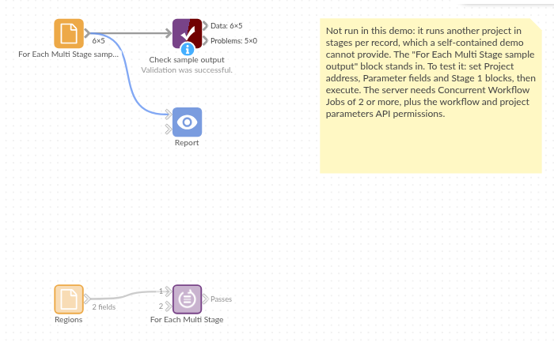

# For Each Multi Stage

*Omniscope custom block · Preparation*

**Refresh the sales once, then for each region: build its figures, and only when that run has finished, publish its PDF. One record per region, stages in a set order.**

**Python** · urllib3, pandas · urllib3 installed on first run if missing

## The problem it solves

A regional sales pack project reads the sales database, filters to one region, writes a summary, and turns the region's report tab into a PDF. The PDF block does not take the summary as an input, so in one run nothing makes it wait for the summary; and the sales should be refreshed once, not five times.

This block runs the database block once, then for each region sets the Region and Report title parameters and runs two stages: the filter and summary, then the PDF.

- **1** run before the loop: the sales database, refreshed from source
- **5** regions, each with **2** stages: Region filter and Summary, then Region PDF
- **11** workflow runs in all, each waited for before the next starts
- **1** output record per region with its result and, if it failed, the stage

### How it works

- Before the loop: run the listed blocks once (`w/execute`) and wait (`w/job/<id>/state`).
- For each record: set the parameters (`w/updateparams`), then run stage 1, 2 and 3 in turn, each waited for.
- Stage 1 with no blocks listed runs the whole workflow; stages 2 and 3 run only when they list blocks.

## What goes in

### Regions

5 invented sales regions, each with the title for its report.

| Region | Report title |
|---|---|
| North East | North East: weekly sales |
| North West | North West: weekly sales |
| Midlands | Midlands: weekly sales |
| South East | South East: weekly sales |
| South West | South West: weekly sales |

*5 rows in the sample file.*

## The options

| Option | Example setting | What it does |
|---|---|---|
| Project address | `http://127.0.0.1:24679/Sales/Regional pack.iox/` | The project to run. On the same server, the internal address. |
| Username, Password | (empty) | Only for a server that asks for sign-in. |
| Blocks before the loop | `Sales database` | Run once, before any parameter is set. |
| Refresh from source (before the loop) | on | Reload the sales from the database. |
| Parameter fields | `Region`, `Report title` | Fields named like the other project's parameters. |
| Stage 1 blocks | `Region filter, Summary` | First run of each pass. |
| Stage 2 blocks | `Region PDF` | Second run, once stage 1 has finished. |
| Stage 3 blocks | (empty) | No third stage. |
| Carry on after a failed pass | off | Off: stop at the first failure. |
| Wait for a busy project (minutes) | 10 | How long to wait if the project is already running. |

## What comes out

### Passes

| Pass | Region | Report title | Result | Failed at stage | Job IDs |
|---|---|---|---|---|---|
| 1 | North East | North East: weekly sales | COMPLETED | | JOB_2, JOB_3 |
| 2 | North West | North West: weekly sales | COMPLETED | | JOB_4, JOB_5 |
| 3 | Midlands | Midlands: weekly sales | COMPLETED | | JOB_6, JOB_7 |
| 4 | South East | South East: weekly sales | COMPLETED | | JOB_8, JOB_9 |
| 5 | South West | South West: weekly sales | COMPLETED | | JOB_10, JOB_11 |

5 records, as in `placeholder.csv` (a real server gives its own job IDs; JOB_1 was the run before the loop). With **Carry on after a failed pass**, a failed region shows FAILED and its stage, its later stages are skipped, and the other regions still run.

## Where it pays off

### Reporting: Build, then publish

Per region or client, compute the figures in one run and produce the PDF or email from them in the next, so the document never shows the previous record's numbers.

### Data loading: Stage, then merge

Per source, load into a staging table in stage 1 and merge it into the main table in stage 2, with a one-off clean-up before the loop.

### Models: Train, then score

Per product line, fit a model in one stage and score the new data with it in the next, after a shared refresh of the history.

*Use cases describe typical scenarios and are illustrative; the sample data is invented.*

## Why do this in Omniscope

- **Order without wiring.** The stages put an order on blocks that are not connected, such as an Output File and a Report to PDF, without restructuring the other project; it stays usable on its own.
- **One record of every pass.** The Passes output says which region failed and at which stage, and can go into a Validate data block that stops the schedule or emails someone when any pass failed.
- **Stages are a list.** They sit at the top of the block's Python; a fourth stage, or a different parameter per stage, is a small change.

## How it fits into an Omniscope workflow

Region list (File) → **For Each Multi Stage** → Validate data (Result is COMPLETED) → Report

The other project, Regional pack.iox: Sales database → Record filter (Region parameter) → Summary (Output File) and Report → Region PDF (Report to PDF, title from the Report title parameter)

## Try it

1. This block needs a second project on the same server, so the demo holds the block, configured with an example address, and a File block of `placeholder.csv`: the Passes output for the five regions.
2. To run it for real: make a project with parameters Region and Report title and blocks named as in the options; set the server's Concurrent Workflow Jobs to 2 or more; and give the user the two API permissions (see the README).
3. Put that project's address in **Project address** and run: the Passes output lists five COMPLETED passes, and the other project has written one summary and one PDF per region.
4. Rename the Region PDF block in the other project and run again: stage 2 of the first pass stops the block with the server's message that the block could not be found.

## Running in Omniscope

*The demo project's workflow: the placeholder data, the block, and a Validate data check on its output.*

<!--language-->
## Language and libraries

Python. It uses urllib3 (MIT licence) and pandas (BSD 3-Clause).

pandas is part of Omniscope's Python environment. urllib3 is listed in the block's dependencies, so Omniscope installs it with pip on first run if it is missing.
<!--/language-->

## Tested

The block is covered by automated tests that run its script against a stand-in for Omniscope's Python API and a stand-in for the Workflow REST API (no server is called): the order of the requests, each stage waiting for the one before, the stage before the loop, refresh flags per stage as true/false values, empty stage options, a failure in a stage (stop, or skip the rest of the pass), a failed stage before the loop, a cancelled stage, parameter values as valid JSON, server errors, a busy project, a run stuck in the queue, sign-in, empty input, option checks and 1,000 records.
