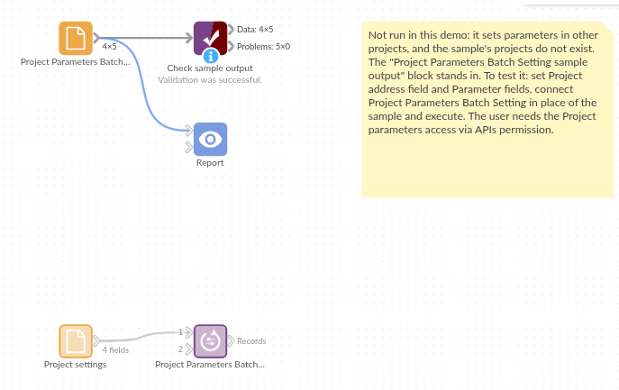

# Project Parameters Batch Setting

*Omniscope custom block · Preparation*

**Five branch projects built from one design, with their region, minimum order and currency kept in one table: change a cell, run, and every project has its new settings.**

**Python** · urllib3, pandas · urllib3 installed on first run if missing

## The problem it solves

A wholesaler has one report project per branch, copied from the same design, each with parameters for its region, minimum order and currency. When the minimum order changes, someone opens five projects and edits each one, and sooner or later one is missed.

This block reads the settings table, one record per project, and writes each record's values into its project.

- **5** branch projects, one record each
- **3** parameters per project: Region, Minimum order and Currency
- **5** requests, one per record, each set in full or refused in full
- **0** projects changed if any address in the table is malformed: every address is checked first

### How it works

- For each record: send its parameter fields to the project at its address (`w/updateparams`).
- A refused update stops the block with the server's reason and the record's number.
- The input records are passed on unchanged, for blocks that should run after the update.

## What goes in

### Project settings

5 invented branch projects on one server, with each branch's settings.

| Project | Region | Minimum order | Currency |
|---|---|---|---|
| http://127.0.0.1:24679/Branch reports/Leeds.iox/ | North | 250 | GBP |
| http://127.0.0.1:24679/Branch reports/York.iox/ | North | 250 | GBP |
| http://127.0.0.1:24679/Branch reports/Bristol.iox/ | South West | 150 | GBP |
| http://127.0.0.1:24679/Branch reports/Dublin.iox/ | Ireland | 200 | EUR |
| http://127.0.0.1:24679/Branch reports/Cork.iox/ | Ireland | 100 | EUR |

*5 rows in the sample file.*

## The options

| Option | Demo setting | What it does |
|---|---|---|
| Project address field | `Project` | The field holding each project's address. |
| Parameter fields | `Region`, `Minimum order`, `Currency` | Fields named like the projects' parameters. |
| Username, Password | (empty) | Only for a server that asks for sign-in. |

## What comes out

### Records

The 5 input records, unchanged, once all five projects have their new values. In the Bristol project, for example, Region is now South West, Minimum order 150 and Currency GBP.

## Where it pays off

### Branch and client reports: One settings table

Keep the settings of many copies of a report in one table, edited by the people who own them, and push them out on a schedule.

### Environments: Test and live

Point a set of projects at the test or the live database by setting their connection parameters from a table with one record per project.

### Periodic roll-over: New period, every project

At the start of a month, set the reporting period in every project that uses it, from one record per project.

*Use cases describe typical scenarios and are illustrative; the sample data is invented.*

## Why do this in Omniscope

- **Settings kept with the data.** The settings table can come from a spreadsheet, a database or a Formula in the same workflow, and the update runs on the scheduler with the rest of it, rather than someone editing projects by hand.
- **All or nothing per project.** Each project's values are set together or refused together, with the server's reason, and a malformed address stops the block before any project is touched.
- **Open to change.** The requests are ordinary Python, editable in the block; running each project after its update, or logging the old values first, is a few lines.

## How it fits into an Omniscope workflow

Settings table (File or Database) → Validate data (one record per project) → **Project Parameters Batch Setting** → (blocks to run once the settings are in place)

## Try it

1. This block needs other projects on the same server, so the demo holds the block, configured as above, and a File block of `placeholder.csv`: its output for the sample table, which is the table passed on unchanged.
2. To run it for real: make a project with Text parameters Region and Currency and a Number parameter Minimum order, copy it a few times, and give the user the *Project parameters access via APIs* permission.
3. List the copies' addresses in the table and run: open any copy's Parameters dialog to see its new values.
4. Delete the Currency parameter from one copy and run again: the block stops at that copy's record with the server's message that the parameter was not found; the copies before it keep their new values.

## Running in Omniscope

*The demo project's workflow: the placeholder data, the block, and a Validate data check on its output.*

<!--language-->
## Language and libraries

Python. It uses urllib3 (MIT licence) and pandas (BSD 3-Clause).

pandas is part of Omniscope's Python environment. urllib3 is listed in the block's dependencies, so Omniscope installs it with pip on first run if it is missing.
<!--/language-->

## Tested

The block is covered by automated tests that run its script against a stand-in for Omniscope's Python API and a stand-in for the Workflow REST API (no server is called): the request per record, parameter values of every type as valid JSON, the server's error messages and refused permission, a missing or malformed address (nothing sent), a pasted report address, sign-in, the address field left out of the parameters, empty input, option checks and 5,000 records across 50 projects.
