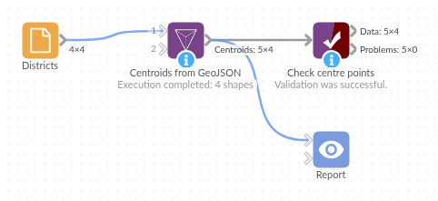

# Centroids from GeoJSON

*Omniscope custom block · Preparation*

**One point per region: a latitude and longitude for the centre of every shape in a boundary file, ready to pin, label or measure from.**

**Python** · geopandas, pandas · geopandas installed on first run

## The problem it solves

Boundaries (sales territories, council districts, delivery zones) describe each region as a shape, in a boundary file or as GeoJSON or WKT text in a table. A map can draw the shapes, but a lot of analysis wants one point per region: a pin with the region's total, a label, a distance from the region to a site, a join to other point data. Working out the centre of a shape by hand is not practical, and the obvious shortcut, the middle of its bounding box, can be far off for an irregular region.

The block reads the shapes, from records on its input or from a file, and outputs one record per shape with the shape's ID and a **Lat** and **Long** for its centre. For a C- or L-shaped region, where the true centroid falls outside the shape, it can give a point that is guaranteed to be inside instead.

- **4** districts in the sample data, one point each
- **1** of them (the L-shaped Brackenford) has its centroid outside its own boundary; **Point inside the shape** fixes that
- Shapefiles in British National Grid (metres) come out in latitude and longitude too

### How it works

- Connect records with a shape per record, as GeoJSON geometry or WKT text, and choose that field as the **Geometry field**; or choose a GeoJSON file, shapefile or GeoPackage on the server.
- Optionally choose the field (or file property) that names each shape; empty keeps all the others.
- Choose **Centroid** (the centre of the area) or **Point inside the shape**.
- Shapes in records are taken as longitude / latitude; a file in metres is converted to latitude and longitude after the point is found.

## What goes in

### Districts (sample-data/districts.csv)

Four invented districts with made-up names and shapes, each boundary as WKT text (shortened here).

| District code | District name | Households | Boundary |
|---|---|---|---|
| D01 | Ashcombe | 4200 | POLYGON ((-1.6 53.12, -1.4 53.12, ...)) |
| D02 | Brackenford | 2900 | POLYGON ((-1.4 53.12, -1.2 53.12, ...)) |
| D03 | Coldharbour Vale | 3600 | POLYGON ((-1.6 53, -1.35 53, ...)) |
| D04 | Dunmere | 1800 | MULTIPOLYGON (((-1.35 53, -1.2 53, ...)), ((-1.1 53.05, ...))) |

*Ashcombe and Brackenford interlock (Brackenford is L-shaped); Dunmere has a detached second part to the east.*

## The options

| Option | Demo setting | What it does |
|---|---|---|
| Geometry field | Boundary | The field holding each shape (GeoJSON or WKT). |
| ID field | (empty) | The field that names each shape; empty keeps every other field. |
| Shapes file, Shape ID property | (empty) | Not used: the shapes come from the input. |
| Point | Centroid | The centre of the area, or a point guaranteed to be inside the shape. |

## What comes out

### Centre points (Point = Centroid)

| District code | District name | Households | Lat | Long |
|---|---|---|---|---|
| D01 | Ashcombe | 4200 | 53.18636 | -1.44591 |
| D02 | Brackenford | 2900 | 53.16250 | -1.27375 |
| D03 | Coldharbour Vale | 3600 | 53.06000 | -1.47500 |
| D04 | Dunmere | 1800 | 53.06031 | -1.26281 |

### The same with Point = Point inside the shape

| District name | Lat | Long |
|---|---|---|
| Ashcombe | 53.20000 | -1.43000 |
| Brackenford | 53.20000 | -1.23000 |
| Coldharbour Vale | 53.06000 | -1.47500 |
| Dunmere | 53.06000 | -1.27500 |

Brackenford's centroid (53.1625, -1.27375) lies in the corner of the L, which belongs to Ashcombe: a pin there would mark the wrong district. The point inside the shape sits in Brackenford's eastern arm. For the rectangle (Coldharbour Vale) the two are the same.

## Where it pays off

### Sales and territories: Territory pins

Put one point per sales territory on a map, sized by revenue, rather than shading whole shapes.

### Public sector: Distances from areas

Measure from each district's centre to the nearest clinic, school or depot, with the distance blocks in the same workflow.

### Logistics: Zone labels

Label delivery zones on a map with their codes, using points that are guaranteed to sit inside each zone.

### Data preparation: Joining area data to point data

Give area-level figures (population, households) a location so they can be plotted beside customer or site points.

*Use cases describe typical scenarios and are illustrative; the sample data is invented.*

## Why do this in Omniscope

- **Boundaries to map in one workflow.** The centre points feed a Join with the area figures and the map in the Report directly, so the pins move with the data when a territory's figures change, without exporting coordinates from a desktop mapping tool.
- **The same points every run.** Updated boundaries in the source table or file give fresh centres on the next scheduled run; a shape that can't be read keeps its record, with an empty Lat and Long, and is counted in the block's message rather than dropped.
- **A choice the shortcut lacks.** "Point inside the shape" keeps a pin on its own region where a centroid would land on a neighbour; and as the script is in the block, a different rule (the largest part of a split region, say) is a few lines to change.

## How it fits into an Omniscope workflow

Boundaries (Database or File) → **Centroids from GeoJSON** → Join (on the district code, with area figures) → Report (map view)

Connect a table with one shape per record (GeoJSON or WKT text), or leave the input empty and choose a file in the options. Join the output to a table of figures per region on the ID, then plot Lat and Long in a map view, or feed them to a distance block.

## Try it

1. Open the demo project (`demo.iox` on the demo server, or import `demo.ioz` from this folder): a File block loads `districts.csv`, four invented districts with their boundaries as WKT.
2. The question: where should each district's pin go?
3. Open the block: Geometry field is Boundary, ID field is empty, Point is Centroid. Run it.
4. Look at the output: four records with the code, name and households plus Lat and Long (the Boundary field is left out). Brackenford's point (53.1625, -1.27375) is in Ashcombe's corner.
5. Change Point to **Point inside the shape** and run again: Brackenford's point moves to 53.2, -1.23, inside its own boundary.

## Running in Omniscope

*The demo project's workflow: the sample data, the block, and a Validate data check on its output.*

<!--language-->
## Language and libraries

Python. It uses geopandas (BSD 3-Clause), with Shapely (BSD 3-Clause) for reading GeoJSON and WKT text and for the centre points, pyproj (MIT) for converting coordinates and pyogrio (MIT) for reading the file formats; and pandas (BSD 3-Clause).

pandas is part of Omniscope's Python environment. geopandas is listed in the block's dependencies, so Omniscope installs it (and the packages it needs) with pip on first run if it is missing; the server needs access to the Python package index for that, or geopandas installed beforehand.
<!--/language-->

## Tested

The block is covered by automated tests that run its script against a stand-in for Omniscope's Python API: the sample shapes as WKT records (the same points as from the file), GeoJSON text, mixed and unreadable shapes, the input's ID field, the input taking precedence over the file, the sample file with and without an ID property, points inside the shapes, a shapefile in British National Grid, a zipped shapefile, an unknown property, a missing or unreadable file, a shape with no geometry, existing Lat and Long properties, an empty file, and 20,000 shapes.
