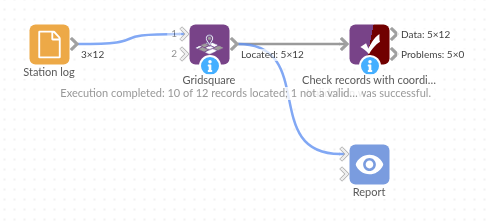

# Gridsquare

*Omniscope custom block · Preparation*

**Grid square locators such as IO91wm, turned into a longitude and latitude you can map, at whatever precision the locator gives.**

**Python** · pandas · nothing extra to install

## The problem it solves

Radio logs, contest entries and some field records give a location as a Maidenhead locator: `IO91wm` rather than a latitude and longitude. A map view needs coordinates, and the conversion, though simple arithmetic, is fiddly to write as a formula: letters and digits alternate, each pair has its own base and square size, and logs mix 4-, 6- and 8-character locators.

The block converts each locator to the centre of the square it names, at the precision the locator gives, and leaves records with a missing or invalid locator in place with empty coordinates, so nothing silently lands in the wrong place.

- **10** of the 12 sample stations located, from 4- to 10-character locators
- **1** invalid locator (`IO92ZZ`: subsquare letters stop at X) and **1** empty one kept, with empty coordinates
- Lower-case locators read the same as upper case

### How it works

- Choose the field with the locators.
- Name the two fields to add (Longitude and Latitude by default).
- Each pair of characters narrows the square: field (20 x 10 degrees), square (2 x 1), subsquare (5 x 2.5 minutes), extended square (30 x 15 seconds), and a fifth pair (1.25 x 0.625 seconds).
- The output point is the centre of the smallest square the locator names.

## What goes in

### Station log

12 invented stations with their locator and number of contacts.

| Station | Locator | Contacts |
|---|---|---|
| Hilltop relay | IO91 | 14 |
| Harbour club | IO91wm | 9 |
| Coastal lookout | IO80fr52 | 5 |
| Ridge camp | IO93fb34xk | 8 |
| Canal workshop | IO92ZZ | 7 |
| Market square | | 1 |

*12 rows in the sample file; the six above show each case.*

## The options

| Option | Demo setting | What it does |
|---|---|---|
| Grid square field | Locator | The field with the locators. |
| Longitude field | Longitude | Name of the longitude field to add. |
| Latitude field | Latitude | Name of the latitude field to add. |

## What comes out

### Records with coordinates

| Station | Locator | Contacts | Longitude | Latitude |
|---|---|---|---|---|
| Hilltop relay | IO91 | 14 | -1.00000 | 51.50000 |
| Harbour club | IO91wm | 9 | -0.12500 | 51.52083 |
| Moorland portable | IO83qn | 22 | -2.62500 | 53.56250 |
| Island beacon | IO70jc | 3 | -5.20833 | 50.10417 |
| Valley school | io92jl | 6 | -1.20833 | 52.47917 |
| Fen weather post | JO02bf | 11 | 0.12500 | 52.22917 |
| Coastal lookout | IO80fr52 | 5 | -3.53750 | 50.71875 |
| Ridge camp | IO93fb34xk | 8 | -1.55017 | 53.06016 |
| Ferry station | IN69 | 2 | -7.00000 | 49.50000 |
| Northern outpost | IP90jd | 4 | -1.20833 | 60.14583 |
| Canal workshop | IO92ZZ | 7 | | |
| Market square | | 1 | | |

The block's message: "10 of 12 records located; 1 not a valid locator (empty Longitude and Latitude)". Hilltop relay's 4-character locator puts it at the centre of a square about 139 by 111 km; Ridge camp's 10-character one is within a square about 24 by 19 m.

## Where it pays off

### Amateur radio: Contact maps

Map the stations in a contest or activity log, sized by number of contacts, from the locators in the log.

### Field work: Survey records

Place field observations or equipment readings logged with a grid square on a map, and keep track of which ones need a better location.

### Data quality: Checking logged locations

Filter on an empty Longitude to list the records whose locator is missing or mistyped.

*Use cases describe typical scenarios and are illustrative; the sample data is invented.*

## Why do this in Omniscope

- **Log to map in one place.** The coordinates go straight into a map view in the Report and into the distance blocks, and a new log loaded into the same File block is located on the next run, with no conversion step outside the workflow.
- **Invalid locators stay visible.** Records with a mistyped locator are kept with empty coordinates and counted in the block's message, so the run can fail at a Validate data check when too many cannot be located.
- **Precision you can change.** The script is in the block: to place every station at the corner of its square instead of the centre, or to add the square's size as a field, it is a line or two in the block's editor.

## How it fits into an Omniscope workflow

Log (File or Database) → **Gridsquare** → Report (map view)

Feed one record per station, contact or observation with its locator. Add a Record Filter on an empty Longitude to list the records that could not be located.

## Try it

1. Open the demo project (`demo.iox` on the demo server, or import `demo.ioz` from this folder): 12 invented stations with their locators.
2. The question: where are these stations?
3. Open Gridsquare: Grid square field is Locator; the two field names are left as Longitude and Latitude. Run it.
4. Look at the output: ten stations have coordinates; Canal workshop (`IO92ZZ`) and Market square (no locator) have none, and the block's message counts them.
5. Compare Hilltop relay (`IO91`, a 2 x 1 degree square) with Harbour club (`IO91wm`, a subsquare inside it): both are in the same 4-character square, the second placed far more precisely.

## Running in Omniscope

*The demo project's workflow: the sample data, the block, and a Validate data check on its output.*

<!--language-->
## Language and libraries

Python. It uses pandas (BSD 3-Clause), part of Omniscope's Python environment. Nothing else to install.
<!--/language-->

## Tested

The block is covered by automated tests that run its script against a stand-in for Omniscope's Python API: the sample data, every locator length (checked against an independent implementation), the eight-character example, the corners of the grid, case and spaces, invalid and missing locators, existing fields with the new names, custom field names, bad options, no input, a numeric field, empty input, and 210,000 records.
