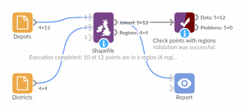

# Shapefile

*Omniscope custom block · Preparation*

**Which territory, district or zone is each point in? Points matched to regions given as GeoJSON or WKT records, or in a shapefile or GeoJSON file, including files in British National Grid.**

**Python** · geopandas, pandas · geopandas installed on first run

## The problem it solves

A list of customers, depots or incidents with latitude and longitude says where each one is, but not which sales territory, council district or delivery zone it belongs to, and that is usually what the report is grouped by. The regions exist as shapes: a table of boundaries as GeoJSON or WKT text, or a boundary file (often a shapefile from a GIS team or a public data portal, and often in metres rather than degrees).

The block reads the regions, from records on its second input or from a file, finds the region each point falls in, and adds the region's label to the point's record. With a file, run it once with just the file to see what properties the regions have; then choose the one to use as the label.

- **10** of the 12 sample depots placed in a district, including one on Dunmere's detached eastern part
- **1** depot outside every district and **1** with no coordinates kept, with an empty region
- The same districts as WKT records, a GeoJSON file or a British National Grid shapefile give the same answer

### How it works

- Connect the points to the first input and choose their latitude and longitude fields.
- Connect the regions to the second input and choose the **Region geometry field** (GeoJSON or WKT, in longitude / latitude) and the **Region label field**; or choose a regions file and its **Label property**.
- Each point is converted to a file's coordinates if needed and tested against the regions with a spatial index.
- The **regions** field gets the label of the region the point is in; several labels, comma-separated, where regions overlap.

## What goes in

### Depots (input 1)

12 invented depots with their location and number of vans.

| Depot | Latitude | Longitude | Vans |
|---|---|---|---|
| North yard | 53.21 | -1.52 | 6 |
| Mill lane | 53.18 | -1.31 | 4 |
| Station road | 53.14 | -1.25 | 3 |
| Island store | 53.065 | -1.08 | 1 |
| Far point | 53.30 | -1.40 | 2 |
| Unknown site | | | 1 |

*12 rows in the sample file.*

### Districts (input 2)

Four invented districts with made-up names and shapes, each boundary as WKT text (shortened here). Dunmere has a detached second part to the east.

| District code | District name | Households | Boundary |
|---|---|---|---|
| D01 | Ashcombe | 4200 | POLYGON ((-1.6 53.12, -1.4 53.12, ...)) |
| D02 | Brackenford | 2900 | POLYGON ((-1.4 53.12, -1.2 53.12, ...)) |
| D03 | Coldharbour Vale | 3600 | POLYGON ((-1.6 53, -1.35 53, ...)) |
| D04 | Dunmere | 1800 | MULTIPOLYGON (((-1.35 53, -1.2 53, ...)), ((-1.1 53.05, ...))) |

## The options

| Option | Demo setting | What it does |
|---|---|---|
| Latitude | Latitude | The first input's field with each point's latitude. |
| Longitude | Longitude | The first input's field with each point's longitude. |
| Region geometry field | Boundary | The second input's field with each region's shape. |
| Region label field | District name | The field to put in the regions field. |
| Shapefile, Label property | (empty) | Not used: the regions come from the second input. |

## What comes out

### Joined: points with regions

| Depot | Latitude | Longitude | Vans | regions |
|---|---|---|---|---|
| North yard | 53.21 | -1.52 | 6 | Ashcombe |
| Mill lane | 53.18 | -1.31 | 4 | Ashcombe |
| Station road | 53.14 | -1.25 | 3 | Brackenford |
| Old forge | 53.22 | -1.23 | 2 | Brackenford |
| Quarry gate | 53.05 | -1.55 | 5 | Coldharbour Vale |
| Bridge end | 53.09 | -1.42 | 7 | Coldharbour Vale |
| Low common | 53.03 | -1.28 | 3 | Dunmere |
| Marsh farm | 53.10 | -1.21 | 2 | Dunmere |
| Island store | 53.065 | -1.08 | 1 | Dunmere |
| Far point | 53.30 | -1.40 | 2 | |
| Canal wharf | 53.15 | -1.33 | 4 | Brackenford |
| Unknown site | | | 1 | |

The block's message: "10 of 12 points are in a region (4 regions)." Mill lane sits in the corner of Brackenford's L shape, which belongs to Ashcombe: a bounding-box or nearest-centre rule would put it in Brackenford. Island store, on Dunmere's detached part, is placed in Dunmere.

### Regions

| District code | District name | Households | geometry |
|---|---|---|---|
| D01 | Ashcombe | 4200 | POLYGON ((-1.6 53.12, -1.4 53.12, ... )) |
| D02 | Brackenford | 2900 | POLYGON ((-1.4 53.12, -1.2 53.12, ... )) |
| D03 | Coldharbour Vale | 3600 | POLYGON ((-1.6 53, -1.35 53, ... )) |
| D04 | Dunmere | 1800 | MULTIPOLYGON (((-1.35 53, -1.2 53, ... ))) |

## Where it pays off

### Sales: Territory reporting

Tag every customer or order with its sales territory from the territory shapefile, then aggregate revenue per territory.

### Public sector: Incidents by district

Assign incidents, requests or inspections to council districts or wards, from the boundary files the council already holds in British National Grid.

### Logistics: Delivery zones

Give each delivery address its zone, and list the addresses that fall outside every zone.

### Property and insurance: Risk areas

Flag properties that fall in a flood zone or other risk area; overlapping areas are all listed.

*Use cases describe typical scenarios and are illustrative; the sample data is invented.*

## Why do this in Omniscope

- **From boundaries to grouped report.** The regions field is just another field: the next Aggregate block totals vans or revenue per district, and the Report's filters slice by it, all in the workflow that loads the points.
- **Re-tagged on every run.** New customers or redrawn territories (in the table or file) are matched again on the next scheduled run, and a rise in the number of points in no region can be flagged with Validate data.
- **Files or tables.** Shapefiles in British National Grid (or any other projected system with a `.prj`) work without converting them first, and boundaries kept as GeoJSON or WKT in a database table work as data, with no file on the server.

## How it fits into an Omniscope workflow

Points (File or Database) + Regions (Database or File) → **Shapefile** → Aggregate (per region) → Report

Connect the points to the first input and the regions (one record per region, shape as GeoJSON or WKT) to the second; or leave the second input empty, choose a regions file and run once to see the Regions output before setting the label. Use a Record Filter on an empty regions field to find points outside every region.

## Try it

1. Open the demo project (`demo.iox` on the demo server, or import `demo.ioz` from this folder): 12 invented depots and four invented districts with their boundaries as WKT.
2. The question: which district is each depot in?
3. Open the block: Latitude and Longitude are chosen; Region geometry field is Boundary and Region label field is District name. Run it.
4. Look at the Joined output: ten depots have a district; Far point is outside all four, Unknown site has no coordinates.
5. Change the Region label field to District code and run again: the regions field now holds the codes.

## Running in Omniscope

*The demo project's workflow: the sample data, the block, and a Validate data check on its output.*

<!--language-->
## Language and libraries

Python. It uses geopandas (BSD 3-Clause) to read the file and match the points, with Shapely (BSD 3-Clause) for the geometry tests, pyproj (MIT) for converting coordinates and pyogrio (MIT) for reading the file formats; and pandas (BSD 3-Clause).

pandas is part of Omniscope's Python environment. geopandas is listed in the block's dependencies, so Omniscope installs it (and the packages it needs) with pip on first run if it is missing; the server needs access to the Python package index for that, or geopandas installed beforehand.
<!--/language-->

## Tested

The block is covered by automated tests that run its script against a stand-in for Omniscope's Python API: the sample data with the districts as WKT records (the same answer as from the file), GeoJSON text, numeric labels and unreadable shapes, the second input taking precedence over the file, the sample with the districts file, the Regions output on its own, empty options, the districts as a British National Grid shapefile and as a zipped shapefile, numeric labels and overlapping regions, record order and types, an unknown label property, text coordinates, a missing field or input, a missing or unreadable file, empty input, and 100,000 points against 2,500 regions.
