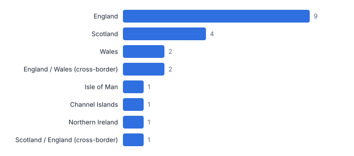
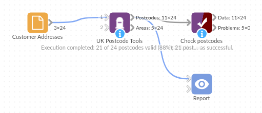

# UK Postcode Tools

*Omniscope custom block · Preparation*

**Valid, consistently formatted UK postcodes with area, district, sector, area name and country, even when they are buried in a free-text address. Offline, nothing to subscribe to.**

**Python** · pandas · nothing extra to install

## The problem it solves

Postcodes are the key to UK geography: territories, delivery zones, catchments, demographics and maps all hang off them. But CRM and order data hold them in every format (`ls15hd`, `M3  2EG`, `YO1 OAB` with a letter O), sometimes only inside the address line, and some are simply invalid.

UK Postcode Tools validates every value against the official format and the list of postcode areas, standardises it, explains what is wrong when it fails, and splits it into the parts analysts join and aggregate on.

- **21 of 24** postcodes valid after clean-up
- **1** letter-O-for-zero slip fixed automatically
- **8** countries and territories identified
- **0** lookup services or keys needed

### How it works

- Pick the postcode field, or an address field and tick *Find the postcode inside the text*.
- Each value is upper-cased, spaced correctly and checked against the UK format rules and the 120-plus postcode areas.
- Valid postcodes get area, district (outward code), sector, area name and country; invalid ones get the reason.
- The summary output counts records per country and area, and per problem: a ready-made data-quality report.

## What goes in

### Customer addresses

24 synthetic customers, postcodes typed in mixed formats; one missing, three invalid.

| Customer ID | Address | Postcode |
|---|---|---|
| C001 | 12 Larch Row, Leeds LS1 5HD | ls15hd |
| C002 | Flat 3, 48 Bramble Street, Manchester, M3 2EG | M3  2EG |
| C003 | 7 Thistle Court Edinburgh EH2 2PR | EH2 2PR |
| C004 | Unit 4 Heron Business Park, Cardiff CF10 5AF | CF105AF |
| C005 | 27 Willow Street, Bristol | BS1 4D |
| C006 | 5 Linen Yard Belfast BT1 5AB | bt1 5ab |
| C007 | The Old Croft, Lerwick, Shetland ZE1 0AA | ZE1 0AA |
| C008 | 14 Ashgrove Lane Glasgow G1 3DX | G1 3DX |
| C009 | La Petite Rue, St Peter Port GY1 1AA | GY1 1AA |
| C010 | 99 Marigold Street London W3 7TN | W3 7TN |

*24 rows in the sample file.*

## The options

| Option | Demo setting | What it does |
|---|---|---|
| Postcode or address field | `Postcode` |  |
| Find the postcode inside the text | `Off` | Tick when the field is a full address rather than just a postcode. |
| Prefix for new fields | `Postcode` | New fields are '<prefix> Valid', '<prefix> Area' and so on. |

## What comes out

### Postcodes

| Customer ID | Postcode | Postcode Formatted | Postcode Valid | Postcode Problem | Postcode District | Postcode Sector | Postcode Area Name | Postcode Country |
|---|---|---|---|---|---|---|---|---|
| C001 | ls15hd | LS1 5HD | Yes |  | LS1 | LS1 5 | Leeds | England |
| C002 | M3  2EG | M3 2EG | Yes |  | M3 | M3 2 | Manchester | England |
| C003 | EH2 2PR | EH2 2PR | Yes |  | EH2 | EH2 2 | Edinburgh | Scotland |
| C004 | CF105AF | CF10 5AF | Yes |  | CF10 | CF10 5 | Cardiff | Wales |
| C005 | BS1 4D |  | No | Inward code (last three characters) not valid |  |  |  |  |
| C006 | bt1 5ab | BT1 5AB | Yes |  | BT1 | BT1 5 | Belfast | Northern Ireland |
| C007 | ZE1 0AA | ZE1 0AA | Yes |  | ZE1 | ZE1 0 | Lerwick (Shetland) | Scotland |
| C008 | G1 3DX | G1 3DX | Yes |  | G1 | G1 3 | Glasgow | Scotland |
| C009 | GY1 1AA | GY1 1AA | Yes |  | GY1 | GY1 1 | Guernsey | Channel Islands |
| C010 | W3 7TN | W3 7TN | Yes |  | W3 | W3 7 | London W | England |
| C011 | NW5 2RX | NW5 2RX | Yes |  | NW5 | NW5 2 | London NW | England |
| C012 | PL1 2LR | PL1 2LR | Yes |  | PL1 | PL1 2 | Plymouth | England |
| C013 | CH12HU | CH1 2HU | Yes |  | CH1 | CH1 2 | Chester | England / Wales (cross-border) |
| C014 |  |  | No | Missing |  |  |  |  |
| C015 | NR1 1EF | NR1 1EF | Yes |  | NR1 | NR1 1 | Norwich | England |
| C016 | SW9 8LP | SW9 8LP | Yes |  | SW9 | SW9 8 | London SW | England |
| C017 | TD1 1BX | TD1 1BX | Yes |  | TD1 | TD1 1 | Galashiels | Scotland / England (cross-border) |
| C018 | SA1 5LB | SA1 5LB | Yes |  | SA1 | SA1 5 | Swansea | Wales |
| C019 | YO1 OAB | YO1 0AB | Yes |  | YO1 | YO1 0 | York | England |
| C020 | QQ1 1AA |  | No | Letters or digits not allowed in this position |  |  |  |  |
| C021 | IM1 1AA | IM1 1AA | Yes |  | IM1 | IM1 1 | Isle of Man | Isle of Man |
| C022 | SY3 8LA | SY3 8LA | Yes |  | SY3 | SY3 8 | Shrewsbury | England / Wales (cross-border) |
| C023 | AB101AB | AB10 1AB | Yes |  | AB10 | AB10 1 | Aberdeen | Scotland |
| C024 | S1 2HE | S1 2HE | Yes |  | S1 | S1 2 | Sheffield | England |

### Area summary

| Postcode Country | Postcode Area | Postcode Area Name | Records | Share |
|---|---|---|---|---|
| Channel Islands | GY | Guernsey | 1 | 0.042 |
| England | LS | Leeds | 1 | 0.042 |
| England | M | Manchester | 1 | 0.042 |
| England | NR | Norwich | 1 | 0.042 |
| England | NW | London NW | 1 | 0.042 |
| England | PL | Plymouth | 1 | 0.042 |
| England | S | Sheffield | 1 | 0.042 |
| England | SW | London SW | 1 | 0.042 |
| England | W | London W | 1 | 0.042 |
| England | YO | York | 1 | 0.042 |
| England / Wales (cross-border) | CH | Chester | 1 | 0.042 |
| England / Wales (cross-border) | SY | Shrewsbury | 1 | 0.042 |

### Extracting from the address text instead

| Address | Postcode Formatted | Postcode Valid | Postcode Area Name |
|---|---|---|---|
| 12 Larch Row, Leeds LS1 5HD | LS1 5HD | Yes | Leeds |
| Flat 3, 48 Bramble Street, Manchester, M3 2EG | M3 2EG | Yes | Manchester |
| 7 Thistle Court Edinburgh EH2 2PR | EH2 2PR | Yes | Edinburgh |
| Unit 4 Heron Business Park, Cardiff CF10 5AF | CF10 5AF | Yes | Cardiff |
| 27 Willow Street, Bristol |  | No |  |
| 5 Linen Yard Belfast BT1 5AB | BT1 5AB | Yes | Belfast |

*Valid postcodes by country (synthetic data).*

## Where it pays off

### Retail and e-commerce: Delivery and catchment analysis

Standardise customer postcodes, then aggregate by district or sector for catchment maps, delivery zones and local marketing.

### Insurance: Rating by postcode sector

Clean and split postcodes to sector level to join risk factors and rating tables reliably.

### Public sector and charities: Service reach by nation and area

Report users by country and postcode area, and catch invalid postcodes at the point of entry.

### Data quality and CRM: Address hygiene

A repeatable postcode check in every data load, with the problem per record for the data steward.

*Use cases describe typical scenarios and are illustrative; the sample data is synthetic.*

## Why do this in Omniscope

- **Postcodes ready for the territory join.** The standardised postcode, district and sector feed a join to a territory table or the ONS Postcode Directory in the next block, and invalid records go to a review table on every load.
- **No lookup service in the loop.** Validation uses the official format rules and the postcode area list held in the block, so each run gives the same answer without a subscription or network call, and the summary counts problems per load.
- **The area list is in the script.** The 120-plus postcode areas and the format patterns are at the top of the Python script; checking that an address really exists still needs a lookup file, which can be joined in the workflow.

## How it fits into an Omniscope workflow

CRM / orders → Data Cleansing → **UK Postcode Tools** → Join (postcode lookup or territories) → Report

Run after Data Cleansing and before joins on postcode, such as to a territory table, to the ONS Postcode Directory for coordinates, or to demographic data.

Route invalid records (Postcode Valid = No) to a review table or back to the source system.

The standardised postcodes feed the territory or ONS joins directly in the workflow, so the cleaned values and the report filters stay consistent from the CRM load to the final view.

## In one step

Offline format and area validation, standardisation and splitting in one block; a full address-existence check still needs a lookup file or service.

## Try it

1. Open the demo project (`demo.iox` on the demo server, or import `demo.ioz` from this folder): customer addresses with postcodes typed every possible way.
2. The question: can we join these to our territory or demographic tables as they are? Not reliably.
3. Open UK Postcode Tools: choose the Postcode field. Run it.
4. Look at the output: 21 of 24 valid and standardised, the letter-O slip fixed, invalid ones with a reason, plus district, sector, area name and country.
5. Switch to the Address field with extraction ticked: the postcode is found inside the free text.

## Running in Omniscope

*The demo project's workflow: the sample data, the block, and a Validate data check on its output.*

<!--language-->
## Language and libraries

Python. It uses pandas, plus the Python standard library (re).

pandas and numpy are part of Omniscope's Docker Python image, and the block was run in both host mode and Docker mode on an Omniscope server, with the same results. It needs nothing else installed.
<!--/language-->

## Tested

Run on a real Omniscope server:

- The demo workflow ran without errors (postcodes: 24 records, areaSummary: 24 records).

The block is also covered by automated tests (normal data, empty input, wrong types, large input).
