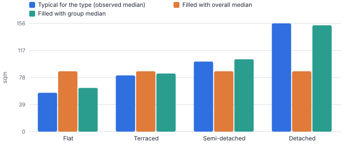
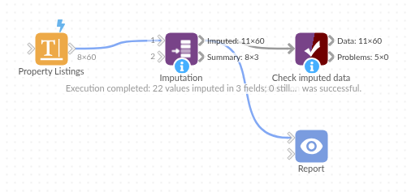

# Imputation

*Omniscope custom block · Preparation*

**Fill the gaps without distorting the data: medians, means, modes, constants, previous / next values or interpolation, worked out within the right groups, with every filled value flagged.**

**Python** · pandas, numpy · nothing extra to install

## The problem it solves

Missing values break totals, averages, charts and especially models, most of which drop any row with a gap. Filling every gap with one overall average is quick but wrong: a missing flat gets the floor area of a typical house.

Imputation fills each field with the right statistic for its group (for example the median floor area for that property type in that region), falls back sensibly when a group has no data, recognises sentinel values such as -999, and adds an indicator field for every filled value so nothing is hidden.

- **22** values filled across 3 fields
- **13** floor areas, including 3 coded as -999
- **0** values still missing
- **16** property-type and region groups used

### How it works

- Choose the fields (or leave empty for all), and a method for number fields and for text fields.
- Optionally choose *Within groups*: the statistic is computed per group, falling back to the overall value for empty groups.
- For time series, choose *Order by* and use previous value, next value or linear interpolation per group.
- List sentinel values such as `-999` to treat them as missing.
- Every imputed field gets a *Was Imputed* indicator (1 or 0); the summary output shows method, counts and the value used.

## What goes in

### Property listings with gaps

60 synthetic listings: 5 missing bedroom counts, 10 missing floor areas plus 3 entered as -999, and 4 missing agents.

| Listing ID | Region | Property Type | Bedrooms | Floor Area (sqm) | Asking Price | Agent | Listed On |
|---|---|---|---|---|---|---|---|
| L1000 | North West | Flat | 3 | 55 | 189000 | Harper & Co | 2025-06-01 |
| L1001 | North West | Terraced | 3 | 80 | 221000 | Northside Homes | 2025-06-03 |
| L1002 | North West | Semi-detached | 3 | 98 | 270000 |  | 2025-06-05 |
| L1003 | North West | Detached | 3 |  | 339000 | Coast Estates | 2025-06-07 |
| L1004 | London | Flat | 1 | 65 | 426000 | Harper & Co | 2025-06-09 |
| L1005 | London | Terraced | 3 | -999 | 521000 | Northside Homes | 2025-06-11 |
| L1006 | London | Semi-detached | 2 | 111 | 633000 | Brick Lane Lettings | 2025-06-13 |
| L1007 | London | Detached | 5 |  | 1056000 | Coast Estates | 2025-06-15 |
| L1008 | South West | Flat | 1 | 49 | 240000 | Harper & Co | 2025-06-17 |
| L1009 | South West | Terraced |  | 78 | 253000 | Northside Homes | 2025-06-19 |

*60 rows in the sample file.*

## The options

| Option | Demo setting | What it does |
|---|---|---|
| Fields to impute | `Bedrooms, Floor Area (sqm), Agent` | Leave empty to impute every field (except group and order fields). |
| Number fields | `Median` | Median is robust to outliers and is the usual default. |
| Text fields | `Most common value` | How missing text is filled. |
| Within groups (optional) | `Property Type, Region` | Compute mean / median / mode, and fill previous / next, separately for each combination of these fields. |
| Also treat as missing | `-999` | Comma-separated sentinel values, such as -999, 9999, unknown. |
| Add 'Was Imputed' indicator fields | `On` | Adds a Yes / No field per imputed field, so filled values stay visible. |
| Fall back to the overall value | `On` | When a group has no values at all (or interpolation has no neighbour on one side), use the overall statistic or the nearest value. |

## What comes out

### Imputed data (rows that had a gap)

| Listing ID | Region | Property Type | Bedrooms | Floor Area (sqm) | Agent | Bedrooms Was Imputed | Floor Area (sqm) Was Imputed | Agent Was Imputed |
|---|---|---|---|---|---|---|---|---|
| L1002 | North West | Semi-detached | 3 | 98 | Brick Lane Lettings | 0 | 0 | 1 |
| L1003 | North West | Detached | 3 | 165 | Coast Estates | 0 | 1 | 0 |
| L1005 | London | Terraced | 3 | 89 | Northside Homes | 0 | 1 | 0 |
| L1007 | London | Detached | 5 | 143 | Coast Estates | 0 | 1 | 0 |
| L1009 | South West | Terraced | 4 | 78 | Northside Homes | 1 | 0 | 0 |
| L1012 | Yorkshire | Flat | 3 | 63 | Harper & Co | 0 | 1 | 0 |
| L1015 | Yorkshire | Detached | 3 | 156 | Coast Estates | 1 | 0 | 0 |
| L1018 | North West | Semi-detached | 4 | 98 | Brick Lane Lettings | 0 | 1 | 0 |
| L1019 | North West | Detached | 4 | 170 | Coast Estates | 0 | 0 | 1 |
| L1022 | London | Semi-detached | 2 | 112 | Brick Lane Lettings | 0 | 1 | 0 |
| L1026 | South West | Semi-detached | 2 | 95 | Brick Lane Lettings | 0 | 1 | 0 |
| L1029 | Yorkshire | Terraced | 2 | 88 | Northside Homes | 0 | 1 | 0 |

### Imputation summary

| Field | Type | Method | Missing Before | Imputed | Still Missing | Value Used | Within Groups |
|---|---|---|---|---|---|---|---|
| Bedrooms | Number | Median | 5 | 5 | 0 |  | Property Type, Region |
| Floor Area (sqm) | Number | Median | 13 | 13 | 0 |  | Property Type, Region |
| Agent | Text | Mode | 4 | 4 | 0 |  | Property Type, Region |

*One overall median gives every missing listing the same floor area; group medians keep flats small and detached houses large (synthetic data).*

## Where it pays off

### Property and insurance: Complete risk and valuation inputs

Fill missing floor areas, build years or bedroom counts per property type and area before pricing or valuation models, with flags so underwriters can see what was estimated.

### Manufacturing and utilities: Sensor and meter gaps

Interpolate short gaps in meter or sensor readings in time order per device, and carry the last reading forward where interpolation is not possible.

### Healthcare and research: Survey and trial data

Impute missing measurements by cohort or site, keeping indicator fields so analysts can run sensitivity checks with and without imputed values.

### Retail: Product attributes

Fill missing weights, sizes or categories from the most common value in each product family before range analysis or shipping-cost estimates.

*Use cases describe typical scenarios and are illustrative.*

## Why do this in Omniscope

- **Models and reports from one filled table.** Prediction, Regression or Clustering downstream get complete data, and the Was Imputed fields stay in it, so a Report filter compares results with and without the estimated values.
- **Each filled value accounted for.** The summary output records the method, count and value used per field; -999 codes are treated as missing and integer fields stay whole numbers, both checked by the tests.
- **Group statistics without extra steps.** Medians within property type and region, with fallback to the overall value, are one option rather than a summarise-and-join; a method your field needs can be added in the block's script.

## How it fits into an Omniscope workflow

Listings (File / Database) → Data Cleansing → **Imputation** → Prediction → Report

Put Imputation after cleansing and before analytics blocks such as Prediction, Regression or Clustering, which work best with complete data.

Keep the indicator fields in the data: filter on them in a Report to compare results with and without imputed values.

Values are imputed from the current data between cleansing and the models, and the indicator fields let a Report filter compare results with and without imputed values.

## In one step

Group-wise imputation is a single option, with no separate summarise-and-join steps.

## Try it

1. Open the demo project (`demo.iox` on the demo server, or import `demo.ioz` from this folder): 60 property listings with gaps in floor area, bedrooms and agent, and some floor areas entered as -999.
2. The question: what happens to an average price per square metre if we just drop these rows, or fill them all with one average?
3. Open the Imputation block: median for numbers, most common value for text, within Property Type and Region, with -999 treated as missing.
4. Run it and filter the output on *Floor Area Was Imputed = 1*: flats got flat-sized values, detached houses house-sized values.
5. Look at the chart comparing overall-median filling with group filling, then the summary output: 22 values filled, none left missing.

## Running in Omniscope

*The demo project's workflow: the sample data, the block, and a Validate data check on its output.*

<!--language-->
## Language and libraries

Python. It uses pandas and numpy, plus the Python standard library (re).

pandas and numpy are part of Omniscope's Docker Python image, and the block was run in both host mode and Docker mode on an Omniscope server, with the same results. It needs nothing else installed.
<!--/language-->

## Tested

The demo workflow runs without errors on an Omniscope server and produces 60 records in Imputed data and 3 in Imputation summary. Its automated tests cover normal data, empty input, wrong types and large input.
