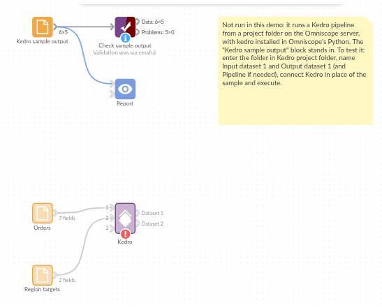

# Kedro

*Omniscope custom block · Preparation · Interfaces*

**A data pipeline already written in Kedro? Feed it from the workflow and bring its results back, without rewriting a step.**

**Python** · Kedro, pandas · installs `kedro>=0.19` on first run

## The problem it solves

A data science team keeps its preparation and modelling in a Kedro project: a catalog of datasets and a pipeline of Python functions, tested and versioned. The analysts' data, and the reports people read, are in Omniscope. Without a bridge, someone exports the data to the project's folder, runs `kedro run`, and imports the result by hand each time.

This block saves the workflow's data into the project's input datasets, runs the pipeline, and outputs the datasets it produces.

- **40** orders and **5** regional targets in, as two catalog datasets
- **1** pipeline run: cancelled orders removed, the rest totalled per region
- **5** regions out, each with its orders, units, sales and whether the target was met

### How it works

- Name, for each connected input, the catalog dataset it replaces (`orders`, `targets`). The input is saved to it before the run.
- The default pipeline runs, or the one you name; an environment such as `prod` picks Kedro's configuration.
- Name the datasets to bring back: a free output of the pipeline, a catalog dataset, or `data/08_reporting/<name>.csv`.

## What goes in

### Orders

40 invented orders from a stationery wholesaler.

| Order | Order Date | Region | Product | Quantity | Unit Price | Status |
|---|---|---|---|---|---|---|
| ORD-3101 | 2025-04-19 | South West | Whiteboard markers (8) | 22 | 11.90 | Shipped |
| ORD-3102 | 2025-04-26 | Midlands | Sticky notes (12) | 6 | 7.60 | Shipped |
| ORD-3103 | 2025-04-09 | South East | Ballpoint pens (50) | 21 | 9.80 | Cancelled |
| ORD-3104 | 2025-04-15 | South West | A4 paper (box) | 20 | 21.50 | Shipped |
| ORD-3105 | 2025-04-04 | Wales | Sticky notes (12) | 12 | 7.60 | Cancelled |

*40 rows in the sample file: 26 shipped, 6 pending, 8 cancelled.*

### Region targets

A sales target for each of the 5 regions (second input).

## The options

| Option | Example setting | What it does |
|---|---|---|
| Kedro project folder | the project's folder on the server (empty in the demo) | The folder holding `pyproject.toml`. |
| Input dataset 1 | `orders` | Catalog dataset that input 1 is saved to. |
| Input dataset 2 | `targets` | Catalog dataset that input 2 is saved to. |
| Input dataset 3 | (empty) | Not used. |
| Output dataset 1 | `region_summary` | Dataset output as Dataset 1 after the run. |
| Output dataset 2 | (empty) | Not used. |
| Pipeline | (empty) | The default pipeline. |
| Environment | (empty) | Kedro's default configuration. |

## What comes out

### Region summary (Dataset 1)

| Region | Orders | Units | Sales | Target | Target met |
|---|---|---|---|---|---|
| Midlands | 7 | 67 | 707.90 | 600 | true |
| North | 5 | 49 | 702.70 | 800 | false |
| South East | 6 | 76 | 962.60 | 900 | true |
| South West | 9 | 134 | 1,790.10 | 1,500 | true |
| Wales | 5 | 58 | 464.80 | 500 | false |

32 orders counted: the 8 cancelled ones were removed by the pipeline's first step.

## Where it pays off

### Data science teams: Pipelines analysts can use

Run the team's tested Kedro pipeline on the data analysts already have in Omniscope, and give them the result to explore, without them touching Python.

### Forecasting and scoring: Models in production reports

Let a Kedro pipeline score new records (churn risk, demand forecast) and put the scores straight into the report that people act on.

### Data engineering: One definition of a cleaning step

Keep a cleaning or feature step in one place, the Kedro project, and use it both in the team's own runs and in Omniscope workflows.

*Use cases describe typical scenarios and are illustrative; the sample data is invented.*

## Why do this in Omniscope

- **The pipeline's result lands in the report.** The region summary goes from the block into the next blocks and the Report directly, and the orders reach the pipeline from whatever source the workflow reads, so nobody copies files between the project folder and Omniscope.
- **Scheduled with the rest.** Each scheduled run of the workflow feeds the latest orders through the same Kedro pipeline; Validate data can then check the summary (five regions, no missing sales) before the report is refreshed.
- **Errors you can read.** A missing dataset, a pipeline that fails or a project Kedro can't load stops the block with Kedro's own reason, not a bare traceback; the wiring is a short script you can open and change in the block's editor.

## How it fits into an Omniscope workflow

Orders (Database or File) + Region targets (File) → **Kedro** → Validate data → Report

Connect the orders to input 1 and the targets to input 2, in the order of the Input dataset options.

## Try it

The demo project holds the block with Kedro project folder empty (a Kedro project has to be installed on the server for the block to run), the two sample files connected to it, and a File block of `sample-data/placeholder.csv` (the block's output for the sample data) feeding the rest of the workflow.

1. Open the demo project (`demo.iox` on the demo server, or import `demo.ioz` from this folder).
2. The question: which regions met their sales target?
3. Look at the placeholder output: Midlands, South East and South West met theirs; North and Wales did not.
4. To run it for real on your own server: copy `tests/kedro-project/` from this folder to the server, install `kedro` and `kedro-datasets[pandas-csvdataset]` in Omniscope's Python environment, point Kedro project folder at the copy and run, then connect its Dataset 1 output where the File block was.

## Running in Omniscope

*The demo project's workflow: the placeholder data, the block, and a Validate data check on the output.*

<!--language-->
## Language and libraries

Python. It uses Kedro (Apache License 2.0) and pandas.

Omniscope installs `kedro>=0.19` on first run. The Kedro project's own packages, such as `kedro-datasets` (Apache License 2.0), must also be installed in Omniscope's Python environment.
<!--/language-->

## Tested

The block is covered by automated tests that run its script against a stand-in for Omniscope's Python API: with a stand-in for Kedro, the sample data, free outputs, dataset objects, a named pipeline and environment, names outside the catalog, an existing raw file, empty input, seven wrong settings, a failing run or unloadable project, Kedro not installed, a non-table output and 300,000 records; and with real Kedro 1.7, the sample project in `tests/kedro-project/`, both its pipelines.
