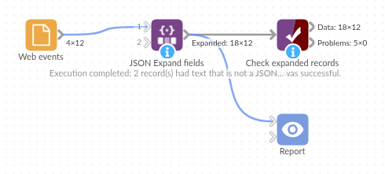

# JSON Expand fields

*Omniscope custom block · Preparation*

**Event details packed into a JSON text field? One field per key, with numbers as numbers, beside the fields you already have.**

**Python** · pandas · nothing extra to install

## The problem it solves

A web shop's event export has one record per event: when it happened, what kind of event, and a `Properties` field holding the details as JSON. Page views carry the page and the referrer, basket events the product, quantity and price, checkouts the order number and total. While the details are inside one text field, nobody can count basket additions by product or add up checkout totals.

This block reads the JSON in every record and adds a field for each key.

- **12** events in, **12** out, with **14** new fields
- **3** numeric keys as Integer fields (`qty`, `items`, `results`) and **2** as Decimal (`price`, `total`)
- **1** nested `delivery` object kept as JSON text, ready to expand again
- **3** events without a JSON object (empty, cut short, an array) kept, with the new fields empty

### How it works

- The keys become fields in the order they first appear; a record without a key gets an empty value.
- A key with only numbers becomes a number field, only `true`/`false` a yes/no field, anything else text.
- Objects and arrays inside the JSON are written as JSON text.

## What goes in

### Web events

12 invented events from an online garden and kitchen shop.

| Event ID | Event | Properties |
|---|---|---|
| E-1001 | page_view | `{"page": "/garden/planters", "referrer": "search", "device": "mobile"}` |
| E-1002 | add_to_basket | `{"page": "/garden/planters", "sku": "PL-30", "qty": 2, "price": 14.99, "device": "mobile"}` |
| E-1003 | checkout | `{"order_id": "SO-5521", "items": 3, "total": 52.47, "voucher": null, "device": "mobile", "delivery": {"method": "standard", "days": 3}}` |
| E-1005 | search | `{"query": "copper kettle", "results": 12, "device": "desktop"}` |
| E-1007 | newsletter_signup | |
| E-1010 | page_view | `{"page": "/basket", "device": "tablet"` |
| E-1012 | page_view | `["/home", "/sale"]` |

*12 rows and a Timestamp field in the sample file.*

## The options

| Option | Demo setting | What it does |
|---|---|---|
| JSON field | `Properties` | The text field holding the JSON. |
| Keep the input fields | ticked | The new fields come after Event ID, Timestamp, Event and Properties. |
| Prefix for new fields | empty | No key clashes with an input field name, so no prefix is needed. |

## What comes out

### Expanded events (selected records and fields)

| Event ID | Event | page | device | sku | qty | price | order_id | total | delivery |
|---|---|---|---|---|---|---|---|---|---|
| E-1001 | page_view | /garden/planters | mobile | | | | | | |
| E-1002 | add_to_basket | /garden/planters | mobile | PL-30 | 2 | 14.99 | | | |
| E-1003 | checkout | | mobile | | | | SO-5521 | 52.47 | `{"method": "standard", "days": 3}` |
| E-1006 | add_to_basket | | desktop | KT-11 | 1 | 39.00 | | | |
| E-1010 | page_view | | | | | | | | |

12 records, 18 fields. E-1010's JSON is cut short and E-1012's is an array, so their new fields are empty; the block's message reports 2 records whose text was not a JSON object.

## Where it pays off

### Web and app analytics: Event properties

Expand the properties of tracked events into fields to count, filter and chart by page, product or device.

### Integrations: Payloads stored as text

Webhook and API payloads saved to a database as JSON text become ordinary fields for reporting.

### Logs: Structured log lines

Application logs that write one JSON object per line can be read as text and expanded into level, message, user and timing fields.

### Forms: Answers stored as JSON

Form tools that keep the answers to optional questions in one JSON field produce one field per question.

*Use cases describe typical scenarios and are illustrative; the sample data is invented.*

## Why do this in Omniscope

- **From the raw export to the report in one workflow**: the expanded `sku`, `qty` and `total` fields go straight on to Aggregate and a Report of basket additions by product, without a separate script to flatten the export first.
- **New keys come through by themselves**: when the tracking starts sending a new property, the next scheduled run adds it as a field, with no list of keys to maintain.
- **Problems are counted, not hidden**: records with broken or non-object JSON are kept and counted in the block's message, so a change in the export shows up instead of silently dropping events.

## How it fits into an Omniscope workflow

Event export (File or Database) → **JSON Expand fields** → Record filter (Event = add_to_basket) → Aggregate (by sku) → Report

For nested values, add a second JSON Expand fields block on the nested field (here `delivery`), with a prefix such as `delivery_`.

## Try it

1. Open the demo project (`demo.iox` on the demo server, or import `demo.ioz` from this folder): 12 web events with JSON properties.
2. The question: what was added to baskets, and what did checkouts total?
3. Open JSON Expand fields: JSON field `Properties`, input fields kept. Run it.
4. Look at the output: `sku`, `qty`, `price` filled for the basket events, `order_id` and `total` for the checkouts (91.47 in all), and the block's message about 2 records.
5. Add a second JSON Expand fields block after it on `delivery`, with the prefix `delivery_`: `delivery_method` and `delivery_days` appear for the two checkouts.

## Running in Omniscope

*The demo project's workflow: the sample data, the block, and a Validate data check on its output.*

<!--language-->
## Language and libraries

Python. It uses pandas and Python's `json` module.

pandas is part of Omniscope's Python environment. It needs nothing else installed.
<!--/language-->

## Tested

The block is covered by automated tests that run its script against a stand-in for Omniscope's Python API: the sample data, JSON that is not an object, nested values, keys with mixed types, a prefix and the new fields alone, a key that clashes with an input field, empty input, a number field and missing options, and 100,000 records.
