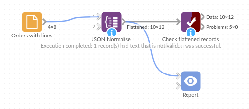

# JSON Normalise

*Omniscope custom block · Preparation*

**Order lines stored as a JSON array in each order? One record per line, with the order's own fields repeated, ready to add up by product.**

**Python** · pandas, numpy · nothing extra to install

## The problem it solves

An online ordering system exports one record per order, with the order lines in a `Lines` field as a JSON array: product code, name, quantity, price, and sometimes a colour option or tags. Until each line is a record of its own, nobody can total quantities by product or join the lines to a price list.

This block turns every array item into a record, flattens nested options into fields, and repeats the order's fields on each line.

- **8** orders in, **12** records out: **10** order lines and **2** orders kept without lines
- **140** units and **892.00** of goods across the lines, from Integer and Decimal fields
- **1** order holding a single object instead of an array, read as one line
- **1** order with broken JSON kept and counted in the block's message

### How it works

- An object is one record; an array of objects is one record per item; anything else goes in a `_value` field.
- Nested objects become fields joined with a dot (`Lines_options.colour`); arrays inside an item stay as JSON text.
- The input fields come first and keep their types.

## What goes in

### Orders with lines

8 invented orders from a garden supplies wholesaler, with the lines as JSON.

| Order | Customer | Order Date | Lines |
|---|---|---|---|
| SO-3001 | Fernhill Garden Centre | 2025-04-01 | `[{"sku": "PL-30", "name": "Terracotta pot 30cm", "qty": 12, "price": 6.5}, {"sku": "CP-50", ...}]` |
| SO-3002 | Marsh Lane Hardware | 2025-04-01 | `[{"sku": "HR-01", "name": "Hose reel", "qty": 4, "price": 24.0, "options": {"colour": "green"}}]` |
| SO-3004 | Willow Bank Landscapes | 2025-04-02 | |
| SO-3005 | Oakley Nurseries | 2025-04-03 | `{"sku": "GL-12", "name": "Gardening gloves", "qty": 24, "price": 3.75}` |
| SO-3007 | Hollybush Farm Shop | 2025-04-04 | `[{"sku": "CP-50", ..., "tags": ["bulk", "pallet"]}]` |
| SO-3008 | Riverside Tea Rooms | 2025-04-04 | `[{"sku": "HB-01", "name": "Herb planter", "qty": 2, "price": 18.0}` |

*8 rows in the sample file.*

## The options

| Option | Demo setting | What it does |
|---|---|---|
| JSON field | `Lines` | The text field holding the JSON. |
| Keep the input fields | ticked | Order, Customer, Order Date and Lines are repeated on each line. |

## What comes out

### Order lines (selected records)

| Order | Customer | Lines_sku | Lines_name | Lines_qty | Lines_price | Lines_options.colour | Lines_tags |
|---|---|---|---|---|---|---|---|
| SO-3001 | Fernhill Garden Centre | PL-30 | Terracotta pot 30cm | 12 | 6.50 | | |
| SO-3001 | Fernhill Garden Centre | CP-50 | Compost 50L | 20 | 7.25 | | |
| SO-3002 | Marsh Lane Hardware | HR-01 | Hose reel | 4 | 24.00 | green | |
| SO-3004 | Willow Bank Landscapes | | | | | | |
| SO-3005 | Oakley Nurseries | GL-12 | Gardening gloves | 24 | 3.75 | | |
| SO-3007 | Hollybush Farm Shop | CP-50 | Compost 50L | 40 | 7.25 | | `["bulk", "pallet"]` |
| SO-3008 | Riverside Tea Rooms | | | | | | |

12 records, 10 fields (Order Date and Lines not shown). The block's message: 1 record had text that is not valid JSON.

## Where it pays off

### Sales: Order lines from order exports

Turn orders with embedded line arrays into order lines, to total units and revenue by product or join a price list.

### Integrations: API responses saved as text

Flatten responses stored by an earlier step, such as a list of invoices or tickets returned in one call, into a table.

### Document databases: Exported documents

Documents with nested sub-documents and arrays become flat records with dotted field names for reporting.

### Product data: Variants and attributes

A product feed listing each product's variants as an array becomes one record per variant, with the product's fields repeated.

*Use cases describe typical scenarios and are illustrative; the sample data is invented.*

## Why do this in Omniscope

- **From the order export to the product report in one workflow**: the lines go straight on to a Field organiser for line value, an Aggregate by `Lines_sku` and the Report, and the order's customer and date are on every line to filter by.
- **The same flattening on every run**: the next export is flattened the same way, and broken JSON is counted in the block's message rather than stopping the schedule.
- **Nested JSON flattened in one step**: arrays become records and nested objects become dotted fields (the core Parse text block is the place to start for JSON in a field); for a deeper array, add a second JSON Normalise on the field it was written to.

## How it fits into an Omniscope workflow

Orders (File, Database or API) → **JSON Normalise** → Field organiser (`Lines_qty * Lines_price`) → Aggregate (by `Lines_sku`) → Report

## Try it

1. Open the demo project (`demo.iox` on the demo server, or import `demo.ioz` from this folder): 8 orders with their lines as JSON.
2. The question: how many of each product were ordered?
3. Open JSON Normalise: JSON field `Lines`, input fields kept. Run it.
4. Look at the output: 12 records, SO-3003's three lines each with the order's customer and date, SO-3005's single object as one line, and the message about SO-3008.
5. Untick **Keep the input fields** and run again: 10 records, only the line fields.

## Running in Omniscope

*The demo project's workflow: the sample data, the block, and a Validate data check on its output.*

<!--language-->
## Language and libraries

Python. It uses pandas, numpy and Python's `json` module.

pandas and numpy are part of Omniscope's Python environment. It needs nothing else installed.
<!--/language-->

## Tested

The block is covered by automated tests that run its script against a stand-in for Omniscope's Python API: the sample data, invalid JSON, input field types kept, records without JSON with and without the input fields, arrays of values and single values, nested objects and mixed types, empty input, bad options, and 20,000 orders with up to five lines each.
