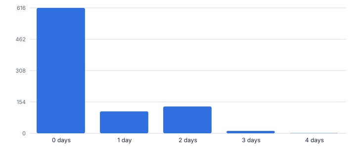
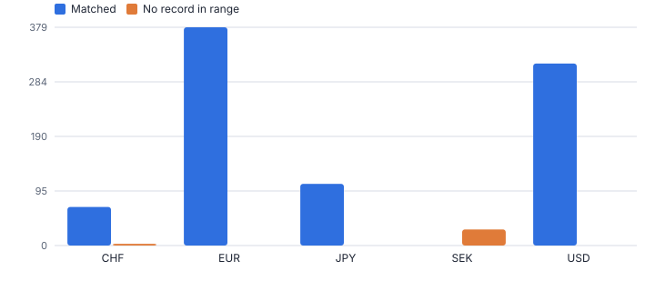
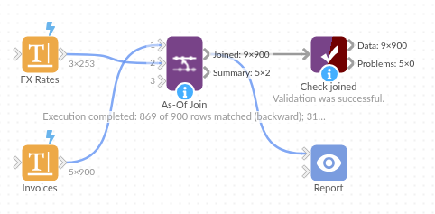

# As-Of Join

*Omniscope custom block · Preparation*

**Join each row to the record in force at its date: the latest exchange rate, the price list or tariff that applied, the owner or grade at the time.**

**Python** · pandas, numpy · nothing extra to install

## The problem it solves

Exchange rates are published on working days; invoices are raised every day. Price lists change on effective dates, not on every order date. A plain join on key and date misses every row that falls between two records, and the usual workaround (generate every date, fill forward, then join) is slow and error-prone.

This block does a point-in-time join per key: for each row it finds the latest record on or before the date (or the next, or the nearest), with a maximum age and validity end dates, keeps every row in its original order and says how old the matched record is.

- **900** invoices in five currencies (illustrative)
- **284** would get no rate from a plain join on currency and date
- **240** weekend invoices given Friday's rate
- **31** flagged: no SEK rates, CHF feed stopped

### How it works

- Connect the rows to enrich (invoices, orders, events) to input 1 and the dated reference table (rates, prices, assignments) to input 2.
- Choose the date field on each side and the key fields (for example Currency on both); keys can have different names and types on each side.
- Choose the direction, a maximum gap in days, an optional end date for validity ranges, and which fields to bring across.
- Outputs: input 1 with the matched fields, As Of Date, Days From As Of Date and As Of Status; and a summary per status.

## What goes in

### Input 1: invoices

900 invented invoices, July to September 2025.

| Invoice | Invoice Date | Currency | Amount | Customer |
|---|---|---|---|---|
| SI-80096 | 2025-07-01 | USD | 469.68 | Damson Inc |
| SI-80163 | 2025-07-01 | JPY | 63592.26 | Alder Ltd |
| SI-80486 | 2025-07-01 | USD | 1015.42 | Damson Inc |
| SI-80550 | 2025-07-01 | JPY | 34622.06 | Birch plc |
| SI-80564 | 2025-07-01 | USD | 534.44 | Elm KK |
| SI-80844 | 2025-07-01 | JPY | 165951.43 | Elm KK |

*900 rows in the sample file.*

### Input 2: FX rates

Invented daily rates for EUR, USD, JPY and CHF on working days only (not market data). No SEK rates; CHF stops on 19 September.

| Rate Date | Currency | Units Per GBP |
|---|---|---|
| 2025-07-01 | EUR | 1.1589 |
| 2025-07-02 | EUR | 1.1543 |
| 2025-07-03 | EUR | 1.1496 |
| 2025-07-04 | EUR | 1.1484 |
| 2025-07-07 | EUR | 1.1404 |
| 2025-07-08 | EUR | 1.1398 |

*253 rows in the sample file.*

## The options

| Option | Demo setting | What it does |
|---|---|---|
| Date field | `Invoice Date` | Date of each row in input 1, such as an invoice date. |
| Key fields (optional) | `Currency` | For example Currency or Product. Matched in order with the input 2 keys. |
| Effective date field | `Rate Date` | Date from which each input 2 record applies, such as a rate date. |
| Maximum gap (days) | `5` | 0 = no limit. |
| Direction | `Latest on or before` | Which reference record each row takes: the latest on or before its date, the next on or after, or the nearest. |

## What comes out

### Joined (first rows, then flagged rows)

| Invoice | Invoice Date | Currency | Amount | Customer | Units Per GBP | As Of Date | Days From As Of Date | As Of Status |
|---|---|---|---|---|---|---|---|---|
| SI-80096 | 2025-07-01 (Tue) | USD | 469.68 | Damson Inc | 1.353 | 2025-07-01 (Tue) | 0 | Matched |
| SI-80163 | 2025-07-01 (Tue) | JPY | 63,592.26 | Alder Ltd | 200.31 | 2025-07-01 (Tue) | 0 | Matched |
| SI-80486 | 2025-07-01 (Tue) | USD | 1,015.42 | Damson Inc | 1.353 | 2025-07-01 (Tue) | 0 | Matched |
| SI-80550 | 2025-07-01 (Tue) | JPY | 34,622.06 | Birch plc | 200.31 | 2025-07-01 (Tue) | 0 | Matched |
| SI-80564 | 2025-07-01 (Tue) | USD | 534.44 | Elm KK | 1.353 | 2025-07-01 (Tue) | 0 | Matched |
| SI-80844 | 2025-07-01 (Tue) | JPY | 165,951.43 | Elm KK | 200.31 | 2025-07-01 (Tue) | 0 | Matched |
| SI-80865 | 2025-07-01 (Tue) | EUR | 1,066.78 | Elm KK | 1.159 | 2025-07-01 (Tue) | 0 | Matched |
| SI-80893 | 2025-07-01 (Tue) | EUR | 145.69 | Birch plc | 1.159 | 2025-07-01 (Tue) | 0 | Matched |
| SI-80022 | 2025-07-02 (Wed) | EUR | 317.04 | Alder Ltd | 1.154 | 2025-07-02 (Wed) | 0 | Matched |
| SI-80126 | 2025-07-02 (Wed) | USD | 600.39 | Cedar GmbH | 1.351 | 2025-07-02 (Wed) | 0 | Matched |
| SI-80864 | 2025-07-03 (Thu) | SEK | 185.36 | Alder Ltd |  |  |  | No record in range |
| SI-80739 | 2025-07-11 (Fri) | SEK | 111.62 | Cedar GmbH |  |  |  | No record in range |
| SI-80443 | 2025-07-12 (Sat) | SEK | 92.57 | Birch plc |  |  |  | No record in range |
| SI-80601 | 2025-07-15 (Tue) | SEK | 1,002.95 | Elm KK |  |  |  | No record in range |

### Summary

| As Of Status | Rows | Share | Average Days From As Of Date | Largest Days From As Of Date |
|---|---|---|---|---|
| Matched | 869 | 0.966 | 0.474 | 4 |
| No record in range | 31 | 0.034 |  |  |

*Most invoices use a same-day rate; weekend and bank-holiday invoices use the last published one (illustrative data).*

*SEK invoices have no rate at all; 3 CHF invoices fall more than 5 days after the last CHF rate (illustrative data).*

## Where it pays off

### Finance: Currency conversion

Convert transactions at the rate published on or before the transaction date, with stale rates flagged instead of silently used.

### Retail and wholesale: Historic prices and costs

Attach the list price, cost or promotion in force at each order date, from a price history with effective dates.

### Telecoms and utilities: Tariffs and contracts

Rate usage records with the tariff valid at the time, using valid-from and valid-to dates.

### HR and sales operations: Who owned it at the time

Credit each deal to the account owner or territory valid on the close date, from an assignment history.

*Use cases describe typical scenarios and are illustrative.*

## Why do this in Omniscope

- **Converted amounts that follow both inputs.** The conversion is a Field Organiser step after the join, so it updates when either the invoices or the rates table changes, and the Report can show each row's As Of Status.
- **Stale or missing rates flagged.** With a maximum gap of 5 days, CHF invoices after the feed stopped and SEK invoices with no rate at all are marked for review instead of being converted at the wrong rate.
- **Point-in-time rules as options.** Backward, forward or nearest matching and a validity end date are settings, keys may differ in name and type on each side, and the pandas as-of merge behind it is open in the block.

## How it fits into an Omniscope workflow

Transactions → Rates or price history → **As-Of Join** → Field Organiser (converted amount) → Report

Feed transactions and the dated reference table into the block; then calculate the converted amount (Amount / Units Per GBP) in a Field Organiser.

Filter on As Of Status to route flagged rows to a review list before reporting.

Converted amounts update when either the transactions or the rates table changes, and the As Of Status flag lets a Report show what needed review.

## In one step

A point-in-time join per key, with a maximum age and validity ranges.

## Try it

1. Open the demo project (`demo.iox` on the demo server, or import `demo.ioz` from this folder): invented invoices in five currencies and a table of daily rates on working days.
2. The question: what rate applies to each invoice? A plain join on currency and date leaves 284 invoices with no rate.
3. Open the block: Invoice Date and Currency on input 1, Rate Date and Currency on input 2, latest on or before, maximum 5 days. Run it.
4. Look at the joined output: weekend invoices pick up Friday's rate, and every row says how old its rate is.
5. Look at the flagged rows: SEK has no rates and CHF stopped mid-September. The block flags them rather than using an out-of-date rate.

## Running in Omniscope

*The demo project's workflow: the sample data, the block, and a Validate data check on its output.*

<!--language-->
## Language and libraries

Python. It uses pandas and numpy.

pandas and numpy are part of Omniscope's Docker Python image, and the block was run in both host mode and Docker mode on an Omniscope server, with the same results. It needs nothing else installed.
<!--/language-->

## Tested

The demo workflow runs without errors on an Omniscope server and produces 900 records in Joined and 2 in Summary. Its automated tests cover normal data, empty input, wrong types and large input.
