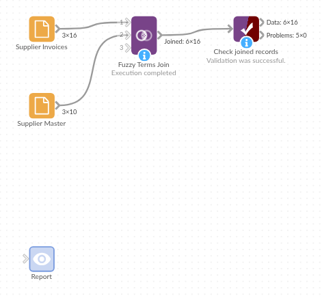

# Fuzzy Terms Join

*Omniscope custom block · Preparation · Join*

**Supplier, customer or product names typed differently in two systems? Pair each record with the one it shares the most distinctive words with, in any order and any case.**

**R** · data.table · install data.table on the server's R if missing

## The problem it solves

The same supplier appears as "HARBOURSIDE PACKAGING LTD" on an invoice and "Harbourside Packaging Limited" in the supplier master. An exact join on the name finds nothing, and cleaning every variant by hand does not scale.

This block splits both names into words and pairs each invoice with the master record it shares the most distinctive words with. Words that occur in many names, such as "Ltd" or "Services", count for little; words that pick out one supplier, such as "Harbourside", count for a lot.

- **0 of 16** invoice names match a master name exactly
- **16 of 16** invoices paired with the right supplier account by a Left join
- **27,768.39** of invoice spend attributed to supplier accounts and categories

### How it works

- Words are runs of letters, compared in lower case; digits, punctuation and one-letter words are ignored.
- Each shared word scores by how rare it is in the input being matched (inverse document frequency); a pair's score is the sum.
- Each record is paired with its highest-scoring record on the other side. Records with no word in common are left out, and there is no minimum score.

## What goes in

### Supplier invoices (first input)

16 invented invoices, with the supplier name as typed on each.

| Invoice | Supplier | Amount |
|---|---|---|
| INV-1001 | Harbourside Packaging | 1840.50 |
| INV-1002 | HARBOURSIDE PACKAGING LTD | 920.00 |
| INV-1005 | Kestrel Logistics (Midlands) | 2760.00 |
| INV-1008 | Office Supplies - Pennine | 189.50 |
| INV-1010 | Precision Eng. Tamworth | 2240.00 |
| INV-1011 | Bramble & Thistle Catering | 780.25 |

*16 rows in the sample file.*

### Supplier master (second input)

10 invented supplier accounts.

| Account | Name | Category |
|---|---|---|
| S-001 | Harbourside Packaging Limited | Packaging |
| S-003 | Kestrel Logistics Midlands Ltd | Transport |
| S-004 | Pennine Office Supplies Ltd | Office |
| S-005 | Tamworth Precision Engineering Ltd | Engineering |
| S-006 | Bramble and Thistle Catering Services | Food |
| S-010 | Ashby Fleet Hire Ltd | Transport |

*10 rows in the sample file.*

## The options

| Option | Demo setting | What it does |
|---|---|---|
| Join type | Left | Each first-input record gets its best match from the second input. Right does the opposite; Left + Right gives both. |
| Left field | `Supplier` | The text field to match on in the first input. |
| Right field | `Name` | The text field to match on in the second input. |

## What comes out

### Joined records (Left join, selected rows)

| Invoice | Supplier | Amount | Account | Name | Category |
|---|---|---|---|---|---|
| INV-1001 | Harbourside Packaging | 1840.50 | S-001 | Harbourside Packaging Limited | Packaging |
| INV-1002 | HARBOURSIDE PACKAGING LTD | 920.00 | S-001 | Harbourside Packaging Limited | Packaging |
| INV-1005 | Kestrel Logistics (Midlands) | 2760.00 | S-003 | Kestrel Logistics Midlands Ltd | Transport |
| INV-1008 | Office Supplies - Pennine | 189.50 | S-004 | Pennine Office Supplies Ltd | Office |
| INV-1010 | Precision Eng. Tamworth | 2240.00 | S-005 | Tamworth Precision Engineering Ltd | Engineering |
| INV-1011 | Bramble & Thistle Catering | 780.25 | S-006 | Bramble and Thistle Catering Services | Food |
| INV-1016 | Timber Merchants Lindqvist | 1290.00 | S-008 | Lindqvist Timber Merchants Ltd | Materials |

All 16 invoices come out, each with the right account.

### The other way round (Right join)

A Right join gives each of the 10 supplier accounts its best invoice. Eight are right. The two suppliers with no invoices still get one, because there is no minimum score:

| Account | Name | Invoice | Supplier |
|---|---|---|---|
| S-009 | Northgate Printing Services | INV-1012 | Bramble Thistle Catering Services |
| S-010 | Ashby Fleet Hire Ltd | INV-1002 | HARBOURSIDE PACKAGING LTD |

Each shares only a common word ("services", "ltd"). Check matches like these before relying on them; the Fuzzy Match block can drop them with a threshold.

## Where it pays off

### Procurement: Spend by supplier

Attach supplier accounts and categories to invoice lines whose supplier names were typed by hand, then total spend per supplier and category.

### Sales and CRM: Accounts across systems

Pair customer records between a CRM, a billing system and a support desk where company names are written differently.

### Product data: Catalogue alignment

Match product descriptions from a supplier's price list to your own catalogue, where the same words appear in a different order.

### Public data: Organisation names

Link records from published registers, grants or contracts to your own list of organisations.

*Use cases describe typical scenarios and are illustrative; the sample data is invented.*

## Why do this in Omniscope

- **Invoice lines to category spend.** The join sits between the invoice file and the supplier master, and an Aggregate straight after it gives spend per category, rebuilt from the current files.
- **Weak pairs are visible.** Comparing the output's record count with the first input's shows invoices that matched nothing, and a Right join shows pairs resting on a word such as "ltd".
- **The scoring is plain R.** Word splitting and the inverse-document-frequency score are in the block's R script; add a minimum score there, or use Fuzzy Match, which has a threshold.

## How it fits into an Omniscope workflow

Invoices (File) + Supplier master (Database) → **Fuzzy Terms Join** → Aggregate (by Category) → Report

Connect the records you want to enrich to the first input and the reference list to the second, and use a Left join. Before relying on the result, check a sample of the pairs, or compare the record count with the first input's to find records that matched nothing.

## Try it

1. Open the demo project (`demo.iox` on the demo server, or import `demo.ioz` from this folder): 16 invoices and a supplier master of 10 accounts.
2. The question: which supplier account, and so which category, does each invoice belong to?
3. Open Fuzzy Terms Join: join type Left, left field Supplier, right field Name. Run it.
4. Look at the output: 16 records, each invoice with its supplier account, including "Precision Eng. Tamworth" and "Office Supplies - Pennine".
5. Change the join type to Right and run again: S-009 and S-010 have no invoices but still get a match through "services" and "ltd".

## Running in Omniscope

*The demo project's workflow: the sample data, the block, and a Validate data check on its output.*

<!--language-->
## Language and libraries

R. It uses the data.table package.

data.table is not part of base R: install it on the Omniscope server's R if it is missing (`install.packages("data.table")`).
<!--/language-->

## Tested

The block is covered by automated tests that run its script against a stand-in for Omniscope's R API: the sample data in all three join types, word splitting and weighting, ties, records with nothing in common, missing values, fields with the same name in both inputs, empty inputs, wrong field types and missing inputs, and 10,000 records a side.
