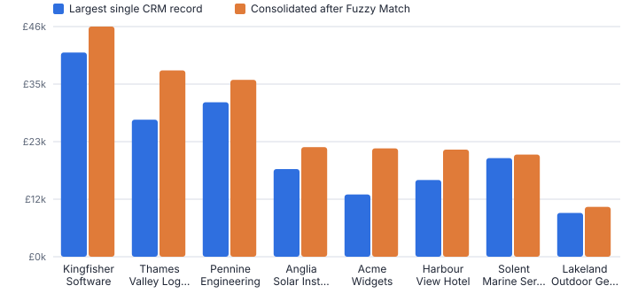
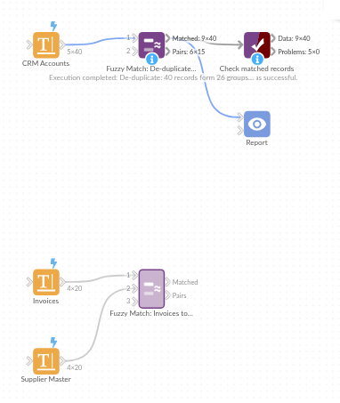

# Fuzzy Match

*Omniscope custom block · Preparation*

**Find the duplicates your exact joins miss. Group near-identical customers, suppliers or products, or match messy names to a clean master list, with a score for every match.**

**Python** · pandas · nothing extra to install

## The problem it solves

The same customer turns up as *Acme Widgets Ltd*, *ACME Widgets Limited* and *Acme Widget Ltd.*. An exact join or de-duplicate treats them as three different companies, so spend is split, campaigns double-mail and supplier analysis under-counts. Fixing it by hand does not scale, and formulas can only compare one pair of values at a time.

Fuzzy Match compares records by similarity: it ignores case, punctuation, accents and company suffixes, tolerates typos and word order, and returns a similarity score you control with a single threshold.

- **40 → 26** CRM records become distinct accounts
- **14** duplicate records found
- **15 of 20** invoices matched to the supplier master
- Runs on Omniscope's standard Python libraries, with nothing extra to install

### How it works

- **One input: de-duplicate.** Each record gets a *Group ID*; matches chain together, so A≈B and B≈C put A, B and C in one group. The first record of each group is the master.
- **Two inputs: lookup.** Each record of the first input gets its best match (or best few) from the second, with the matched fields appended and a *Match Status* of Matched, No match or No value.
- Five similarity measures: Jaro-Winkler with any word order (default, good for names), Jaro-Winkler, Levenshtein edit distance, word set (ignores extra words) and character trigrams.
- Optional second field (such as an address) blended into the score, and an optional *must match exactly* field (such as postcode) that sharpens results and speeds up large inputs.
- A second output lists every matching pair and its score, so borderline matches can be reviewed.

## What goes in

### De-duplicate demo: a CRM export (one input)

| Account ID | Company | Town | Postcode | Annual Spend |
|---|---|---|---|---|
| A001 | Acme Widgets Ltd | Leeds | LS1 4AP | 12500 |
| A002 | ACME Widgets Limited | Leeds | LS1 4AP | 8300 |
| A003 | Acme Widget Ltd. | Leeds | LS1 4AP | 950 |
| A004 | Brightwater Plumbing | Bristol | BS2 0JA | 4200 |
| A005 | Bright Water Plumbing Services | Bristol | BS2 0JA | 3100 |
| A006 | Northern Rail Supplies plc | York | YO1 7HH | 22000 |
| A007 | Cotswold Organic Farms | Cirencester | GL7 1AA | 7600 |
| A008 | Cotswold Organics Farm | Cirencester | GL7 1AA | 2200 |

*40 rows in the sample file.*

### Lookup demo: invoices (input 1) and supplier master (input 2)

Supplier names as typed on invoices, matched against a 20-row supplier master list.

| Invoice | Supplier on Invoice | Postcode | Amount |
|---|---|---|---|
| INV-5001 | ACME WIDGETS LTD | LS1 4AP | 1240.50 |
| INV-5002 | Bright Water Plumbing | BS2 0JA | 380.00 |
| INV-5003 | Northern Rail Supplies | YO1 7HH | 9120.75 |
| INV-5004 | Cotswold Organics | GL7 1AA | 455.20 |
| INV-5005 | Harbor View Hotel | PL1 2PB | 2210.00 |
| INV-5006 | Pennine Eng. Group | HD1 2TP | 15600.00 |

*20 rows in the sample file.*

## The options

| Option | Demo setting | What it does |
|---|---|---|
| Match field | `Company` | The text field to compare, such as a company or customer name. |
| Must match exactly (optional) | `Postcode` | Only records with the same value in this field are compared, such as postcode or country. Improves precision and makes large inputs much faster. |
| Similarity measure | `Jaro-Winkler, any word order (recommended for names)` | How the similarity of two values is scored, from 0 (nothing in common) to 1 (identical after clean-up). |
| Match threshold | `0.88` | Pairs scoring at or above this value count as a match. 0.85 to 0.92 suits company names. |
| Ignore case, accents and punctuation | `On` | Compare "Café & Co." and "cafe and co" as the same text. |
| Ignore company suffixes | `On` | Drop words such as Ltd, Limited, plc, LLP, Inc, Corp, Co, GmbH and The before comparing. |
| Matches per record (lookup mode) | `1` | Lookup demo: best match only. The lookup demo uses the Word set measure with threshold 0.85. |

## What comes out

### Matched records (de-duplicate)

Records sharing a Group ID are the same account. Filter on *Is Group Master = Yes* for a clean list, or aggregate by Group ID.

| Account ID | Company | Postcode | Annual Spend | Group ID | Group Size | Is Group Master | Best Match Score |
|---|---|---|---|---|---|---|---|
| A001 | Acme Widgets Ltd | LS1 4AP | 12500 | 1 | 3 | Yes | 1 |
| A002 | ACME Widgets Limited | LS1 4AP | 8300 | 1 | 3 | No | 1 |
| A003 | Acme Widget Ltd. | LS1 4AP | 950 | 1 | 3 | No | 0.9833 |
| A004 | Brightwater Plumbing | BS2 0JA | 4200 | 2 | 1 | Yes |  |
| A005 | Bright Water Plumbing Services | BS2 0JA | 3100 | 3 | 1 | Yes |  |
| A006 | Northern Rail Supplies plc | YO1 7HH | 22000 | 4 | 1 | Yes |  |
| A007 | Cotswold Organic Farms | GL7 1AA | 7600 | 5 | 2 | Yes | 0.9591 |
| A008 | Cotswold Organics Farm | GL7 1AA | 2200 | 5 | 2 | No | 0.9591 |
| A009 | Harbour View Hotel | PL1 2PB | 15400 | 6 | 2 | Yes | 1 |
| A010 | The Harbour View Hotel | PL1 2PB | 6100 | 6 | 2 | No | 1 |
| A011 | Pennine Engineering Group | HD1 2TP | 31000 | 7 | 2 | Yes | 0.984 |
| A012 | Pennine Engineering Grp | HD1 2TP | 4500 | 7 | 2 | No | 0.984 |

### Matched records (lookup)

Invoice names resolved to supplier numbers, even with typos (Kingsfisher), missing words (Solent Marine) and American spelling (Harbor).

| Invoice | Supplier on Invoice | Match: Supplier No | Match: Supplier Name | Match Score | Match Status |
|---|---|---|---|---|---|
| INV-5001 | ACME WIDGETS LTD | S100 | Acme Widgets Limited | 1 | Matched |
| INV-5002 | Bright Water Plumbing |  |  |  | No match |
| INV-5003 | Northern Rail Supplies | S102 | Northern Rail Supplies PLC | 1 | Matched |
| INV-5004 | Cotswold Organics |  |  |  | No match |
| INV-5005 | Harbor View Hotel | S104 | Harbour View Hotel Ltd | 0.9444 | Matched |
| INV-5006 | Pennine Eng. Group |  |  |  | No match |
| INV-5007 | Riverside Dental | S106 | Riverside Dental Practice | 1 | Matched |
| INV-5008 | Thames Valley Logistic | S107 | Thames Valley Logistics Limited | 0.9565 | Matched |
| INV-5009 | Highland Coffee Roasters Ltd | S108 | Highland Coffee Roasters | 1 | Matched |
| INV-5010 | Lakeland Outdoor | S109 | Lakeland Outdoor Gear Ltd | 1 | Matched |

### Match pairs

| Record 1 | Record 2 | Value 1 | Value 2 | Score | Group ID |
|---|---|---|---|---|---|
| 1 | 2 | Acme Widgets Ltd | ACME Widgets Limited | 1 | 1 |
| 1 | 3 | Acme Widgets Ltd | Acme Widget Ltd. | 0.9833 | 1 |
| 2 | 3 | ACME Widgets Limited | Acme Widget Ltd. | 0.9833 | 1 |
| 7 | 8 | Cotswold Organic Farms | Cotswold Organics Farm | 0.9591 | 5 |
| 9 | 10 | Harbour View Hotel | The Harbour View Hotel | 1 | 6 |
| 11 | 12 | Pennine Engineering Group | Pennine Engineering Grp | 0.984 | 7 |

*Duplicates hide your biggest customers: consolidating Fuzzy Match groups shows each account's true annual spend (synthetic data).*

## Where it pays off

### Retail and e-commerce: Single customer view

Merge customers who registered twice, ordered as guests or were imported from a loyalty scheme. Campaigns stop double-mailing and lifetime value is measured per real customer.

### Finance and procurement: Spend analysis and duplicate vendors

Match invoice supplier names to the vendor master so spend rolls up correctly, and flag vendors set up twice: a common route to duplicate payments.

### Healthcare and public sector: Record linkage across systems

Link people across systems that do not share an ID, using name plus date of birth or postcode, with every link scored for human review.

### Mergers and data migration: Consolidate two CRMs

After an acquisition, match the two account lists, keep one master per company and carry the other system's IDs across for reconciliation.

*Use cases describe typical scenarios and are illustrative.*

## Why do this in Omniscope

- **Review table beside the spend totals.** The Match pairs output feeds a steward's review table in the same report as the totals by Group ID, and a filter on No match gives an exceptions list that refreshes on every run.
- **One threshold on a visible score.** Every pair carries a similarity score; the tests check that identical text scores 1 under all five measures and that known duplicates are grouped.
- **Words your sector ignores.** Company suffixes are a list in the Python script and extra words to ignore are an option, so terms common in your names stop driving matches.

## How it fits into an Omniscope workflow

CRM export → **Fuzzy Match** → Aggregate (by Group ID) → Report

Drop Fuzzy Match after any input block. Its first output feeds an Aggregate block (sum spend by Group ID) or a Record filter (keep group masters); the Match pairs output feeds a review table in a Report, where a data steward can check borderline scores.

For lookups, connect the messy data to the first input and the clean master list to the second. Combine with a Record filter on *Match Status = No match* to build an exceptions list that refreshes on every run.

Matching, grouping and the steward's review table share one report, so a corrected group flows straight into the spend totals on the next run.

## In one step

Two modes in one block (purge duplicates within one source, or match two sources), with a match threshold and a pairs output, and no match keys to build by hand. Results go straight into interactive reports.

## Try it

1. Open the demo project (`demo.iox` on the demo server, or import `demo.ioz` from this folder): a CRM export with duplicate accounts. Look at the CRM Accounts table: Acme Widgets Ltd, ACME Widgets Limited and Acme Widget Ltd. are clearly one customer.
2. The question: who is our biggest customer? An exact de-duplicate says three different companies, so the answer is wrong.
3. Open the Fuzzy Match block: match on Company, must match exactly on Postcode, threshold 0.88. That is all the configuration.
4. Look at the output: Group ID and Group Size. 40 records become 26 accounts. Open the Match pairs output to see the scores for review.
5. Look at the chart of consolidated spend: the real top accounts only appear after matching.
6. Switch to the second workflow: invoices matched to the supplier master, including typos and missing words, with a No match list for follow-up.

## Running in Omniscope

*The demo project's workflow: the sample data, the block, and a Validate data check on its output.*

<!--language-->
## Language and libraries

Python. It uses pandas, plus the Python standard library (collections, re, unicodedata).

pandas and numpy are part of Omniscope's Docker Python image, and the block was run in both host mode and Docker mode on an Omniscope server, with the same results. It needs nothing else installed.
<!--/language-->

## Tested

Both demo workflows ran without errors on an Omniscope server: de-duplicating the CRM accounts (40 records in Matched records, 15 in Match pairs) and matching invoices to the supplier master (20 and 15). Automated tests also cover normal data, empty input, wrong types and large input.
