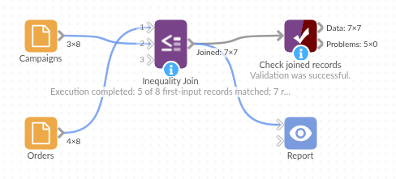

# Inequality Join

*Omniscope custom block · Preparation*

**Join on "before", "after", "at least" or "at most" instead of "equal": every campaign a customer received before each order, every threshold a value has passed, per customer or product.**

**R** · data.table · install data.table on the server's R if missing

## The problem it solves

Some questions pair records by order rather than by equality. Which campaigns had a customer received before they ordered? Which price breaks has an order quantity reached? Which earlier visits came before each complaint? An equal-value join can't answer them, and joining everything to everything and filtering multiplies the data before it shrinks it.

The block joins each record of the first input to every record of the second for which the comparison holds, optionally only within the same customer, product or site. The comparison is done by a join that does not test every pair, so it stays quick as long as the output itself stays reasonable.

- **5** of the 8 sample orders had at least one campaign sent to the customer beforehand
- **7** order and campaign pairs: SO-502 and SO-505 each follow two campaigns
- **3** orders with no earlier campaign kept by a Left join, for comparison

### How it works

- Choose the number or date field in each input and how they must compare (here Ordered >= Sent).
- Optionally choose a field in each input that must also be equal (here Customer).
- Every pair that matches is output: the order's fields, then the campaign's.
- Inner keeps the matched orders; Left keeps every order.

## What goes in

### Orders (input 1)

8 invented orders.

| Order | Customer | Ordered | Amount |
|---|---|---|---|
| SO-501 | C-01 | 2026-02-03 | 120.00 |
| SO-502 | C-01 | 2026-03-18 | 64.50 |
| SO-503 | C-02 | 2026-02-20 | 310.00 |
| SO-504 | C-03 | 2026-01-12 | 45.00 |
| SO-505 | C-03 | 2026-03-02 | 88.20 |
| SO-506 | C-04 | 2026-03-25 | 150.00 |
| SO-507 | C-05 | 2026-02-14 | 72.40 |
| SO-508 | C-02 | 2026-01-08 | 99.00 |

### Campaigns (input 2)

8 invented campaign sends: which customer was sent which campaign, and when.

| Campaign | Customer | Sent |
|---|---|---|
| Winter offer | C-01 | 2026-01-20 |
| Spring launch | C-01 | 2026-03-10 |
| Winter offer | C-02 | 2026-01-20 |
| Spring launch | C-02 | 2026-03-10 |
| Winter offer | C-03 | 2026-01-20 |
| Loyalty voucher | C-03 | 2026-02-25 |
| Spring launch | C-04 | 2026-03-10 |
| Loyalty voucher | C-04 | 2026-03-30 |

## The options

| Option | Demo setting | What it does |
|---|---|---|
| Comparator | Left >= Right | The order date must be on or after the send date. |
| Join type | Inner | Only orders with an earlier campaign. |
| Left field / Right field | Ordered / Sent | The dates to compare. |
| Equal field (both inputs) | Customer / Customer | Only the same customer's campaigns. |

## What comes out

### Joined records

| Order | Customer | Ordered | Amount | Campaign | Customer.1 | Sent |
|---|---|---|---|---|---|---|
| SO-501 | C-01 | 2026-02-03 | 120.00 | Winter offer | C-01 | 2026-01-20 |
| SO-502 | C-01 | 2026-03-18 | 64.50 | Winter offer | C-01 | 2026-01-20 |
| SO-502 | C-01 | 2026-03-18 | 64.50 | Spring launch | C-01 | 2026-03-10 |
| SO-503 | C-02 | 2026-02-20 | 310.00 | Winter offer | C-02 | 2026-01-20 |
| SO-505 | C-03 | 2026-03-02 | 88.20 | Winter offer | C-03 | 2026-01-20 |
| SO-505 | C-03 | 2026-03-02 | 88.20 | Loyalty voucher | C-03 | 2026-02-25 |
| SO-506 | C-04 | 2026-03-25 | 150.00 | Spring launch | C-04 | 2026-03-10 |

The block's message: "5 of 8 first-input records matched; 7 records out". SO-504 (C-03, 12 January) and SO-508 (C-02, 8 January) came before their customer's first campaign, and SO-507's customer, C-05, received none; C-04's Loyalty voucher, sent after SO-506, is not paired with it. With Join type Left these three orders are added with empty campaign fields (10 records).

## Where it pays off

### Marketing: Campaign attribution

List every campaign, email or visit a customer had before each purchase, then count touches per order or keep the latest with an Aggregate.

### Pricing: Price breaks reached

Join each order quantity to every price break at or below it, then keep the highest break per order.

### Service: What came before a complaint

Pair each complaint with the earlier orders, deliveries or calls for the same account.

### Finance: Thresholds crossed

Join balances or spend to every limit or alert threshold they exceed, per account.

*Use cases describe typical scenarios and are illustrative; the sample data is invented.*

## Why do this in Omniscope

- **Pairs straight into the analysis.** The joined pairs go on into an Aggregate (campaigns per order, revenue after each campaign) and the report, so the attribution is re-done whenever orders or sends are added.
- **Size kept in view.** The block's message reports how many first-input records matched and how many records came out, and a scheduled run can be stopped by Validate data if a missing Equal field makes the output explode.
- **Open R script.** The join is a few lines of data.table in the block's editor; adding a second condition (a date window, say) is a change to one line.

## How it fits into an Omniscope workflow

Orders (Database) + Campaign sends (File) → **Inequality Join** → Aggregate (campaigns per order) → Report

Connect the records to enrich to the first input. Always set the Equal fields when the data has a natural key (customer, product, site), to keep the output to the pairs that matter.

## Try it

1. Open the demo project (`demo.iox` on the demo server, or import `demo.ioz` from this folder): 8 invented orders and 8 campaign sends.
2. The question: which campaigns did each customer receive before ordering?
3. Open Inequality Join: Comparator Left >= Right; Left field Ordered with Equal field Customer; Right field Sent with Equal field Customer. Run it.
4. Look at the output: 7 pairs for 5 orders; SO-502 and SO-505 each follow two campaigns.
5. Change Join type to Left and run again: 10 records, with SO-504, SO-507 and SO-508 added with empty campaign fields.

## Running in Omniscope

*The demo project's workflow: the sample data, the block, and a Validate data check on its output.*

<!--language-->
## Language and libraries

R, with the data.table package (Mozilla Public License 2.0) for the join.

data.table is not part of base R: install it on the Omniscope server's R if it is missing (`install.packages("data.table")`).
<!--/language-->

## Tested

The block is covered by automated tests that run its script against a stand-in for Omniscope's R API: the sample data in Inner and Left joins, no Equal field, every comparator, the defaults, output order, field names in both inputs and with spaces, missing values, numbers against dates, text fields and mismatched Equal fields, missing choices and inputs, empty inputs, and 10,000 records a side (checked against a brute-force count).
