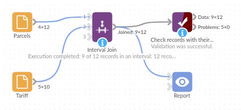

# Interval Join

*Omniscope custom block · Preparation*

**Look records up by range, not by equal value: each weight to its price band, each date to its price period, each score to its grade, per zone or product if you like.**

**Python** · pandas, numpy · nothing extra to install

## The problem it solves

Price bands, tax brackets, grade boundaries, alert levels and validity periods are all tables of ranges: a start, an end and something that applies in between. Attaching the right band to each record is a lookup by range, which an equal-value join can't do. The usual workaround, joining every record to every band and filtering, multiplies the data by the number of bands and is easy to get wrong at the boundaries.

The block takes the records and the table of intervals and pairs each record with the interval (or intervals) that contain its value, with control over whether the boundaries themselves count, and an optional field that must match as well, so each zone, product or customer can have its own bands.

- **9** of the 12 sample parcels priced from the tariff for their zone
- **2** parcels in the open-ended "10 kg and over" band, which has no end weight
- Boundary weights land in one band only: 2.0 kg is Medium, 5.0 kg is Large

### How it works

- Choose the value field (first input) and the start and end fields (second input): numbers or dates.
- Choose whether a value equal to the start, and to the end, is inside the interval.
- Optionally choose a field in each input that must also be equal (here Zone).
- Inner keeps the records found in an interval; Left keeps every record.

## What goes in

### Parcels (input 1)

12 invented parcels with their delivery zone, weight and date sent.

| Parcel | Zone | Weight kg | Sent |
|---|---|---|---|
| P-101 | North | 0.4 | 2026-03-02 |
| P-102 | North | 2.0 | 2026-03-02 |
| P-105 | South | 4.99 | 2026-03-04 |
| P-106 | South | 5.0 | 2026-03-04 |
| P-109 | Islands | 32.0 | 2026-03-06 |
| P-110 | Overseas | 1.0 | 2026-03-06 |
| P-111 | North | | 2026-03-09 |

*12 rows in the sample file.*

### Tariff (input 2)

10 invented weight bands, per zone. The Heavy bands for North and South have no upper weight.

| Zone | From kg | To kg | Band | Price |
|---|---|---|---|---|
| North | 0 | 2 | Small | 3.20 |
| North | 2 | 5 | Medium | 4.60 |
| North | 5 | 10 | Large | 7.90 |
| North | 10 | | Heavy | 12.50 |
| Islands | 0 | 5 | Standard | 9.80 |
| Islands | 5 | 30 | Heavy | 19.00 |

*South has the same four bands as North at different prices.*

## The options

| Option | Demo setting | What it does |
|---|---|---|
| Join type | Left | Keep every parcel; those with no band get empty tariff fields. |
| Value in interval | Weight kg | The value to look up. |
| Interval start / end | From kg / To kg | The band limits. |
| Start / End | Inclusive / Exclusive | 2.0 kg is in 2 to 5, not in 0 to 2. |
| Also match on | Zone / Zone | Each parcel is priced from its own zone's bands. |

## What comes out

### Records with their intervals

| Parcel | Zone | Weight kg | Zone.1 | From kg | To kg | Band | Price |
|---|---|---|---|---|---|---|---|
| P-101 | North | 0.4 | North | 0 | 2 | Small | 3.20 |
| P-102 | North | 2.0 | North | 2 | 5 | Medium | 4.60 |
| P-103 | North | 7.5 | North | 5 | 10 | Large | 7.90 |
| P-104 | South | 1.2 | South | 0 | 2 | Small | 3.50 |
| P-105 | South | 4.99 | South | 2 | 5 | Medium | 4.95 |
| P-106 | South | 5.0 | South | 5 | 10 | Large | 8.40 |
| P-107 | South | 18.0 | South | 10 | | Heavy | 13.75 |
| P-108 | Islands | 3.1 | Islands | 0 | 5 | Standard | 9.80 |
| P-109 | Islands | 32.0 | | | | | |
| P-110 | Overseas | 1.0 | | | | | |
| P-111 | North | | | | | | |
| P-112 | North | 12.25 | North | 10 | | Heavy | 12.50 |

*The Sent field (a date, still a date) is left out of the table.* The three parcels without a price are the ones to look at: P-109 is over the Islands' 30 kg limit, there is no Overseas tariff, and P-111 has no weight. The block's message: "9 of 12 records in an interval; 12 records out".

## Where it pays off

### Logistics: Rate cards

Price each shipment from the carrier's weight or distance bands per zone, and list the shipments outside every band.

### Finance: Periods and brackets

Attach the price, rate or budget period in force at each transaction date, where the periods have a start and an end; or put amounts into brackets.

### Education and HR: Grades and pay scales

Turn scores into grades from a table of boundaries per subject, or salaries into pay bands per grade.

### Operations: Alert levels

Label each sensor reading with its alert level from threshold tables per machine type.

*Use cases describe typical scenarios and are illustrative; the sample data is invented.*

## Why do this in Omniscope

- **The band table is data, not a formula.** When the carrier changes its rates, replace the tariff file feeding the second input; the next run prices every parcel from the new bands, with no nested IF formula to edit.
- **Gaps show up.** With a Left join, records in no band are kept with empty band fields, so a Record Filter or a Validate data block after the join can stop the run, or list them in the report, instead of losing them silently.
- **One step in the pricing workflow.** The joined prices go straight into an Aggregate per zone and the report; the script is in the block, so a rule such as "use the cheapest of overlapping bands" is a few lines to add in the block's editor.

## How it fits into an Omniscope workflow

Parcels (File or Database) + Tariff (File) → **Interval Join** → Field Organiser (charge = Price) → Aggregate (per zone) → Report

Connect the records to look up to the first input and the band table to the second. Use a Left join and a Record Filter on an empty Band to find the records no band covers.

## Try it

1. Open the demo project (`demo.iox` on the demo server, or import `demo.ioz` from this folder): 12 invented parcels and a delivery tariff with bands per zone.
2. The question: what does each parcel cost to send, and which parcels does the tariff not cover?
3. Open Interval Join: Join type Left; Value Weight kg; start From kg, end To kg; Start inclusive, End exclusive; Also match on Zone and Zone. Run it.
4. Look at the output: nine parcels have a band and price; P-109, P-110 and P-111 have none.
5. Change End to Inclusive and run again: P-102 (2.0 kg) and P-106 (5.0 kg) now each fall in two bands, so they appear twice (14 records).

## Running in Omniscope

*The demo project's workflow: the sample data, the block, and a Validate data check on its output.*

<!--language-->
## Language and libraries

Python. It uses pandas (BSD 3-Clause) and numpy (BSD 3-Clause), both part of Omniscope's Python environment. Nothing else to install.
<!--/language-->

## Tested

The block is covered by automated tests that run its script against a stand-in for Omniscope's Python API: the sample data in Inner and Left joins, field types kept, date intervals, all four boundary settings, open-ended intervals, overlapping intervals and output order, an interval that ends before it starts, the optional equal-value field (one side only, missing keys), text and mixed types, missing inputs and fields, clashing field names, field names with spaces, empty inputs, and 200,000 records against 1,000 bands.
