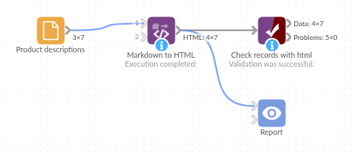

# Markdown to HTML

*Omniscope custom block · Preparation*

**Descriptions written with asterisks, dashes and pipes? Real bold, lists, links and tables as HTML, next to the record they belong to.**

**Python** · pandas, Python-Markdown · Python-Markdown installed on first run

## The problem it solves

A product catalogue keeps its descriptions in Markdown, because that is what the buying team writes in: bold for the material, bullet lists for the dimensions, a link to a guide, a small table of sizes. Shown as it is, the text is full of asterisks, dashes and pipes; a web page, an email or a view that displays HTML needs HTML.

This block converts each record's Markdown to HTML in a new field, keeping the product's other fields beside it.

- **7** products in, **7** out, each with a new `HTML` field
- **6** kinds of formatting in the sample: bold and italic, bullet and numbered lists, a link, a heading, a table, a quote
- **1** product with no description: the HTML field stays empty

### How it works

- Each record's text is converted with Python-Markdown; identical texts are converted once.
- With **Tables, fenced code and footnotes** ticked, the `extra` extension adds tables, fenced code blocks and footnotes.
- The result is an HTML fragment (`
`, `<ul>`, `<table>`), without a page around it.
- HTML already in the text, scripts included, is passed through unchanged: only convert text from sources you trust if the HTML will be shown in a report or a web page.

## What goes in

### Product descriptions

7 invented products from a garden supplies catalogue, with descriptions in Markdown.

| SKU | Product | Description |
|---|---|---|
| PL-30 | Terracotta pot 30cm | `Frost-resistant **terracotta**, hand-finished.` `- 30 cm across, 26 cm tall` `- Drainage hole and saucer` `- Made in Italy` |
| CP-50 | Peat-free compost 50L | `... for *pots and borders*. See our [growing guide](https://example.com/guides/compost) ...` |
| HR-01 | Hose reel with 25m hose | `## What's included` `1. Wall-mounted reel` `2. 25 m reinforced hose` ... |
| WC-09 | Watering can 9L | `\| Size \| Capacity \| Weight \|` ... (a table) |
| NT-04 | Netting 4m | |

*7 rows in the sample file.*

## The options

| Option | Demo setting | What it does |
|---|---|---|
| Markdown field | `Description` | The text field holding Markdown. |
| HTML field name | `HTML` | The new field. |
| Keep the input fields | ticked | SKU, Product and Description stay beside the HTML. |
| Tables, fenced code and footnotes | ticked | WC-09's size table becomes an HTML table. |

## What comes out

### Products with HTML (selected records)

| SKU | HTML |
|---|---|
| PL-30 | `
Frost-resistant <strong>terracotta</strong>, hand-finished.
<ul><li>30 cm across, 26 cm tall</li>...</ul>` |
| CP-50 | `
Peat-free, multi-purpose compost for <em>pots and borders</em>.

See our <a href="https://example.com/guides/compost">growing guide</a> ...
` |
| HR-01 | `<h2>What's included</h2><ol><li>Wall-mounted reel</li>...</ol>` |
| WC-09 | `<table><thead><tr><th>Size</th><th>Capacity</th><th>Weight</th></tr></thead>...</table>` |
| NT-04 | |

7 records, 4 fields (line breaks inside the HTML not shown). Untick the extensions and WC-09's table stays a paragraph of pipes.

## Where it pays off

### Retail: Product descriptions for the web

Convert descriptions kept in Markdown into the HTML a shop page or a product feed expects.

### Communications: Formatted emails

Build the body of a scheduled email (a weekly summary, an alert) from Markdown text assembled in the workflow.

### Support and project tools: Comments and notes

Ticket comments and notes exported in Markdown can be shown formatted in a report instead of as raw markup.

### Documentation: Release notes

Turn release notes written in Markdown into HTML for a web page or a newsletter.

*Use cases describe typical scenarios and are illustrative; the sample data is invented.*

## Why do this in Omniscope

- **Text and data in the same workflow**: the HTML sits on the product's own record, so it can be filtered, joined to stock and prices, and sent on to the next block or the Report with everything else about the product.
- **Converted again on every run**: when the buying team edits a description, the next scheduled run updates the HTML; no one pastes text through a converter by hand.
- **A short script you can extend**: the block is a few lines around Python-Markdown; unlock the block's design and you can add another of Python-Markdown's extensions (a table of contents, for example) or clean the HTML before it goes out.

## How it fits into an Omniscope workflow

Product list (File or Database) → **Markdown to HTML** → Join (stock and prices) → Output (file or email) or Report

## Try it

1. Open the demo project (`demo.iox` on the demo server, or import `demo.ioz` from this folder): 7 products with Markdown descriptions.
2. The question: what does each description look like as HTML?
3. Open Markdown to HTML: Markdown field `Description`. Run it.
4. Look at the `HTML` field: `<strong>`, `<ul>`, `<a href>`, `<h2>`, `<table>`, and an empty value for NT-04.
5. Untick **Tables, fenced code and footnotes** and run again: WC-09's table comes out as a paragraph of pipes.

## Running in Omniscope

*The demo project's workflow: the sample data, the block, and a Validate data check on its output.*

<!--language-->
## Language and libraries

Python. It uses pandas and Python-Markdown.

pandas is part of Omniscope's Python environment. Python-Markdown (`markdown`) is listed in the block's dependencies, so Omniscope installs it with pip on first run if it is missing.
<!--/language-->

## Tested

The block is covered by automated tests that run its script against a stand-in for Omniscope's Python API: the sample data, empty values, input fields kept and dropped, the HTML field's name and in-place conversion, the extensions on and off, footnotes per record, number fields, empty input and bad options, HTML passed through, and 20,000 records.
