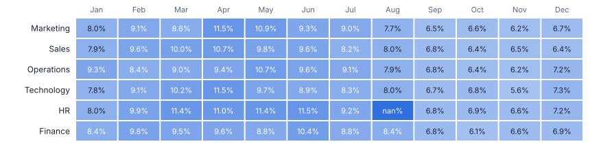
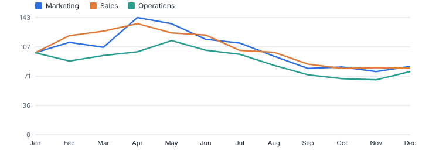
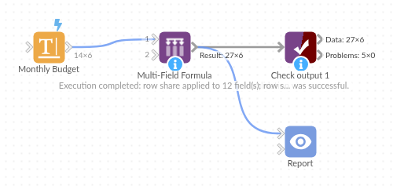

# Multi-Field Formula

*Omniscope custom block · Preparation*

**One operation, many fields: shares of row total, indexes, rounding, scaling, filling and text clean-up across every month column (or any set of fields) in one step.**

**Python** · pandas, numpy · nothing extra to install

## The problem it solves

Wide tables are everywhere in finance and planning: one column per month, per scenario, per store. Applying the same calculation to every column, such as each month's share of the year, an index to January, rounding or filling blanks, means a formula per column, and new columns next month mean editing the workflow again.

Multi-Field Formula applies one operation to every selected field, chosen by name pattern so new columns are included automatically, and can add row totals and other row statistics.

- **12** month columns picked up by the pattern 2025$
- **12** share fields added in one step
- **25** operations for numbers and text
- One block setting replaces a formula per column

### How it works

- Select fields by list, by a regular-expression name pattern (for example `2025$`), or all numbers / all text.
- Pick the operation: round, arithmetic with a value, share of row or column total, index or difference to a base field, z-score, min-max, log, absolute, floor / cap, fill, convert to number; or text case, trim, prefix / suffix, fill, length.
- Replace the fields or add new ones with a suffix; tick row statistics to add sum, mean, minimum, maximum, count or standard deviation across the selected fields.
- Fields of the wrong type for the operation are skipped and listed in the block message.

## What goes in

### Monthly budget, one column per month

Six departments x 12 months (6 shown), synthetic. HR has a blank for August.

| Department | Cost Centre | Jan 2025 | Feb 2025 | Mar 2025 | Apr 2025 | May 2025 | Jun 2025 |
|---|---|---|---|---|---|---|---|
| Marketing | CC-852 | 40682.67 | 45868.29 | 43388.66 | 58139.94 | 55086.36 | 47341.2 |
| Sales | CC-335 | 61910.63 | 74777.67 | 78205.65 | 83866.24 | 76869.75 | 75293.81 |
| Operations | CC-915 | 134808.26 | 121172.06 | 130172.92 | 136388.15 | 154714.67 | 139019.58 |
| Technology | CC-930 | 82035.1 | 96052.98 | 108064.92 | 121828.31 | 103050.61 | 94616.51 |
| HR | CC-569 | 19212.48 | 23733.69 | 27271.83 | 26375.25 | 27319.78 | 27582.05 |
| Finance | CC-731 | 29810.53 | 34905.66 | 33987.84 | 34040.71 | 31442.85 | 36968.97 |

*6 rows in the sample file.*

## The options

| Option | Demo setting | What it does |
|---|---|---|
| Field name pattern (regular expression) | `2025$` | Adds every field whose name matches, for example 2025$ for all 2025 columns. |
| Operation | `Share of row total` | What to do to every chosen field. |
| Results | `Add new fields` | Overwrite the fields, or add new ones next to them. |
| Suffix for new fields | ` share` | Added to the name of each new field. |
| Row sum | `On` | Adds the total of the chosen fields for each row. |

## What comes out

### Output (first three months and their shares)

| Department | Jan 2025 | Feb 2025 | Mar 2025 | Jan 2025 share | Feb 2025 share | Mar 2025 share | Row Sum |
|---|---|---|---|---|---|---|---|
| Marketing | 40,682.67 | 45,868.29 | 43,388.66 | 0.08 | 0.091 | 0.086 | 1 |
| Sales | 61,910.63 | 74,777.67 | 78,205.65 | 0.079 | 0.096 | 0.1 | 1 |
| Operations | 134,808.26 | 121,172.06 | 130,172.92 | 0.093 | 0.084 | 0.09 | 1 |
| Technology | 82,035.10 | 96,052.98 | 108,064.92 | 0.078 | 0.091 | 0.102 | 1 |
| HR | 19,212.48 | 23,733.69 | 27,271.83 | 0.08 | 0.099 | 0.114 | 1 |
| Finance | 29,810.53 | 34,905.66 | 33,987.84 | 0.084 | 0.098 | 0.095 | 1 |

*The new share fields as a heat map: the seasonal phasing of each department's budget (synthetic data).*

*The same block with Index to base field: each month relative to January.*

## Where it pays off

### Finance: Budget phasing and variance packs

Shares of the annual total per month, indexes to the first month or to budget, and rounding for presentation, across every month column.

### Retail: Store-by-week tables

Normalise weekly sales columns per store to shares or indexes to compare stores of different sizes.

### Data science: Feature preparation

Z-score, min-max scale or log-transform dozens of numeric features before clustering or modelling.

### Data management: Bulk clean-up

Trim, upper-case or fill blanks in every text field of an imported table in one step.

*Use cases describe typical scenarios and are illustrative.*

## Why do this in Omniscope

- **New columns picked up by name.** A pattern such as `2025$` selects the month fields, so a column that matches is included on the next run and the heat map in the Report carries on without edits.
- **Wrong types named, integers kept.** Fields of the wrong type for an operation are skipped and listed in the block message, and rounding or filling leaves integer fields as integers, as the tests check.
- **Operations chain and extend.** Two blocks in a row fill blanks with 0 and then take shares of the row total; the 25 operations are a pick list in the block's script, where another can be added.

## How it fits into an Omniscope workflow

Budget (Excel) → **Multi-Field Formula** → **Multi-Field Formula** → Report

Chain blocks for several operations (fill blanks with 0, then share of row total). Use the name pattern so next year's columns work without changes.

For long data (one row per month), Omniscope's Aggregate and Field organiser formulas are often simpler; this block is for the wide case.

It applies one operation across the fields that match a name pattern, so when next year's budget columns arrive the workflow and the Report carry on without edits, and it can be opened and adapted from its source.

## In one step

The common multi-field operations as a pick list, with dynamic field selection by name pattern. Omniscope's Bulk field organiser covers renaming and types.

## Try it

1. Open the demo project (`demo.iox` on the demo server, or import `demo.ioz` from this folder): a budget with one column per month.
2. The question: what share of each department's annual budget falls in each month? Twelve formulas, or one block.
3. Open Multi-Field Formula: name pattern 2025$, share of row total, add new fields, row sum. Run it.
4. Look at the twelve new share fields and the heat map. Switch to Index to base field (January) for the trend view.
5. Next year's columns are picked up by changing the pattern, not the workflow.

## Running in Omniscope

*The demo project's workflow: the sample data, the block, and a Validate data check on its output.*

<!--language-->
## Language and libraries

Python. It uses pandas and numpy, plus the Python standard library (re).

pandas and numpy are part of Omniscope's Docker Python image, and the block was run in both host mode and Docker mode on an Omniscope server, with the same results. It needs nothing else installed.
<!--/language-->

## Tested

The demo workflow runs without errors on an Omniscope server and produces 6 records in Result. Its automated tests cover normal data, empty input, wrong types and large input.
