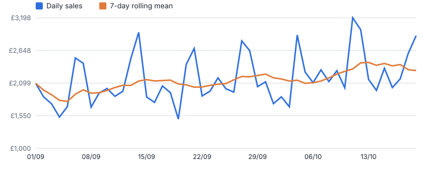
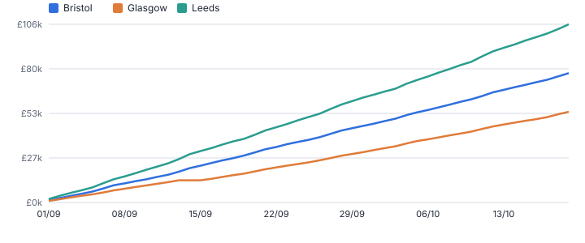
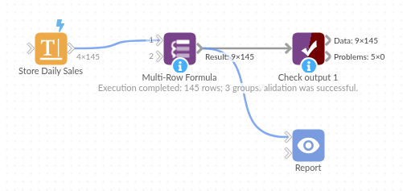

# Multi-Row Formula

*Omniscope custom block · Preparation*

**Previous value, change, running totals, rolling averages and ranks, per group and in date order: the calculations that need more than one row, in one block.**

**Python** · pandas, numpy · nothing extra to install

## The problem it solves

Most business questions compare a row with its neighbours: *how did sales change since yesterday?*, *what is the 7-day average?*, *what is the running total this month?*, *which was the best day per store?*. Formulas work one row at a time, so these need either self-joins on shifted copies of the data or special functions that do not restart per group.

Multi-Row Formula does them directly: choose value fields, a group (store, customer, product) and an order (date), then tick the calculations. Rolling windows can count rows or calendar days, so a store closed for two days does not distort its 7-day average.

- **11** window calculations available
- **3** stores, each calculated separately
- **7 days** rolling window that respects gaps
- Calculations chosen with tick boxes rather than written as formulas

### How it works

- Pick value fields, optional group-by fields and the order-by field.
- Tick what you need: previous / next value, change and % change, running total, rolling mean / sum / min / max, rank, share of group total, row number.
- *Rows back / forward* controls the comparison: 1 for the previous record, 7 for the same weekday last week with daily data.
- Rolling windows count rows or days; with days, missing dates are simply not in the window.
- Output keeps the input order (or sorted, if you prefer) with clearly named new fields such as *Sales Rolling Mean (7 days)*.

## What goes in

### Daily sales for three stores

Seven weeks of synthetic daily sales. Glasgow was closed on 14 and 15 September for a refit, so those dates are missing.

| Store | Date | Sales | Transactions |
|---|---|---|---|
| Leeds | 2025-09-01 | 2093.89 | 53 |
| Leeds | 2025-09-02 | 1867.65 | 67 |
| Leeds | 2025-09-03 | 1748.7 | 70 |
| Leeds | 2025-09-04 | 1527.23 | 70 |
| Leeds | 2025-09-05 | 1702.22 | 95 |
| Leeds | 2025-09-06 | 2523.37 | 93 |
| Leeds | 2025-09-07 | 2432.33 | 90 |
| Leeds | 2025-09-08 | 1694.2 | 69 |

*145 rows in the sample file.*

## The options

| Option | Demo setting | What it does |
|---|---|---|
| Value fields | `Sales` | Fields to calculate on. Previous / next work for any field; the other calculations need numbers. |
| Group by (optional) | `Store` | Calculations restart for each combination of these fields, for example Store or Customer. |
| Order by | `Date` | Order of rows within each group, usually a date. For rolling windows in days choose exactly one date field. |
| % change vs previous | `On` | As a fraction: 0.05 means up 5%. |
| Rolling mean | `On` | Average over the rolling window. |
| Rolling window counts | `Days (uses the date in Order by)` | Whether the window counts rows or days of the date in Order by. |
| Running total | `On` | Cumulative sum within each group. |
| Rolling window size | `7` | Rows or days in each rolling window. |
| Rows back / forward | `1` | For previous, next and change: 1 compares with the row just before; 7 with daily data compares with the same weekday last week. |

## What comes out

### Output: Glasgow around its closure

On 16 September the 7-day mean covers 10 to 16 September: five trading days, not the last seven rows.

| Store | Date | Sales | Sales Previous | Sales Change | Sales % Change | Sales Running Total | Sales Rolling Mean (7 days) |
|---|---|---|---|---|---|---|---|
| Glasgow | 2025-09-10 | 969.95 | 1,008.47 | -38.52 | -0.0382 | 10,213.37 | 1,029.04 |
| Glasgow | 2025-09-11 | 977.37 | 969.95 | 7.42 | 0.0076 | 11,190.74 | 1,029.18 |
| Glasgow | 2025-09-12 | 925.75 | 977.37 | -51.62 | -0.0528 | 12,116.49 | 1,041.28 |
| Glasgow | 2025-09-13 | 1,114.14 | 925.75 | 188.39 | 0.2035 | 13,230.63 | 1,039.82 |
| Glasgow | 2025-09-16 | 910.48 | 1,114.14 | -203.66 | -0.1828 | 14,141.11 | 979.54 |
| Glasgow | 2025-09-17 | 1,113.49 | 910.48 | 203.01 | 0.223 | 15,254.60 | 1,008.25 |
| Glasgow | 2025-09-18 | 1,026.36 | 1,113.49 | -87.13 | -0.0782 | 16,280.96 | 1,018.04 |
| Glasgow | 2025-09-19 | 933.12 | 1,026.36 | -93.24 | -0.0908 | 17,214.08 | 1,019.52 |
| Glasgow | 2025-09-20 | 1,329 | 933.12 | 395.88 | 0.4243 | 18,543.08 | 1,062.49 |
| Glasgow | 2025-09-21 | 1,355.55 | 1,329 | 26.55 | 0.02 | 19,898.63 | 1,111.33 |

*Daily sales are noisy, with weekend peaks; the 7-day rolling mean shows the underlying trend (synthetic data).*

*Running total per store, restarting for each group.*

## Where it pays off

### Retail: Trading performance by store

Day-on-day and week-on-week change, 7-day and 28-day rolling averages and best-day ranks per store, feeding a daily trading dashboard.

### Financial services: Account balances and movements

Running balances from transaction lists, change since last statement and days-since-previous-transaction flags for dormancy and fraud rules.

### Manufacturing and IoT: Sensor smoothing and drift

Rolling mean, min and max per machine over the last N readings or N days to smooth noise and spot drift before a failure.

### Marketing and e-commerce: Customer journeys

Previous and next event per customer, time between orders and order number per customer, ready for repeat-purchase and churn analysis.

*Use cases describe typical scenarios and are illustrative.*

## Why do this in Omniscope

- **Alerts and charts share the calculation.** The rolling mean and % change are made before the Record filter and the Report, so the flagged sharp drops and the trend chart use the same calculated fields.
- **Missing days handled by date.** With a window in days, Glasgow's 16 September mean covers its five trading days rather than the last seven rows; the tests check day windows across gaps and that totals restart for each store.
- **Tick boxes, with the code behind them.** The eleven calculations are options; a rule that depends on the previous row's own result can be written into the block's script.

## How it fits into an Omniscope workflow

Sales (Database / File) → **Multi-Row Formula** → Record filter → Report

Place it after the data is at the grain you want (aggregate first if needed, for example to daily totals per store).

Downstream, filter on the new fields (for example *Sales % Change* below -0.2 to flag sharp drops) or chart the rolling mean next to the raw values in a Report.

## In one step

The common multi-row calculations are tick boxes here, so there is nothing to type. For a stateful custom expression (a value that depends on the previous row's result), Omniscope's formulas or a custom block remain the route.

## Try it

1. Open the demo project (`demo.iox` on the demo server, or import `demo.ioz` from this folder): daily sales for three stores. The question: how do we see the trend through the weekend spikes?
2. Open the Multi-Row Formula block: value Sales, group by Store, order by Date, then tick previous value, change, % change, running total and rolling mean over 7 days.
3. Run it and look at the output for Glasgow around 14 September: the store was closed, and the 7-day mean uses the five days that exist rather than blindly the last seven rows.
4. Look at the line chart: daily sales against the rolling mean. The trend is much easier to read.
5. Previous value, change, running total and rolling mean come from one block with tick boxes, with no separate sort or running-total steps.

## Running in Omniscope

*The demo project's workflow: the sample data, the block, and a Validate data check on its output.*

<!--language-->
## Language and libraries

Python. It uses pandas and numpy.

pandas and numpy are part of Omniscope's Docker Python image, and the block was run in both host mode and Docker mode on an Omniscope server, with the same results. It needs nothing else installed.
<!--/language-->

## Tested

The demo workflow runs without errors on an Omniscope server and produces 145 records in Result. Its automated tests cover normal data, empty input, wrong types and large input.
