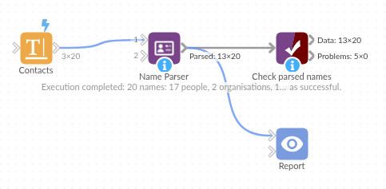

# Name Parser

*Omniscope custom block · Preparation*

**Split full names into title, first, middle, last and suffix, tidy the capitals, spot organisations and build salutations.**

**Python** · pandas, numpy · nothing extra to install

## The problem it solves

Contact lists hold names in every format: "SMITH, JOHN", "dr amelia j. smith-jones", "Prof. Sir Robert Mcdonald OBE", company names in the person field. Mail merges, deduplication and matching all need the parts, and a formula that splits on the first space gets most of them wrong.

This block parses each name with rules for titles, honours, initials, Last, First order and surname particles, tidies capitalisation, and writes a sensible salutation, with a note where it had to guess.

- **20** contact names in mixed formats (invented)
- **17** people split into parts
- **2** organisations recognised, not split
- **6** names with a note to check

### How it works

- Connect data and choose the full-name field.
- Choose whether to tidy capitalisation, a formal or informal salutation, the greeting word, and an optional prefix for the new fields.
- Output: the input with Name Type, Title, First Name, Middle Names, Last Name, Suffix, Initials, Tidy Name, Salutation and Parse Note.

## What goes in

### Contacts

Twenty invented names in mixed formats.

| Contact ID | Full Name | Email |
|---|---|---|
| 1 | Dr Amelia J. Smith-Jones | a.smith-jones@example.com |
| 2 | SMITH, JOHN | jsmith@example.com |
| 3 | mr patrick o'brien | pobrien@example.com |
| 4 | Ms Freya van der Berg | freya.vdb@example.com |
| 5 | Prof. Sir Robert Mcdonald OBE | r.mcdonald@example.com |
| 6 | A. B. Patel | ab.patel@example.com |
| 7 | Johnson, Mary Elizabeth | mary.johnson@example.com |
| 8 | Northbridge Packaging Ltd | accounts@example.com |

*20 rows in the sample file.*

## The options

| Option | Demo setting | What it does |
|---|---|---|
| Full name field | `Full Name` | The whole name as one piece of text. |
| Tidy capitalisation | `On` | Corrects all-capital or all-lower-case names, keeping forms such as McDonald and O'Brien. |
| Salutation | `Formal (Dear Dr Smith)` | Title and surname, or first name only. |

## What comes out

### Parsed names

| Full Name | Name Type | Title | First Name | Middle Names | Last Name | Suffix | Initials | Salutation | Parse Note |
|---|---|---|---|---|---|---|---|---|---|
| Dr Amelia J. Smith-Jones | Person | Dr | Amelia | J | Smith-Jones |  | AJS | Dear Dr Smith-Jones |  |
| SMITH, JOHN | Person |  | John |  | Smith |  | JS | Dear John Smith | Written as Last, First |
| mr patrick o'brien | Person | Mr | Patrick |  | O'Brien |  | PO | Dear Mr O'Brien |  |
| Ms Freya van der Berg | Person | Ms | Freya |  | van der Berg |  | FV | Dear Ms van der Berg |  |
| Prof. Sir Robert Mcdonald OBE | Person | Prof Sir | Robert |  | McDonald | OBE | RM | Dear Sir Robert |  |
| A. B. Patel | Person |  | A | B | Patel |  | ABP | Dear A Patel | First name is an initial |
| Johnson, Mary Elizabeth | Person |  | Mary | Elizabeth | Johnson |  | MEJ | Dear Mary Johnson | Written as Last, First |
| Northbridge Packaging Ltd | Organisation |  |  |  | Northbridge Packaging Ltd |  |  | Dear Sir or Madam |  |
| isla wilson | Person |  | Isla |  | Wilson |  | IW | Dear Isla Wilson |  |
| Williams Jr, David | Person |  | David |  | Williams | Jr | DW | Dear David Williams | Written as Last, First |
| Rev. Thomas Hughes | Person | Rev | Thomas |  | Hughes |  | TH | Dear Rev Hughes |  |
| Chloe | Person |  | Chloe |  |  |  | C | Dear Chloe | Single word |
| Mrs Taylor | Person | Mrs |  |  | Taylor |  | T | Dear Mrs Taylor | Title and surname only |
| George Brown & Sons | Organisation |  |  |  | George Brown & Sons |  |  | Dear Sir or Madam |  |
| Oliver   James   Evans | Person |  | Oliver | James | Evans |  | OJE | Dear Oliver Evans |  |
| Leonardo da Silva | Person |  | Leonardo |  | da Silva |  | LD | Dear Leonardo da Silva |  |
| Mx Sam Rivers | Person | Mx | Sam |  | Rivers |  | SR | Dear Mx Rivers |  |
|  | Empty |  |  |  |  |  |  |  |  |
| Hannah Lee PhD | Person |  | Hannah |  | Lee | PhD | HL | Dear Hannah Lee |  |
| Cllr Ann Davies | Person | Cllr | Ann |  | Davies |  | AD | Dear Cllr Davies |  |

*Most names parse without a note; the notes show what to check (invented names).*

## Where it pays off

### Marketing: Mail merge

Salutations and first names for letters and emails from a single full-name field.

### Data quality: Deduplication and matching

Compare last names and initials separately before fuzzy matching (see the Fuzzy Match block).

### Charities and membership: Supporter records

Titles and honours kept correctly for formal correspondence.

### B2B sales: CRM imports

Separate company names from contact names in imported lists.

*Use cases describe typical scenarios and are illustrative.*

## Why do this in Omniscope

- **Parts feed matching and the mailing.** Last name and initials go to Fuzzy Match in the next block and the salutation to the mail merge export, both from the current contact list.
- **Guesses are marked.** The Parse Note field says where the parser was unsure (6 of the 20 demo names), so a filter gives a short review list, and organisations in the person field are recognised and left whole.
- **Titles and particles in editable lists.** Titles, suffixes and surname particles such as van and bin are lists at the top of the Python script; add one your records use.

## How it fits into an Omniscope workflow

Contacts → Data Cleansing (optional) → **Name Parser** → Fuzzy Match / mail merge export

Run after Data Cleansing; then use the parts for Fuzzy Match on last name plus initial, or export to the mailing tool.

Filter on Parse Note to review the names the block was unsure about.

## In one step

Rule-based name parsing, with salutations and notes on anything unusual.

## Try it

1. Open the demo project (`demo.iox` on the demo server, or import `demo.ioz` from this folder): twenty invented names in every format.
2. The question: can we address each contact properly in the next letter?
3. Run the block: titles, first, middle and last names, suffixes and salutations.
4. Look at SMITH, JOHN, the knight (Dear Sir Robert), the organisations, and the Parse Note column.
5. Switch to informal salutations for an email campaign.

## Running in Omniscope

*The demo project's workflow: the sample data, the block, and a Validate data check on its output.*

<!--language-->
## Language and libraries

Python. It uses pandas and numpy, plus the Python standard library (re).

pandas and numpy are part of Omniscope's Docker Python image, and the block was run in both host mode and Docker mode on an Omniscope server, with the same results. It needs nothing else installed.
<!--/language-->

## Tested

Run on an Omniscope server, the demo workflow finished without errors (20 records in Parsed names). Automated tests also cover normal data, empty input, wrong types and large input.
