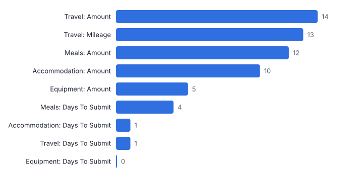
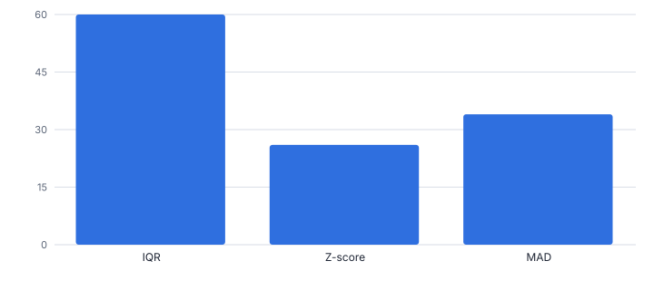
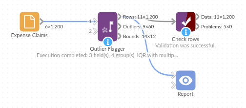

# Outlier Flagger

*Omniscope custom block · Preparation*

**Flag the low and high outliers in many numeric fields at once, within groups, by IQR, z-score or robust MAD, with the bounds used and the values beyond them.**

**Python** · pandas, numpy · nothing extra to install

## The problem it solves

An expense of £2,000 is normal for equipment and extraordinary for a meal. Outlier checks need to run within groups, over several fields, with a rule people can explain, and leave a list someone can review.

This block applies Tukey's IQR fences, z-scores or the robust MAD rule to every chosen field within each group, flags each value, lists the outliers with their bounds and scores, and can add capped copies for modelling.

- **1,200** expense claims checked (illustrative)
- **60** outlying values within their category
- **58** claims to review
- **92** outliers if categories were ignored

### How it works

- Connect data, choose the numeric fields (or leave empty for all), the groups to test within, and key fields to identify rows in the list.
- Choose the method and multiplier (defaults 1.5 for IQR, 3 for z-score, 3.5 for MAD) and the smallest group size to test; optionally add capped fields.
- Outputs: rows with a flag per field, one row per outlying value, and the bounds per field and group.

## What goes in

### Expense claims

1,200 invented claims with planted problems.

| Claim ID | Employee | Category | Amount (GBP) | Mileage | Days To Submit |
|---|---|---|---|---|---|
| EX70000 | E138 | Equipment | 215.23 |  | 1 |
| EX70001 | E154 | Meals | 38.23 |  | 12 |
| EX70002 | E159 | Travel | 101.32 | 1450.0 | 11 |
| EX70003 | E149 | Meals | 26.8 |  | 10 |
| EX70004 | E150 | Travel | 123.69 | 1800.0 | 7 |
| EX70005 | E154 | Travel | 201.87 | 2100.0 | 1 |

*1,200 rows in the sample file.*

## The options

| Option | Demo setting | What it does |
|---|---|---|
| Numeric fields | `Amount (GBP), Mileage, Days To Submit` | Leave empty to check every numeric field. |
| Within groups (optional) | `Category` | For example Category. |
| Key fields for the outlier list | `Claim ID` | For example Claim ID. |
| Method | `IQR (Tukey's fences)` | IQR and MAD resist the outliers they look for; z-score suits roughly normal data. |
| Smallest group to test | `10` | Groups with fewer values are not tested. |

## What comes out

### Bounds per category and field

| Category | Field | Values | Lower Bound | Upper Bound | Low Outliers | High Outliers | Median | Maximum |
|---|---|---|---|---|---|---|---|---|
| Accommodation | Amount (GBP) | 254 | 17.11 | 226.84 | 0 | 10 | 119.15 | 736.82 |
| Accommodation | Days To Submit | 254 | -6.12 | 20.88 | 0 | 1 | 7 | 200 |
| Equipment | Amount (GBP) | 120 | -19.74 | 596.75 | 0 | 5 | 270.14 | 2,220.20 |
| Equipment | Days To Submit | 120 | -9 | 23 | 0 | 0 | 7 | 14 |
| Meals | Amount (GBP) | 393 | 1.71 | 57.5 | 1 | 11 | 28.52 | 75.23 |
| Meals | Days To Submit | 393 | -6.5 | 21.5 | 0 | 4 | 8 | 140 |
| Travel | Amount (GBP) | 433 | 1.14 | 170.94 | 1 | 13 | 83.76 | 254.28 |
| Travel | Mileage | 433 | -60 | 284 | 0 | 13 | 110 | 2,100 |
| Travel | Days To Submit | 433 | -7.5 | 20.5 | 0 | 1 | 7 | 75 |

### Most extreme outliers

| Row Number | Claim ID | Category | Field | Value | Direction | Bound | Score | Beyond Bound |
|---|---|---|---|---|---|---|---|---|
| 371 | EX70370 | Accommodation | Days To Submit | 200 | High | 20.88 | 28.04 | 179.12 |
| 6 | EX70005 | Travel | Mileage | 2,100 | High | 284 | 22.62 | 1,816 |
| 5 | EX70004 | Travel | Mileage | 1,800 | High | 284 | 19.13 | 1,516 |
| 783 | EX70782 | Meals | Days To Submit | 140 | High | 21.5 | 18.43 | 118.50 |
| 540 | EX70539 | Meals | Days To Submit | 120 | High | 21.5 | 15.57 | 98.5 |
| 3 | EX70002 | Travel | Mileage | 1,450 | High | 284 | 15.06 | 1,166 |
| 1076 | EX71075 | Equipment | Amount (GBP) | 2,220.20 | High | 596.75 | 12.03 | 1,623.45 |
| 481 | EX70480 | Meals | Days To Submit | 95 | High | 21.5 | 12 | 73.5 |
| 285 | EX70284 | Accommodation | Amount (GBP) | 736.82 | High | 226.84 | 11.23 | 509.98 |
| 297 | EX70296 | Meals | Days To Submit | 88 | High | 21.5 | 11 | 66.5 |

*Where the outliers are; mileage is tested only for travel, the only category that records it (illustrative data).*

*The methods differ: z-scores are inflated by the outliers themselves, while the IQR and MAD rules are not.*

## Where it pays off

### Finance and audit: Expenses and payments

Claims, invoices or payments that are unusually large or small for their category, supplier or employee grade.

### Manufacturing: Process and sensor readings

Readings outside the normal band for each machine or product line, before they feed reports.

### Data science: Preparing model inputs

Find and cap extreme values per segment before modelling, keeping the originals for reference.

### Retail and e-commerce: Orders and prices

Prices or order quantities far from normal for each product, as a check on data entry and pricing errors.

*Use cases describe typical scenarios and are illustrative.*

## Why do this in Omniscope

- **Review list and model input from one set of bounds.** Flagged claims go out as a review list by email output, while the capped copies feed a model, both from the bounds in the block's third output.
- **A verdict you can explain.** Each flag comes with its method and the bounds for its category, and the tests pin the IQR, z-score and MAD results; testing within categories gives 60 outlying values where an overall test gives 92.
- **Your definition of normal.** Groups, method, multiplier and minimum group size are options; another rule can be added beside the three in the block's script.

## How it fits into an Omniscope workflow

Data → **Outlier Flagger** → Filter (Outlier Count > 0) → Report / Email output (review list)

Run within the groups that define 'normal'; Time Series Anomaly Detection covers values over time, and Benford's Law Test covers digit patterns.

Send the outlier list for review, or use the capped fields in a model.

## In one step

Three standard rules across many fields and groups, with bounds and a list of outliers.

## Try it

1. Open the demo project (`demo.iox` on the demo server, or import `demo.ioz` from this folder): invented expense claims in four categories.
2. The question: which claims look wrong for their category?
3. Open the block: amount, mileage and days to submit, within Category, IQR fences. Run it.
4. Look at the outlier list: impossible mileages, late submissions and very large claims; 60 values in 58 claims.
5. Switch the method to MAD or z-score and compare the counts; then add capped fields for modelling.

## Running in Omniscope

*The demo project's workflow: the sample data, the block, and a Validate data check on its output.*

<!--language-->
## Language and libraries

Python. It uses pandas and numpy.

pandas and numpy are part of Omniscope's Docker Python image, and the block was run in both host mode and Docker mode on an Omniscope server, with the same results. It needs nothing else installed.
<!--/language-->

## Tested

The demo workflow ran without errors on an Omniscope server, giving 1,200 records in Rows, 60 in Outliers and 12 in Bounds. Automated tests cover normal data, empty input, wrong types and large input.
