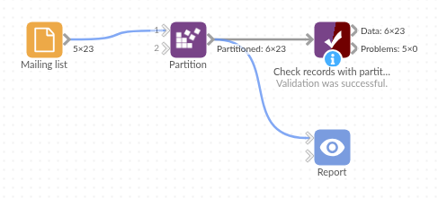

# Partition

*Omniscope custom block · Preparation*

**Split a long list into numbered batches of a fixed size, for an API that takes 100 records at a time, a file per 50,000 rows, or a daily sending limit.**

**Python** · pandas, numpy · nothing extra to install

## The problem it solves

Data often has to leave Omniscope in pieces: a web service accepts at most 100 records per request, a mailing tool sends 500 messages a day, a downstream system wants files of no more than 50,000 rows, a report lists customers 25 to a page. Each of these needs a batch number on every record, counted in a stable order, with the last batch holding the remainder.

The block adds that number. It counts records as they stream through, so it handles very large inputs, and the number is a whole number that filters and sorts properly.

- **23** sample contacts in batches of 10
- **3** partitions: 10, 10 and the remaining 3
- Order kept: contact CT-1011 starts partition 2

### How it works

- Set **Number of records per partition**.
- Records are numbered in the order they arrive: the first batch is 1, the next 2, and so on.
- The last partition holds the records left over.
- Sort first if the batches should follow a particular order.

## What goes in

### Mailing list

23 invented contacts with `example.com` addresses.

| Contact | Name | Email | Region | Signed up |
|---|---|---|---|---|
| CT-1001 | Amira Example | amira@example.com | North | 2025-09-01 |
| CT-1002 | Ben Example | ben@example.com | West | 2025-09-12 |
| CT-1003 | Chloe Example | chloe@example.com | East | 2025-09-23 |

*23 rows in the sample file.*

## The options

| Option | Demo setting | What it does |
|---|---|---|
| Number of records per partition | 10 | The size of each batch. |

## What comes out

### Records with partition number (selected rows)

| Contact | Name | Email | Region | Signed up | Partition |
|---|---|---|---|---|---|
| CT-1001 | Amira Example | amira@example.com | North | 2025-09-01 | 1 |
| CT-1002 | Ben Example | ben@example.com | West | 2025-09-12 | 1 |
| CT-1010 | Jack Example | jack@example.com | West | 2025-12-09 | 1 |
| CT-1011 | Kemi Example | kemi@example.com | East | 2025-12-20 | 2 |
| CT-1020 | Tara Example | tara@example.com | South | 2026-03-29 | 2 |
| CT-1021 | Umar Example | umar@example.com | North | 2026-04-09 | 3 |
| CT-1023 | Will Example | will@example.com | East | 2026-05-01 | 3 |

An Aggregate on Partition gives 10, 10 and 3 records.

## Where it pays off

### Integration: API batch limits

Send records to a web service in requests of the size it accepts, one partition per request.

### Marketing: Sending limits

Spread a mailing over several days by sending one partition a day.

### Data exchange: Files of a fixed size

Write one file per partition when a receiving system limits file size.

### Reporting: Pages of a long list

Give each record a page number for a printed or paged listing.

*Use cases describe typical scenarios and are illustrative; the sample data is invented.*

## Why do this in Omniscope

- **Batches inside the workflow that sends them.** The Partition field feeds a Record Filter, a For Each loop or the block that calls the API, so the batching is part of the same scheduled workflow rather than a spreadsheet step before an upload.
- **Same batches every run.** Numbering follows the order the records arrive in, so with a Sort block in front the same records land in the same batch each time, and a record sent in Monday's batch is not sent again on Tuesday.
- **A whole number, streamed.** Partition is an Integer (2 sorts before 10) and the block streams, so a million-row table is batched without loading it into memory; the counting rule is a few lines in the block's script if you need a different one, such as restarting the count for each region.

## How it fits into an Omniscope workflow

Contacts (Database) → Sort (by Signed up) → **Partition** → Record Filter (Partition = today's batch) → send

Put a Sort block in front when the batches should follow an order. Downstream, filter on one partition, aggregate per partition, or pass the partition numbers to a block that loops.

## Try it

1. Open the demo project (`demo.iox` on the demo server, or import `demo.ioz` from this folder): 23 invented contacts.
2. The question: how do I send these in batches of 10?
3. Open Partition: Number of records per partition is 10. Run it.
4. Look at the Partition field: 1 for the first ten contacts, 2 for the next ten, 3 for the last three.
5. Set the size to 5 and run again: five partitions, the last with 3 contacts.

## Running in Omniscope

*The demo project's workflow: the sample data, the block, and a Validate data check on its output.*

<!--language-->
## Language and libraries

Python. It uses pandas (BSD 3-Clause) and numpy (BSD 3-Clause), both part of Omniscope's Python environment. Nothing else to install.
<!--/language-->

## Tested

The block is covered by automated tests that run its script against a stand-in for Omniscope's Python API: the sample data, the Partition type and sort order, the default size, numbering across stream chunks, a size of 1, an existing Partition field, other fields' types, invalid sizes, empty input, and 500,000 records.
