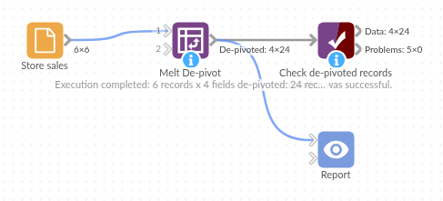

# Melt De-pivot

*Omniscope custom block · Preparation*

**Turn a column per month (or per question, or per measure) into one field of names and one of values, keeping the fields you choose on every record.**

**Python** · pandas, numpy · nothing extra to install

## The problem it solves

Spreadsheets and exports are usually wide: a column for each month, survey question, test or sensor. That is easy to read but awkward to analyse: a line chart over time wants the month in one field, a total across months wants one value field to sum, and a new month means a new column that every downstream formula has to learn about.

The block melts the wide table into a long one. The fields you choose (an ID, a name, a region) are kept on every record; each other field becomes a record with its name and its value. A new month column in next month's file simply becomes more records.

- **6** stores x **4** months in, **24** store-month records out
- **3** empty months left out when "Leave out empty values" is ticked: 21 records
- Sales stay whole numbers in the value field

### How it works

- Choose the fixed fields; every other field is de-pivoted.
- Name the two new fields (Field and Value by default).
- Each store's months come out together, in field order.
- Fields of different types share the value field as text; fields of one type keep it.

## What goes in

### Store sales, one column per month

6 invented stores with monthly sales; three months are empty.

| Store | Region | Jan | Feb | Mar | Apr |
|---|---|---|---|---|---|
| Harbour Street | South | 12400 | 11850 | 13900 | 14250 |
| Mill Lane | North | 8300 | 7900 | | 9100 |
| Station Road | North | 10150 | 9800 | 10600 | 11020 |
| Castle Gate | West | 6200 | | 5900 | 6450 |
| Riverside | South | 15800 | 16240 | 17100 | 16880 |
| Market Cross | East | 9400 | 9150 | 9900 | |

## The options

| Option | Demo setting | What it does |
|---|---|---|
| Fixed fields | Store, Region | Kept on every output record. |
| Name field | Field | Holds the month name. |
| Value field | Value | Holds the sales. |
| Leave out empty values | not ticked | Tick to skip the three empty months. |

## What comes out

### De-pivoted records (first 9 of 24)

| Store | Region | Field | Value |
|---|---|---|---|
| Harbour Street | South | Jan | 12400 |
| Harbour Street | South | Feb | 11850 |
| Harbour Street | South | Mar | 13900 |
| Harbour Street | South | Apr | 14250 |
| Mill Lane | North | Jan | 8300 |
| Mill Lane | North | Feb | 7900 |
| Mill Lane | North | Mar | |
| Mill Lane | North | Apr | 9100 |
| Station Road | North | Jan | 10150 |

The block's message: "6 records x 4 fields de-pivoted: 24 records". Value is a whole-number field. If the table also had a text field, say a store manager's name, that was not fixed, every value would come out as text and the message would say so.

## Where it pays off

### Retail and finance: Months as columns

Turn budget or sales sheets with a column per month into a month field for trend charts and period comparisons.

### Surveys: One column per question

Melt answers into question and answer fields, to count and chart answers across all questions at once.

### Operations: Measurements side by side

Turn readings stored as one column per sensor or test into a long table for one chart per measure.

*Use cases describe typical scenarios and are illustrative; the sample data is invented.*

## Why do this in Omniscope

- **New columns flow through.** When next month's file adds a May column, it is de-pivoted with the rest on the next run; the charts and aggregates after the block need no change.
- **Types never change silently.** If a text column slips into the de-pivoted fields, the values become text consistently and the block's message says so, rather than some values quietly turning into nulls or decimals.
- **The core block for most cases, this script for the rest.** The core De-pivot block needs no Python; this block's script is open in the block editor, so a rule such as "split 'Sales 2026-01' into a measure and a month" can be added where the core block has no option for it.

## How it fits into an Omniscope workflow

Wide sheet (File) → **Melt De-pivot** → Field Organiser (month name to date) → Report (line chart per store)

Keep the identifying fields fixed. After the block, convert the name field (month names, question codes) into what the analysis needs, such as a date.

## Try it

1. Open the demo project (`demo.iox` on the demo server, or import `demo.ioz` from this folder): 6 invented stores with a sales column per month.
2. The question: how do I chart each store's monthly sales as a line?
3. Open Melt De-pivot: Fixed fields Store and Region; leave the two names as Field and Value. Run it.
4. Look at the output: 24 records, four per store, with the month in Field and the sales in Value.
5. Tick **Leave out empty values** and run again: 21 records, without Mill Lane's March, Castle Gate's February and Market Cross's April.

## Running in Omniscope

*The demo project's workflow: the sample data, the block, and a Validate data check on its output.*

<!--language-->
## Language and libraries

Python. It uses pandas (BSD 3-Clause) and numpy (BSD 3-Clause), both part of Omniscope's Python environment. Nothing else to install.
<!--/language-->

## Tested

The block is covered by automated tests that run its script against a stand-in for Omniscope's Python API: the sample data, output order, leaving out empty values, mixed types turned into text (with and without times), same-type fields keeping their type, no fixed fields, custom names, name clashes and empty names, an unknown fixed field and no input, all fields fixed, empty input, and 100,000 records with 12 fields.
