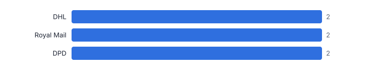
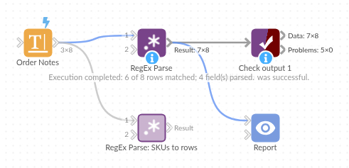

# RegEx Parse

*Omniscope custom block · Preparation*

**Pull order numbers, dates, codes and amounts out of free text, mask sensitive numbers, split lists into rows and validate formats: four modes in one block.**

**Python** · pandas, numpy · nothing extra to install

## The problem it solves

Valuable data hides in text: order references in support notes, tracking numbers in emails, product codes in descriptions, amounts in comments. Regular expressions are the standard way to get it out.

RegEx Parse has four modes: capture groups straight into named fields, replace with back-references, tokenise into columns or rows, and Yes / No validation.

- **4** modes: parse, replace, tokenise, match
- **6 of 8** notes with an order parsed into 4 fields
- **8** SKU rows tokenised from 8 notes
- **2** invalid email addresses flagged

### How it works

- Choose the text field, the mode and the pattern (Python syntax).
- **Parse**: name the groups in the pattern, `(?P<Order>[A-Z]-\d+)`, or list output names; each group becomes a field.
- **Replace**: replacement text with `\1` or `$1` for captured parts, into the same or a new field.
- **Tokenise**: each match becomes a column (up to a maximum) or a row, with a token number.
- **Match**: Yes / No for a match anywhere, at the start or across the whole text.

## What goes in

### Customer service notes

Eight synthetic notes with order numbers, carriers, tracking numbers, card endings and SKUs.

| Note ID | Contact Email | Note |
|---|---|---|
| N01 | jane.smith@example.com | Order #A-10234 shipped 2025-03-04 via DHL, tracking JD014600006281. Card ending 4242 charged £129.99 for SKU-1182 and SKU-2201. |
| N02 | m.ali@example | Order #B-55102 shipped 2025-03-05 via Royal Mail, tracking RM123456789GB. Paid £54.00 (SKU-3310). |
| N03 | priya@example.co.uk | Customer called about order #A-10240: not yet shipped. Refund £12.50 agreed. SKU-1182 out of stock. |
| N04 | tom@@example.com | Order #C-00981 shipped 2025-03-07 via DPD, tracking 15501234567890. SKU-4410, SKU-4411, SKU-4412 in one parcel. |
| N05 | fiona.macleod@example.com | Gift order #A-10255 shipped 2025-03-08 via DHL, tracking JD014600006399. Message card included. |
| N06 |  | No order reference. General enquiry about opening hours. |
| N07 | ahmed.h@example.com | Order #b-55120 shipped 2025-03-09 via Royal Mail, tracking RM987654321GB. Paid £8.75 for SKU-0007. |
| N08 | chloe@example.com | Replacement for order #C-00990 shipped 2025-03-10 via DPD, tracking 15509876543210. Card ending 1881 not charged. |

*8 rows in the sample file.*

## The options

| Option | Demo setting | What it does |
|---|---|---|
| Text field | `Note` | The text to apply the regular expression to. |
| Mode | `Parse: capture groups to fields` | What to do with each match. |
| Regular expression | `order #(?P<Order>[A-Z]-\d+) shipped (?P<Shipped>\d{4}-\d{2}-\d{2}) via (?P<Carrier>[A-Za-z ]+?), tracking (?P<Tracking>\w+)` | For example Order #(?P<Order>[A-Z]-\d+) or [\w.+-]+@[\w-]+\.[\w.]+ |
| Ignore case | `On` | Upper and lower case match each other. |

## What comes out

### Parse: four named groups become four fields

| Note ID | Order | Shipped | Carrier | Tracking |
|---|---|---|---|---|
| N01 | A-10234 | 2025-03-04 | DHL | JD014600006281 |
| N02 | B-55102 | 2025-03-05 | Royal Mail | RM123456789GB |
| N03 |  |  |  |  |
| N04 | C-00981 | 2025-03-07 | DPD | 15501234567890 |
| N05 | A-10255 | 2025-03-08 | DHL | JD014600006399 |
| N06 |  |  |  |  |
| N07 | b-55120 | 2025-03-09 | Royal Mail | RM987654321GB |
| N08 | C-00990 | 2025-03-10 | DPD | 15509876543210 |

### Tokenise to rows: one row per SKU

| Note ID | SKU | Token Number |
|---|---|---|
| N01 | SKU-1182 | 1 |
| N01 | SKU-2201 | 2 |
| N02 | SKU-3310 | 1 |
| N03 | SKU-1182 | 1 |
| N04 | SKU-4410 | 1 |
| N04 | SKU-4411 | 2 |
| N04 | SKU-4412 | 3 |
| N07 | SKU-0007 | 1 |

### Replace: mask card endings

| Note ID | Note (masked) |
|---|---|
| N01 | Order #A-10234 shipped 2025-03-04 via DHL, tracking JD014600006281. card ending **** charged £129.99 for SKU-1182 and SKU-2201. |
| N08 | Replacement for order #C-00990 shipped 2025-03-10 via DPD, tracking 15509876543210. card ending **** not charged. |

### Match: validate email addresses

| Note ID | Contact Email | Email Valid |
|---|---|---|
| N01 | jane.smith@example.com | Yes |
| N02 | m.ali@example | No |
| N03 | priya@example.co.uk | Yes |
| N04 | tom@@example.com | No |
| N05 | fiona.macleod@example.com | Yes |
| N06 |  |  |
| N07 | ahmed.h@example.com | Yes |
| N08 | chloe@example.com | Yes |

*Once parsed, free text becomes data you can aggregate (synthetic data).*

## Where it pays off

### Customer service: Mining case notes

Extract order numbers, products and amounts from contact notes to link cases to orders and quantify issue types.

### Logistics: Tracking and reference numbers

Parse carrier tracking numbers and references from emails and manifests into proper fields for reconciliation.

### Finance and compliance: Masking and validation

Mask card or account numbers before data is shared, and validate IBANs, VAT numbers or reference formats.

### Retail and e-commerce: Product descriptions

Pull sizes, colours, pack quantities and codes out of product titles to build clean attributes.

*Use cases describe typical scenarios and are illustrative.*

## Why do this in Omniscope

- **Codes from notes become report fields.** Order numbers parsed from the notes join to the orders table in the next block, and the Report filters and selects on them like any other field.
- **Masked before it leaves.** The Replace mode masks card endings inside the workflow, before the notes reach an output or a shared report; the tests cover both `\1` and `$1` back-references.
- **A new format is a new pattern.** Each pattern is a setting in Python syntax, so a new reference format means changing the pattern, not the workflow, and several blocks can run in a chain for different patterns.

## How it fits into an Omniscope workflow

Notes / emails (Database) → **RegEx Parse** → Join (orders) → Report

Chain several RegEx Parse blocks for different patterns, or use tokenise-to-rows ahead of an Aggregate to count codes mentioned in text.

Combine with Data Cleansing before (to normalise whitespace) and Fuzzy Match after (to match extracted names).

The extracted codes follow the notes in the database, join to orders, and can be filtered and selected in the Report as ordinary fields.

## In one step

Parse, replace, tokenise and match, using Python regular expression syntax.

## Try it

1. Open the demo project (`demo.iox` on the demo server, or import `demo.ioz` from this folder): free-text order notes from customer service.
2. The question: how many shipments went with each carrier, and which SKUs were mentioned? It is all in the text.
3. Open RegEx Parse (parse mode) and look at the pattern with named groups. Run it: order, date, carrier and tracking are now fields.
4. Open the second block (tokenise to rows): one row per SKU, ready to aggregate.
5. Try replace (masking card endings) and match (validating emails): the other two modes of the same block.

## Running in Omniscope

*The demo project's workflow: the sample data, the block, and a Validate data check on its output.*

<!--language-->
## Language and libraries

Python. It uses pandas and numpy, plus the Python standard library (re).

pandas and numpy are part of Omniscope's Docker Python image, and the block was run in both host mode and Docker mode on an Omniscope server, with the same results. It needs nothing else installed.
<!--/language-->

## Tested

Both RegEx Parse blocks in the demo, parsing and tokenising, ran without errors on an Omniscope server (8 records each in Result). The block's automated tests cover normal data, empty input, wrong types and large input.
