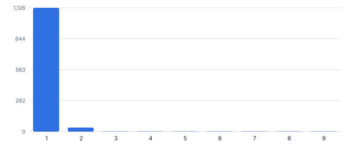
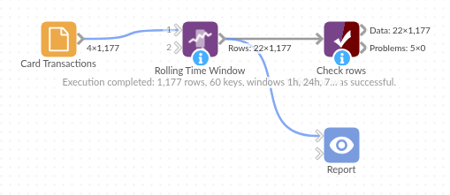

# Rolling Time Window

*Omniscope custom block · Preparation*

**For every row, totals for the same key over the last hour, day or month: velocity features for fraud, activity counts for churn, alarms per machine.**

**Python** · pandas, numpy · nothing extra to install

## The problem it solves

Many signals are about recent activity: how many times has this card been used in the last hour, how much has this customer ordered in 30 days. Row-based moving windows get this wrong when events are irregular, and self-joins on time ranges are slow.

This block computes trailing time-window counts, sums, means, minimums, maximums and distinct counts per key, for several windows at once.

- **1,177** card transactions (synthetic)
- **9** transactions on one card within an hour at the peak
- **10** transactions with 5 or more in the hour
- **3** windows computed at once

### How it works

- Connect data with a key (card, customer, machine) and a timestamp, and optionally a value and a field to count distinct values of.
- List the windows (for example 1h, 24h, 7d) and choose whether the current row counts.
- Output: the input with the aggregates per window.

## What goes in

### Card transactions

Synthetic transactions for 60 cards with two planted bursts.

| Card | Time | Amount (GBP) | Merchant |
|---|---|---|---|
| CARD-4030 | 2025-11-01 04:21 | 43.02 | Fuel |
| CARD-4057 | 2025-11-01 05:23 | 111.36 | Fuel |
| CARD-4040 | 2025-11-01 06:45 | 38.58 | Fuel |
| CARD-4057 | 2025-11-01 09:09 | 53.45 | Rail |
| CARD-4047 | 2025-11-01 10:12 | 8.46 | Online |
| CARD-4005 | 2025-11-01 12:11 | 32.65 | Fuel |

*1,177 rows in the sample file.*

## The options

| Option | Demo setting | What it does |
|---|---|---|
| Key field | `Card` | For example Card or Customer. |
| Timestamp field | `Time` | Date and time of each event. |
| Value field (optional) | `Amount (GBP)` | The amount to sum, average and take the minimum and maximum of. |
| Count distinct (optional) | `Merchant` | For example Merchant. |
| Windows | `1h, 24h, 7d` | For example: 30min, 1h, 24h, 7d, 4w |
| Include the current row | `On` | Unticked, each window covers only earlier rows: useful for scoring a new transaction against its history. |

## What comes out

### Transactions in a busy hour

| Card | Time | Amount (GBP) | Merchant | Count 1h | Sum 1h | Distinct Merchant 1h | Count 24h |
|---|---|---|---|---|---|---|---|
| CARD-4007 | 2025-11-20 15:18 | 2.55 | Online shop 4 | 5 | 10.47 | 5 | 7 |
| CARD-4007 | 2025-11-20 15:21 | 1.41 | Online shop 5 | 6 | 11.88 | 6 | 8 |
| CARD-4007 | 2025-11-20 15:24 | 1.55 | Online shop 6 | 7 | 13.43 | 7 | 9 |
| CARD-4007 | 2025-11-20 15:27 | 2.73 | Online shop 7 | 8 | 16.16 | 8 | 10 |
| CARD-4007 | 2025-11-20 15:30 | 2.8 | Online shop 8 | 9 | 18.96 | 9 | 11 |
| CARD-4033 | 2025-11-26 15:54 | 2.88 | Online shop 4 | 5 | 13.52 | 5 | 7 |
| CARD-4033 | 2025-11-26 15:57 | 2.95 | Online shop 5 | 6 | 16.47 | 6 | 8 |
| CARD-4033 | 2025-11-26 16:00 | 1.83 | Online shop 6 | 7 | 18.3 | 7 | 9 |
| CARD-4033 | 2025-11-26 16:03 | 2.05 | Online shop 7 | 8 | 20.35 | 8 | 10 |
| CARD-4033 | 2025-11-26 16:06 | 2.15 | Online shop 8 | 9 | 22.5 | 9 | 11 |

*Almost all transactions are alone in their hour; the bursts stand out at the right (synthetic data).*

## Where it pays off

### Payments and fraud: Velocity features

Transactions, amount and distinct merchants per card in the last hour and day, as rules or model inputs.

### E-commerce: Customer activity

Orders and spend in the last 30 and 90 days per customer, for churn models and triggers.

### Manufacturing and IT: Alarm and event rates

Alarms per machine or errors per server in the last hour, for alerting.

### Telecoms: Usage windows

Calls or data sessions per subscriber in rolling windows.

*Use cases describe typical scenarios and are illustrative.*

## Why do this in Omniscope

- **Features to alerts in one pipeline.** The windowed counts feed a Filter rule, such as 5 or more in an hour, and an email output, or the Regression block, from the same event data.
- **Windows by timestamp, not by row.** Counts cover the last hour or day by time, whatever order the events arrive in, so the card with 9 transactions in one hour is counted correctly; the tests check excluding the current row and bad window text.
- **Windows typed as text.** `1h, 24h, 7d` or `30min` are written in the options, and a further aggregate can be added in the block's script.

## How it fits into an Omniscope workflow

Event data → **Rolling Time Window** → Filter (rule) or Regression (model) → Email output (alerts)

Feed events in any order; Sessionise Events and Time Series Anomaly Detection look at the same data from other angles.

Filter on thresholds (for example 5 or more in an hour) to raise alerts, or feed the features to the Regression block.

## In one step

Several trailing time windows per key, side by side.

## Try it

1. Open the demo project (`demo.iox` on the demo server, or import `demo.ioz` from this folder): synthetic card transactions.
2. The question: which cards are being used unusually fast?
3. Run the block with 1h, 24h and 7d windows and distinct merchants.
4. Look at the busy hours: 9 small online payments on one card within an hour, each at a different merchant.
5. Exclude the current row to use the counts as model features.

## Running in Omniscope

*The demo project's workflow: the sample data, the block, and a Validate data check on its output.*

<!--language-->
## Language and libraries

Python. It uses pandas and numpy, plus the Python standard library (re).

pandas and numpy are part of Omniscope's Docker Python image, and the block was run in both host mode and Docker mode on an Omniscope server, with the same results. It needs nothing else installed.
<!--/language-->

## Tested

The demo workflow completed without errors on an Omniscope server (1,177 records in Rows). Automated tests check normal data, empty input, wrong types and large input.
