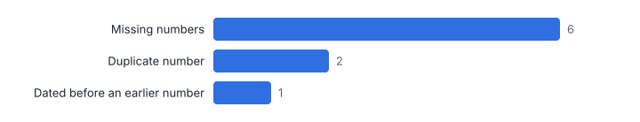
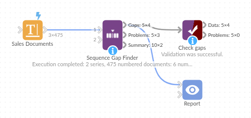

# Sequence Gap Finder

*Omniscope custom block · Preparation*

**Missing, duplicated and out-of-order numbers in invoice, credit note, cheque or ticket sequences, per series, with a completeness summary.**

**Python** · pandas, numpy · nothing extra to install

## The problem it solves

A gap in an invoice sequence can mean a cancelled document that was never recorded, a lost sale, or something worse; a duplicate number or an invoice dated before an earlier one breaks the audit trail. Auditors test sequence completeness routinely, and the check is fiddly with prefixes, several series and unsorted extracts.

This block parses the numbers (prefix and digits), checks each series for gaps, duplicates and date order, and lists exactly what is missing.

- **475** documents in two series (invented)
- **6** numbers missing
- **2** rows sharing a number
- **98.8%** completeness of the invoice series

### How it works

- Connect documents with a number field (a prefix such as INV- is fine), and optionally a series field and a document date.
- Set how many missing numbers to list per gap.
- Outputs: the gaps, the problem documents, and a summary per series.

## What goes in

### Sales documents

Invented invoices and credit notes, shuffled, with planted gaps, a duplicate and a date out of order.

| Document No | Document Date | Amount (GBP) |
|---|---|---|
| INV-010337 | 2025-09-06 | 785.57 |
| INV-010181 | 2025-08-06 | 1272.29 |
| INV-010273 | 2025-08-25 | 112.92 |
| INV-010210 | 2025-08-11 | 267.83 |
| INV-010264 | 2025-08-23 | 1168.12 |
| INV-010392 | 2025-09-16 | 1135.45 |

*475 rows in the sample file.*

## The options

| Option | Demo setting | What it does |
|---|---|---|
| Document number field | `Document No` | The document number, with or without a text prefix. |
| Document date (optional) | `Document Date` | For the date order check. |
| Missing numbers listed per gap | `20` | A longer gap lists this many numbers and then '...'. |

## What comes out

### Gaps

| Series | Last Before Gap | First After Gap | Missing Count | Missing Numbers |
|---|---|---|---|---|
| CN- | CN-000535 | CN-000537 | 1 | CN-000536 |
| INV- | INV-010037 | INV-010041 | 3 | INV-010038, INV-010039, INV-010040 |
| INV- | INV-010152 | INV-010154 | 1 | INV-010153 |
| INV- | INV-010301 | INV-010303 | 1 | INV-010302 |

### Problem documents

| Series | Document | Row Number | Problem | Detail |
|---|---|---|---|---|
| INV- | INV-010201 | 387 | Duplicate number | 2 rows share this number |
| INV- | INV-010201 | 437 | Duplicate number | 2 rows share this number |
| INV- | INV-010261 | 19 | Dated before an earlier number | dated 2025-07-02, but INV-010260 is dated 2025-08-22 |

### Summary

| Series | Documents | First Number | Last Number | Expected In Range | Missing | Gaps | Duplicate Rows | Out Of Order | Completeness |
|---|---|---|---|---|---|---|---|---|---|
| CN- | 59 | CN-000501 | CN-000560 | 60 | 1 | 1 | 0 | 0 | 0.9833 |
| INV- | 416 | INV-010001 | INV-010420 | 420 | 5 | 3 | 2 | 1 | 0.9881 |

*Everything the auditor needs to ask about, in one list (invented data).*

## Where it pays off

### Audit and finance: Sales invoice completeness

Missing and duplicate invoice and credit note numbers per series, for year-end audit and month-end controls.

### Banking and treasury: Cheque and payment runs

Cheque numbers and payment references checked for gaps and reuse.

### Retail and hospitality: Till receipts

Receipt number gaps per till, which can point to voided or deleted transactions.

### Public sector and logistics: Permits, tickets and consignments

Numbered documents issued per office or depot checked for completeness.

*Use cases describe typical scenarios and are illustrative.*

## Why do this in Omniscope

- **Every period's extract, the same checks.** Each extract runs through the same workflow, the findings go to the finance team by email output, and Benford's Law Test or Outlier Flagger can test the same data in the same project.
- **The missing numbers themselves.** The gaps output lists the numbers missing in each series, with prefixes such as INV- handled and shuffled extracts put in order first; the summary gives the 98.8% completeness of the invoice series.
- **Numbering schemes in the script.** The split into prefix and digits is in the block's Python script, so an unusual document numbering can be handled there.

## How it fits into an Omniscope workflow

Document extract → **Sequence Gap Finder** → Report / Email output (findings) → Benford's Law Test (alongside)

Run on each period's extract; Benford's Law Test and Outlier Flagger can be used alongside it for journal and document testing.

Send the gaps and problem documents to the finance team for explanation.

## In one step

Gaps, duplicates and date order checked for each series.

## Try it

1. Open the demo project (`demo.iox` on the demo server, or import `demo.ioz` from this folder): invented invoices and credit notes, shuffled.
2. The question: are any invoice numbers missing or used twice?
3. Run the block with the document number and date.
4. Look at the gaps (6 numbers missing), the duplicated number and the invoice dated out of order.
5. Look at the completeness summary per series.

## Running in Omniscope

*The demo project's workflow: the sample data, the block, and a Validate data check on its output.*

<!--language-->
## Language and libraries

Python. It uses pandas and numpy, plus the Python standard library (re).

pandas and numpy are part of Omniscope's Docker Python image, and the block was run in both host mode and Docker mode on an Omniscope server, with the same results. It needs nothing else installed.
<!--/language-->

## Tested

The demo workflow ran without errors on an Omniscope server, giving 4 records in Gaps, 3 in Problems and 2 in Summary. Automated tests cover normal data, empty input, wrong types and large input.
