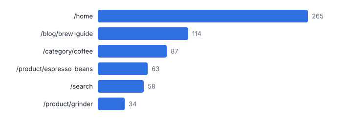
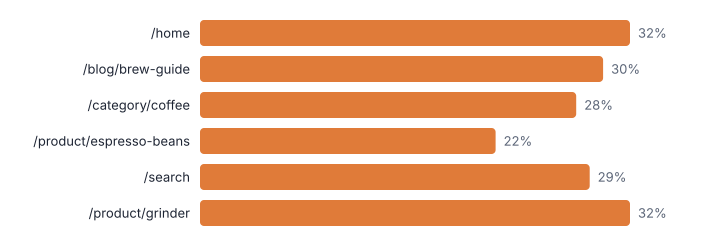
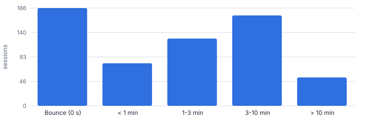
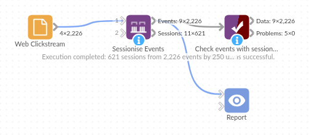

# Sessionise Events

*Omniscope custom block · Preparation*

**From a raw stream of clicks, log lines or transactions to sessions: session IDs on every event, and one row per session with duration, landing and exit, value and bounce.**

**Python** · pandas, numpy · nothing extra to install

## The problem it solves

Event data arrives as one long stream of timestamps per user or device. Most questions are about *visits*: how long they last, where they start and end, which ones convert, which machines run in bursts. Web analytics tools do this sessionisation internally, but raw exports, app logs and IoT feeds leave it to you.

Doing it with formulas needs sorting, a lag of the timestamp per user, a gap test and a running count, then a summary. Sessionise Events does it in one block with the standard 30-minute rule (or any gap you choose).

- **2,226** page views in random order
- **621** sessions from 250 visitors
- **30%** bounce rate
- **16.3%** sessions with an order

### How it works

- Choose the user (or device) field and timestamp; optionally an event name (page, screen) and a value to sum.
- Set the inactivity gap (30 minutes is the web analytics convention) and, optionally, a maximum session length.
- Every event gets its Session ID, session number for that user, position in the session and the seconds since the previous event.
- The sessions output summarises each session: start, end, duration, events, landing and exit, total value, bounce.

## What goes in

### Web clickstream export

2,226 synthetic page views by 250 visitors over five days, in no particular order.

| Visitor | Timestamp | Page | Order Value |
|---|---|---|---|
| U0170 | 2025-10-27 10:34:44 | /blog/brew-guide | 0.0 |
| U0233 | 2025-10-28 02:25:48 | /basket | 0.0 |
| U0201 | 2025-10-29 10:50:20 | /home | 0.0 |
| U0130 | 2025-10-31 16:38:49 | /order-confirmed | 29.38 |
| U0171 | 2025-10-29 11:34:31 | /home | 0.0 |
| U0178 | 2025-10-30 23:13:18 | /basket | 0.0 |

*2,226 rows in the sample file.*

## The options

| Option | Demo setting | What it does |
|---|---|---|
| User or device field | `Visitor` | Who the events belong to: visitor ID, device, card number, badge. |
| Timestamp field | `Timestamp` | Date and time of each event. |
| Event name field (optional) | `Page` | Page, screen or event type; gives the first and last event of each session. |
| Value field (optional) | `Order Value` | Summed per session, such as order value. |
| Inactivity gap (minutes) | `30.0` | A gap longer than this starts a new session. 30 is the web analytics convention. |

## What comes out

### Events with sessions (one visitor)

| Visitor | Timestamp | Page | Session ID | Event Number In Session | Seconds Since Previous Event | Is Session Start |
|---|---|---|---|---|---|---|
| U0001 | 2025-10-30 18:16:00+00:00 | /category/coffee | U0001-1 | 1 |  | Yes |
| U0002 | 2025-10-28 19:10:00+00:00 | /home | U0002-1 | 1 |  | Yes |
| U0002 | 2025-10-28 19:10:40+00:00 | /category/coffee | U0002-1 | 2 | 40 | No |
| U0002 | 2025-10-28 19:11:54+00:00 | /product/grinder | U0002-1 | 3 | 74 | No |
| U0002 | 2025-10-28 19:12:00+00:00 | /basket | U0002-1 | 4 | 6 | No |
| U0002 | 2025-10-28 19:14:38+00:00 | /checkout | U0002-1 | 5 | 158 | No |
| U0002 | 2025-10-28 19:18:33+00:00 | /order-confirmed | U0002-1 | 6 | 235 | No |
| U0002 | 2025-10-28 19:19:32+00:00 | /account | U0002-1 | 7 | 59 | No |
| U0002 | 2025-10-28 19:19:59+00:00 | /home | U0002-1 | 8 | 27 | No |

### Sessions

| Visitor | Session ID | Session Number | Session Start | Session End | Events | Duration (seconds) | First Event | Last Event | Total Value | Bounce |
|---|---|---|---|---|---|---|---|---|---|---|
| U0001 | U0001-1 | 1 | 2025-10-30 18:16:00 | 2025-10-30 18:16:00 | 1 | 0 | /category/coffee | /category/coffee | 0 | Yes |
| U0002 | U0002-1 | 1 | 2025-10-28 19:10:00 | 2025-10-28 19:25:30 | 10 | 930 | /home | /product/grinder | 24.93 | No |
| U0002 | U0002-2 | 2 | 2025-10-29 08:49:00 | 2025-10-29 08:49:00 | 1 | 0 | /home | /home | 0 | Yes |
| U0002 | U0002-3 | 3 | 2025-10-30 14:06:00 | 2025-10-30 14:06:18 | 2 | 18 | /home | /blog/brew-guide | 0 | No |
| U0003 | U0003-1 | 1 | 2025-10-27 18:18:00 | 2025-10-27 18:18:00 | 1 | 0 | /search | /search | 0 | Yes |
| U0003 | U0003-2 | 2 | 2025-10-28 05:33:00 | 2025-10-28 05:44:21 | 11 | 681 | /home | /category/coffee | 0 | No |
| U0003 | U0003-3 | 3 | 2025-10-30 01:51:00 | 2025-10-30 01:58:41 | 8 | 461 | /product/espresso-beans | /basket | 8.18 | No |
| U0004 | U0004-1 | 1 | 2025-10-28 15:26:00 | 2025-10-28 15:28:11 | 3 | 131 | /product/espresso-beans | /checkout | 0 | No |

*Sessions by landing page (synthetic data).*

*Bounce rate by landing page: where first impressions fail.*

*How long sessions last.*

## Where it pays off

### E-commerce and media: Web and app analytics from raw exports

Sessionise event exports from a CDP, server logs or a data warehouse to report landing pages, bounce, session length and conversion per session, with your own rules.

### Manufacturing and IoT: Machine run periods

Group sensor or PLC events into runs separated by idle time to measure run length, utilisation and stops per shift.

### Financial services: Card and login behaviour

Group card transactions or log-ins into bursts to spot unusual activity, such as many transactions in one short session.

### Facilities and public sector: Visits and occupancy

Turn badge or sensor events into visits per person or desk to understand building use.

*Use cases describe typical scenarios and are illustrative.*

## Why do this in Omniscope

- **One definition of a session.** The Report, the daily Aggregate and any Cohort Retention step all use sessions from the same two settings, so bounce rate and session counts agree across tabs.
- **Unsorted input, time zones kept.** The 2,226 page views arrive in random order and are sorted per visitor before the gap test; the tests check that timezone-aware timestamps come through unchanged.
- **Gap and length are yours.** The 30-minute convention and an optional maximum length are settings; another per-session measure can be added to the summary in the block's script.

## How it fits into an Omniscope workflow

Event export (File / Database) → **Sessionise Events** → Aggregate → Report

Feed the events in any order. The sessions output is ready for a Report (landing pages, bounce, duration) or an Aggregate by day or channel.

Join the Session ID back to other event-level data, or feed sessions into Cohort Retention or RFM Segmentation for visitor-level analysis.

## In one step

Sessionisation as one block with two settings (the inactivity gap and an optional maximum length), in place of a sort, a lag, a gap test and a running count.

## Try it

1. Open the demo project (`demo.iox` on the demo server, or import `demo.ioz` from this folder): 2,226 page views, just visitor, timestamp, page and order value.
2. The question: how many visits was that, what are the best landing pages, and how many visits bounce?
3. Open Sessionise Events: visitor, timestamp, page, order value, 30-minute gap. Run it.
4. Look at the sessions output: 621 sessions with landing and exit page, duration and value; then the bounce rate by landing page chart.
5. The same block works for machine logs or card transactions: only the gap changes.

## Running in Omniscope

*The demo project's workflow: the sample data, the block, and a Validate data check on its output.*

<!--language-->
## Language and libraries

Python. It uses pandas and numpy.

pandas and numpy are part of Omniscope's Docker Python image, and the block was run in both host mode and Docker mode on an Omniscope server, with the same results. It needs nothing else installed.
<!--/language-->

## Tested

On an Omniscope server the demo workflow ran cleanly: 2,226 records in Events with sessions and 621 in Sessions. The automated tests check normal data, empty input, wrong types and large input.
