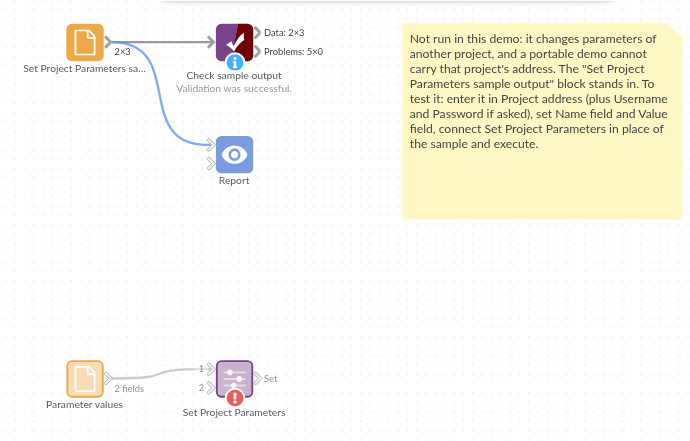

# Set Project Parameters

*Omniscope custom block · Preparation*

**The region, heading and currency of a report, set by the workflow itself from a three-line settings table: change the table, run, and the report's parameters follow.**

**Python** · urllib3, pandas · urllib3 installed on first run if missing

## The problem it solves

A branch report filters on a Region parameter, shows a Report heading parameter as its title and formats money by a Currency parameter. The values change each month, and they are already decided somewhere else: in a settings sheet the regional manager keeps up to date.

This block reads the settings, one record per parameter, and sets them in the project in one request.

- **3** parameters set from **3** records: Region, Report heading and Currency
- **1** request: all three change, or, if one is refused, none does
- **1** project: here, the project the block sits in
- **1** record per parameter in the Set output, for blocks that should run afterwards

### How it works

- Choose the field holding the parameter names and the field holding the values.
- The block sends every name and value to the project in one request (`w/updateparams`).
- If the server refuses (a parameter that doesn't exist, a value of the wrong type, no permission), the block stops with the server's message.

## What goes in

### Parameter values

3 invented settings for a branch report.

| Parameter | Value |
|---|---|
| Region | South West |
| Report heading | South West branches: March 2025 |
| Currency | GBP |

*3 rows in the sample file.*

## The options

| Option | Example setting | What it does |
|---|---|---|
| Project address | the project's own address (empty in the demo) | The project whose parameters to set. |
| Username, Password | (empty) | Only for a server that asks for sign-in. |
| Name field | `Parameter` | The field holding the parameter names. |
| Value field | `Value` | The field holding the new values. |

## What comes out

### Set

| Parameter | Value |
|---|---|
| Region | South West |
| Report heading | South West branches: March 2025 |
| Currency | GBP |

3 records, one per parameter set. In the project's Parameters dialog, Region is now South West; the next run of a block that reads it uses the new value.

## Where it pays off

### Reporting: Settings from a sheet

Let the people who own a report's settings keep them in a spreadsheet, and have the scheduled workflow apply them before it refreshes.

### Self-service: Choices made in the report

With an Editable Table in the report holding name/value records, let users change parameters (a period, a threshold) without opening the Parameters dialog.

### Data-driven settings: Computed values

Set a parameter from the data itself: the latest complete month, this year's target from a targets table, or the newest file name in a folder.

*Use cases describe typical scenarios and are illustrative; the sample data is invented.*

## Why do this in Omniscope

- **Parameters fed by the workflow.** The settings come from any source block, through Formulas or Aggregates if needed, and the block runs with the rest of the workflow on the scheduler; nobody has to remember to edit the Parameters dialog.
- **All or nothing.** The values are sent in one request, so a misspelt name leaves every parameter as it was and the block stops with the server's message, instead of half the settings changing.
- **Short and editable.** The request is a handful of Python lines; reading the current values first, or skipping values that haven't changed, is a few lines.

## How it fits into an Omniscope workflow

Settings sheet (File) → Validate data (names and values present) → **Set Project Parameters** → (blocks that should run afterwards)

Blocks elsewhere in the project that read the parameters pick up the new values the next time they run.

## Try it

1. Open the demo project (`demo.iox` on the demo server, or import `demo.ioz` from this folder). It holds a Text Input with the three settings above feeding Set Project Parameters, with the Name and Value fields chosen but no Project address, so it is not run (a demo can't carry the address of the project it sits in); and a File block with `placeholder.csv`: the 3 records of the Set output.
2. The question: can the workflow set the report's parameters from a table?
3. Follow the File block into the rest of the workflow: the Set output lists the 3 parameters and their new values.
4. To use it in your own project: give it Text parameters named Region, Report heading and Currency (three-dots menu > Parameters), enter the project's own address in **Project address** (as the server reaches itself, for example `http://127.0.0.1:24679/<folder>/<project>.iox/`) and run. The Parameters dialog then shows Region South West, Report heading South West branches: March 2025, Currency GBP. Change a name to one the project doesn't have: the block stops with the server's message and no parameter changes.

## Running in Omniscope

*The demo project's workflow: the placeholder data, the block, and a Validate data check on the output.*

<!--language-->
## Language and libraries

Python. It uses urllib3 (MIT licence) and pandas (BSD 3-Clause).

pandas is part of Omniscope's Python environment. urllib3 is listed in the block's dependencies, so Omniscope installs it with pip on first run if it is missing.
<!--/language-->

## Tested

The block is covered by automated tests that run its script against a stand-in for Omniscope's Python API and a stand-in for the Workflow REST API (no server is called): the request sent, the server's refusals (unknown parameter, no permission, no project), numbers, dates and missing values as valid JSON, a name given twice, a missing name, malformed addresses, a pasted report address, sign-in, empty input, option checks and 10,000 parameters in one request.
