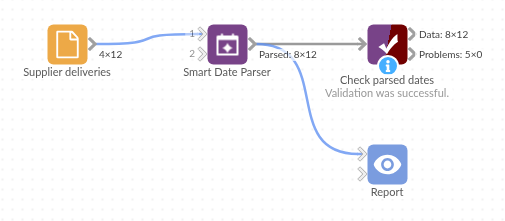

# Smart Date Parser

*Omniscope custom block · Preparation*

**One date field, five formats, two time zones? Real Date fields from every value that holds a date, and a flag on the ones that don't.**

**Python** · pandas, python-dateutil · nothing extra to install

## The problem it solves

A buyer combines delivery records from six suppliers. Each supplier's system writes dates its own way: ISO timestamps in UTC, UK day/month dates, named months, compact `250307` codes, local times with a `+01:00` offset. Until they are one Date field they can't be sorted, filtered by month or subtracted to get lead times.

This block reads every value on its own and writes a Date field beside the original, with a `_failed` field marking the values that could not be read.

- **12** deliveries in, **12** out, each with two parsed Date fields
- **5** order-date formats in one field, plus a compact `yymmdd` code read with a custom format
- **2** order dates flagged: `March 2025` (no day) and `31/02/2025` (no such date)
- **2** delivery times with `+01:00` converted to UTC, and one missing delivery date left empty, not flagged

### How it works

- Custom formats are tried first, then a general parser with your **Day first** setting, then with the other setting, then a list of fixed formats.
- A value starting with a four-digit year is always year-month-day, so `2025-03-04` stays 4 March with Day first ticked.
- A value must hold a year, a month and a day; anything less fails rather than borrowing parts of today's date.

## What goes in

### Supplier deliveries

12 invented deliveries from six suppliers, with an order date and a delivery time in each supplier's own format.

| Delivery | Supplier | Order Date | Delivered At |
|---|---|---|---|
| D-101 | Hartwell Foods | 2025-03-04 | 2025-03-06T09:30:00Z |
| D-103 | Pennine Packaging | 04/03/2025 | 06/03/2025 11:20 |
| D-105 | Calder Print | 5 March 2025 | 7 Mar 2025 16:00 |
| D-106 | Calder Print | March 12, 2025 | 2025-03-14 10:15:00+00:00 |
| D-107 | Ostler Wholesale | 250307 | 2025-03-10T08:50:00+01:00 |
| D-109 | Brightwater Trading | 20250319 | 21-03-2025 13:30 |
| D-110 | Brightwater Trading | 2025-03-20 | |
| D-111 | Kestrel Supplies | March 2025 | 2025-03-25 12:00 |
| D-112 | Kestrel Supplies | 31/02/2025 | 2025-03-27 12:00 |

*12 rows in the sample file.*

## The options

| Option | Demo setting | What it does |
|---|---|---|
| Fields to parse | `Order Date`, `Delivered At` | The text fields holding dates. |
| Output suffix | `_parsed` | Added to the name of each parsed field; empty replaces the field. |
| Day first | ticked | `04/03/2025` is 4 March. |
| Add failure flag | ticked | Adds `Order Date_parsed_failed` and `Delivered At_parsed_failed`. |
| Keep original fields | ticked | The text fields stay beside the parsed ones. |
| Custom formats | `%y%m%d` | Reads Ostler Wholesale's `250307` as 7 March 2025. |

## What comes out

### Parsed deliveries (selected records)

| Delivery | Order Date | Order Date_parsed | Order Date_parsed_failed | Delivered At_parsed |
|---|---|---|---|---|
| D-101 | 2025-03-04 | 2025-03-04 | false | 2025-03-06 09:30 |
| D-103 | 04/03/2025 | 2025-03-04 | false | 2025-03-06 11:20 |
| D-105 | 5 March 2025 | 2025-03-05 | false | 2025-03-07 16:00 |
| D-107 | 250307 | 2025-03-07 | false | 2025-03-10 07:50 |
| D-109 | 20250319 | 2025-03-19 | false | 2025-03-21 13:30 |
| D-110 | 2025-03-20 | 2025-03-20 | false | |
| D-111 | March 2025 | | true | 2025-03-25 12:00 |
| D-112 | 31/02/2025 | | true | 2025-03-27 12:00 |

12 records, 8 fields. Without the custom format, `250307` would be read as 25 March 2007; D-107's delivery at 08:50 `+01:00` is 07:50 UTC.

## Where it pays off

### Purchasing: Supplier and carrier feeds

Combine delivery, invoice and shipping dates from several suppliers' exports and compute lead times on one Date field.

### Finance: Bank and card statements

Statement exports from different banks write dates differently; parse them into one field before reconciling.

### Data migration: Legacy systems

Old systems and hand-kept spreadsheets mix formats within one column; the `_failed` flag gives the list of values to correct by hand.

### Web and event data: Timestamps with offsets

Event logs with `Z` and `+01:00` timestamps come out in UTC, so events from different sources sort in the right order.

*Use cases describe typical scenarios and are illustrative; the sample data is invented.*

## Why do this in Omniscope

- **Mixed formats in, one Date field out, inside the workflow**: the parsed fields go straight on to a Field organiser lead-time formula, a Record filter on the `_failed` flag, and the charts in the Report, with no export and clean-up in another tool.
- **The same reading every run**: the next supplier file is parsed by the same rules (and the same day-first setting), and when a new format appears its values are flagged in `Order Date_parsed_failed`, ready for a Record filter to route to a review table, instead of slipping through as empty dates.
- **Formats the core blocks don't know**: add a code to **Custom formats** for a supplier's own style, or unlock the block's design and open the script to change the order of attempts.

## How it fits into an Omniscope workflow

Supplier files (Append files) → **Smart Date Parser** → Record filter (`_failed` true, to a review table) → Field organiser (lead time in days) → Report

Put it straight after the source, before anything that groups or filters by date.

## Try it

1. Open the demo project (`demo.iox` on the demo server, or import `demo.ioz` from this folder): 12 deliveries from six suppliers.
2. The question: how many days did each delivery take from order?
3. Open Smart Date Parser: fields Order Date and Delivered At, Day first ticked, custom format `%y%m%d`. Run it.
4. Look at the output: every order date is 4 to 20 March 2025 except D-111 and D-112, which are flagged.
5. Clear **Custom formats** and run again: D-107 and D-108 now show 2007 and 2014. Untick **Day first**: D-103 becomes 3 April, while D-101 (`2025-03-04`) stays 4 March.

## Running in Omniscope

*The demo project's workflow: the sample data, the block, and a Validate data check on its output.*

<!--language-->
## Language and libraries

Python. It uses pandas and python-dateutil.

Both are part of Omniscope's Python environment. It needs nothing else installed.
<!--/language-->

## Tested

The block is covered by automated tests that run its script against a stand-in for Omniscope's Python API: the sample data, ISO dates with Day first ticked, month-first dates, mixed time zones, incomplete dates, custom formats tried first, the option defaults, in-place parsing and dropped originals, number and Date fields, empty input, bad options, and 100,000 values.
