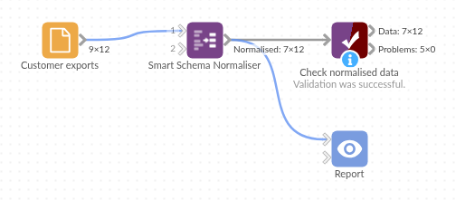

# Smart Schema Normaliser

*Omniscope custom block · Preparation*

**The same field under two names, numbers stored as text, yes written four ways? One tidy field per name, with a sensible type, and no list of fields to keep up to date.**

**Python** · pandas · nothing extra to install

## The problem it solves

A customer list comes from two systems appended together. One system calls the ID `Customer ID` and the spend `Monthly Spend`; the other writes `customer_id` and `monthly-spend`. Each record has its value in one field or the other, sign-up dates are in two formats, one order count reads `unknown`, and the active flag is `yes`, `Y`, `n` or `Yes`.

This block merges the fields that differ only in how their names are written, and gives each text field the type most of its values fit.

- **9** fields in, **7** out: the two ID fields and the two spend fields each merged into one
- **12** customer IDs and **11** spend values, where each source field had only half of them
- **Sign-up dates** in two formats read as one Date field, **active** as yes/no
- **1** order count of `unknown` left empty, so the other 11 count as an Integer field

### How it works

- Names are trimmed, lower-cased, and spaces and dashes become underscores; fields with the same resulting name are merged, first value first.
- Each text field gets the first type, of number, date and yes/no, that fits at least the threshold share of its values; otherwise it stays text.
- Text with a leading zero stays text, words such as `March` are never dates, and missing values stay missing.
- The block streams: the types are decided from the first 10,000 records and kept, so a large input never has to fit in memory; a later value that doesn't fit its field's type is left empty and counted in the block's message.

## What goes in

### Customer exports

12 invented customers from two systems, appended into one table.

| Customer ID | customer_id | Name | Sign-up Date | Monthly Spend | monthly-spend | Orders | Active |
|---|---|---|---|---|---|---|---|
| C-001 | | Ashdown Bakery | 2024-01-15 | 120.50 | | 14 | yes |
| C-002 | | Brindle and Co | 15/02/2024 | 89.00 | | 9 | no |
| | C-003 | Corve Valley Farm | 2024-03-02 | | 240.00 | 22 | Y |
| | C-004 | Dunmore Joinery | 04/03/2024 | | 56.25 | unknown | N |
| C-007 | C-007 | Glenrock Outdoor | 2024-05-06 | 198.00 | 198.00 | 19 | yes |
| C-008 | | Hollin Tea Rooms | | 64.80 | | 5 | |
| | C-009 | Ivybridge Print | 2024-06-21 | | | 3 | n |

*12 rows and a Region field in the sample file.*

## The options

| Option | Demo setting | What it does |
|---|---|---|
| Prefer non-empty values | ticked | Empty text counts as missing when merging. |
| Sort fields by name | unticked | Fields keep the order in which they first appear. |
| Auto cast threshold | `0.9` | 11 of 12 order counts are numbers (92%), enough for an Integer field. At the default 0.98 the field stays text. |
| Day first | ticked | `04/03/2024` is 4 March. |
| Defaults for missing numbers, dates, text | empty | Missing values stay missing. |

## What comes out

### Normalised customers (selected records)

| customer_id | name | sign_up_date | monthly_spend | orders | active | region |
|---|---|---|---|---|---|---|
| C-001 | Ashdown Bakery | 2024-01-15 | 120.50 | 14 | true | South East |
| C-002 | Brindle and Co | 2024-02-15 | 89.00 | 9 | false | North West |
| C-003 | Corve Valley Farm | 2024-03-02 | 240.00 | 22 | true | West Midlands |
| C-004 | Dunmore Joinery | 2024-03-04 | 56.25 | | false | Scotland |
| C-008 | Hollin Tea Rooms | | 64.80 | 5 | | Yorkshire |
| C-009 | Ivybridge Print | 2024-06-21 | | 3 | false | South West |

12 records, 7 fields: `sign_up_date` is a Date, `monthly_spend` a Decimal, `orders` an Integer and `active` yes/no. C-009's spend is missing in both source fields and stays empty rather than becoming 0.

## Where it pays off

### Data integration: Appending exports from several systems

Bring customer, product or order lists from two systems into one table without first renaming every field by hand.

### Spreadsheets: Hand-kept lists

Lists kept by several people collect near-duplicate columns and numbers typed as text; tidy them before joining or charting.

### Recurring feeds: New and renamed fields

A supplier feed that adds a field or changes its capitalisation still comes out with predictable names, so the blocks after it keep working.

### Data exploration: First look at an unknown file

Turn off the File block's type detection and let this block propose types, then check the result in a Data Profiler.

*Use cases describe typical scenarios and are illustrative; the sample data is invented.*

## Why do this in Omniscope

- **Tidy once, straight after the source**: the normalised fields go on to Join, Aggregate and the Report in the same workflow, and the names the later blocks use don't change when an export's capitalisation does.
- **The threshold is the tolerance**: a field keeps its number or date type as long as nearly all of its values fit, and the odd value that doesn't (`unknown`) becomes empty instead of turning the whole field into text and breaking the formulas after it.
- **Rules you can read and change**: the name rule, the yes/no words and the date patterns are a few lines at the top of the script; the design is locked by default, so unlock it to edit them.

## How it fits into an Omniscope workflow

System A export, System B export (File) → Append → **Smart Schema Normaliser** → Validate data → Aggregate → Report

## Try it

1. Open the demo project (`demo.iox` on the demo server, or import `demo.ioz` from this folder): 12 customers from two systems.
2. The question: what does each region spend per month?
3. Open Smart Schema Normaliser: threshold `0.9`, Day first ticked. Run it.
4. Look at the output: 7 fields, one ID and one spend for every customer, `sign_up_date` as a Date.
5. Set the threshold back to `0.98` and run again: `orders` stays text because of the one `unknown`.

## Running in Omniscope

*The demo project's workflow: the sample data, the block, and a Validate data check on its output.*

<!--language-->
## Language and libraries

Python. It uses pandas.

pandas is part of Omniscope's Python environment. It needs nothing else installed.
<!--/language-->

## Tested

The block is covered by automated tests that run its script against a stand-in for Omniscope's Python API: the sample data, the default threshold, missing values not counted against the threshold, defaults for missing values, Date and number fields kept, leading zeros, words that look like months, merging with and without empty values, sorting, empty input, bad options, types decided by the first chunk and kept (with the values that don't fit counted), and 200,000 records. On an Omniscope server it streamed 300,000 records with the late misfits counted and left empty.
