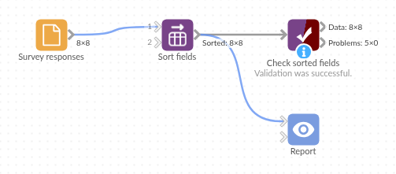

# Sort fields

*Omniscope custom block · Preparation*

**Q1, Q10, Q11, Q2? Fields in the order a person would put them, with the ID kept at the front, and the order kept when the next export adds a field.**

**Python** · pandas · nothing extra to install

## The problem it solves

A survey tool exports one field per question, in the order the questions were last edited: question 10 first, the respondent ID second, question 2 third. A plain alphabetical sort is no better: it puts `Q10` and `Q11` before `Q2`, and capitalised names before lower-case ones.

This block sorts the fields the way a person reads them, numbers in names by value, and keeps the fields you choose at the front.

- **8** fields reordered, **8** records unchanged
- **Q1** to **Q4**, then **Q10** and **Q11**, after the respondent ID
- **By type**: the three text answers, then the three numbers, then the submission date

### How it works

- By name: case is ignored and each run of digits is compared as a number.
- By type: text, numbers (Integer and Decimal together), dates, yes/no; by name within each.
- Fields to keep first come first, in the order chosen.

## What goes in

### Survey responses

8 invented responses to a customer survey, with the fields in the order the survey tool exported them.

| Q10 Recommend Score | Respondent | Q2 Age Band | Submitted | Q1 Region | Q11 Comment | Q3 Visits Per Year | Q4 Spend Per Visit |
|---|---|---|---|---|---|---|---|
| 9 | R-001 | 35-44 | 2025-05-02 | North West | Friendly staff | 12 | 18.50 |
| 6 | R-002 | 25-34 | 2025-05-02 | London | Queues at lunchtime | 30 | 7.20 |
| 10 | R-003 | 55-64 | 2025-05-03 | Scotland | | 4 | 42.00 |

*8 rows in the sample file.*

## The options

| Option | Demo setting | What it does |
|---|---|---|
| Sort fields by | Name | Case-insensitive; numbers in names compared by value. |
| Fields to keep first | `Respondent` | Stays at the start. |

## What comes out

### Sorted by name

| Respondent | Q1 Region | Q2 Age Band | Q3 Visits Per Year | Q4 Spend Per Visit | Q10 Recommend Score | Q11 Comment | Submitted |
|---|---|---|---|---|---|---|---|
| R-001 | North West | 35-44 | 12 | 18.50 | 9 | Friendly staff | 2025-05-02 |
| R-002 | London | 25-34 | 30 | 7.20 | 6 | Queues at lunchtime | 2025-05-02 |
| R-003 | Scotland | 55-64 | 4 | 42.00 | 10 | | 2025-05-03 |

8 records, 8 fields. Sorted by type instead, the order is Respondent, Q1 Region, Q2 Age Band, Q11 Comment, Q3 Visits Per Year, Q4 Spend Per Visit, Q10 Recommend Score, Submitted.

## Where it pays off

### Surveys: Questions in question order

Put numbered question fields in their natural order before building a table view or exporting to a spreadsheet.

### Pivots and time series: Period fields

After a Pivot that makes one field per week or month (`Week 1` to `Week 52`), keep them in sequence, with the grouping field first.

### Data handover: Predictable exports

Give a file sent to another team or system a stable field order, so a field added upstream does not move the others.

### Exploration: Wide tables

Group a wide table's fields by type to see at a glance which are measures, which are categories and which are dates.

*Use cases describe typical scenarios and are illustrative; the sample data is invented.*

## Why do this in Omniscope

- **Ordered where the data is shaped**: the sorted fields go on to a Table view in the Report or to an output file with no extra step, and Respondent stays the first column.
- **A rule, not a list**: the order is worked out again on every run, so when next month's export adds Q12, it lands after Q11 in the scheduled output without anyone editing the block.
- **The sort the core blocks don't offer**: numbers in field names in numeric order, case ignored, and fields pinned first; the rule is a few lines in the block's editor if you want another.

## How it fits into an Omniscope workflow

Survey export (File) → **Sort fields** → Report (Table view) or Output file

Put it last in a branch, just before the output or the Report, since a later Join or Field organiser can change the order again.

## Try it

1. Open the demo project (`demo.iox` on the demo server, or import `demo.ioz` from this folder): 8 survey responses with the fields in export order.
2. The question: can the table read Respondent, then the questions in order?
3. Open Sort fields: sort by Name, keep `Respondent` first. Run it.
4. Look at the output: Respondent, Q1 to Q4, Q10, Q11, Submitted.
5. Switch to Type and run again: the text answers, then the numbers, then the date, after Respondent.

## Running in Omniscope

*The demo project's workflow: the sample data, the block, and a Validate data check on its output.*

<!--language-->
## Language and libraries

Python. It uses pandas.

pandas is part of Omniscope's Python environment. It needs nothing else installed.
<!--/language-->

## Tested

The block is covered by automated tests that run its script against a stand-in for Omniscope's Python API: the sample data by name and by type, case, fields kept first, the same order in every streamed chunk, yes/no and Date fields, empty input, a bad choice, and 50,000 records with 200 fields.
